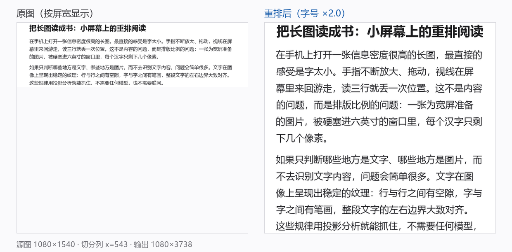

# 图读 PicText · 设计文档与实施计划

> 把别人分享过来的、字很小的长图，按行切成左右两半再插回去，让小屏幕上的字放大一倍。
> v1 不 OCR、不联网、不上模型，纯端侧传统图像处理。v2（约 4.8MB 版面模型）只作为
> 技术验证留在 `:core` / `:cli`，**0.5 安装包不包含 v2**。

**最新安装包**：[v0.5.3 发行版](https://gitee.com/noneoneone/pictext/releases/latest)
（`pictext-0.5.3-v1.apk` · 1.18 MiB · versionCode 9 · minSdk 26 · 无 INTERNET/存储权限）。



左：原图按屏宽显示，22px 正文在 1080 宽的屏幕上是这个样子。右：重排后同一段内容，字号 ×2.0。

---

## 一句话方案

把图片当成版面而不是文字：**二值化 → 水平投影切行 → 判行角色 → 垂直投影/字缝找中线 → 每行左右对半切 → 按 A1、A2、B1、B2 的顺序回插**。非文字块不切，整体放大。整套流程在 `Dispatchers.Default` 上跑，中端机百毫秒级。

v1.1 起多了三层护栏，见 [06 的 §0.1](docs/06-next-steps.md)：

1. **行带合并有总高度上限**（`1.25 × 行高`）：多行正文不再被并成一个大带、再判成图块；
2. **行级角色**（BODY / HEADING / CAPTION / UI）：头像、按钮行、时间戳不再被当成正文切开；
3. **全页一个 `bodyScale`**：正文、引用统一倍率，标题不小于正文，UI 行最多 1.5×；没有收益（`gain < 1.25`）就直接看原图，不再输出 1.03× 的“伪重排”。

v2 的计划在 [07 · V2 计划](docs/07-v2-plan.md)：用版面模型给区域和阅读顺序，用投影给像素级行带与切点，
再用覆盖审计保证不丢内容；字号统一为一个倍率，CJK 正文允许每行一次“强制切”，数字/URL/代码不切。
**0.5 安装包只发 v1**：v2 的代码、模型与 CLI 验收流程都保留在仓库里做技术验证，但不接进 APK；
盲评显示真实样例上 v1 更好（8:4）且 v2 有 2:0 的内容丢失，不值得让所有用户背 23MB 的
ORT + 模型（docs/07 §13.6.10）。v1.2 的 ×4 二次重排改进保留。
配套的 12 张 HTML 版面夹具（浅色/纸纹/深色/双栏/长图/海报/紧排/敏感文本）在 `testdata/layout/`，
带 DOM 真值，可离线重渲染。

这正好回答了你最初的疑问：

> 有没有算法可以在不要求 OCR 识别文字内容的前提下，判断哪些可能是文字、切行、左右对半、按行插回？

**有，而且不需要 MSER/OpenCV。** 对"简单背景 + 普通排版 + 大量文字"这个约束，二值化 + 投影分析就够了，连锁定文字区域的连通域都不必算。详见 [02-算法](docs/02-algorithm.md)。

---

## 已定决策（编码时按这个来，不要临场改）

| # | 决策 | 理由 |
|---|------|------|
| D1 | **v1 纯 Kotlin 实现算法**，不引入 OpenCV、不引入任何模型；**v2 由 D-V2-2 取代**：引入约 4.8MB 的版面模型，但只给区域/顺序，几何仍走投影 | OpenCV 会让 APK 增加 40MB+；模型只补 v1 缺的“区域语义”，不替代像素级切行 |
| D2 | **默认左右两栏（K=2）**，切点逐行吸附到"字缝"，不是几何中点 | 中点极可能劈开一个汉字；中文每 15~25px 必有字缝，逐行找缝的代价很低 |
| D3 | **非文字块整体放大、绝不切分**，宽度最多放到栏宽 | 图表被切开就失去意义；宁可排版难看，不可丢内容 |
| D4 | **不做"一整张重排长图"**，改为按需瓦片渲染 + `LazyColumn` 虚拟化 | 1080×20000 的 ARGB 位图约 86MB，必然 OOM；虚拟化后峰值 < 40MB |
| D5 | **收益门槛**：`gain = bodyScale × k × 源宽 / 屏宽 ≥ 1.25`（`k` = 分析图缩放）才重排，否则直接看原图 | 窄图本来就被放大显示，再切只会字更小、文章更长；漏掉 `k` 会让长图的 gain 虚高（0.5.1 修过） |
| D6 | **分享进入（ACTION_SEND）+ 零权限**；导出计划走 SAF（**P1，未实现**） | 场景就是"从别的 App 分享过来"；不申请存储权限，也不申请网络权限 |

还有一条产品层面的判断：

> **宁可排版难看，不可丢内容。** 分类错了顶多是某一段没切开、某个图被当成了文字；
> 只要每个像素都还在，用户还能退回原图。所有失败路径都按这个原则设计（见 02 文档第 13 节）。

---

## 文档地图

| 文档 | 内容 | 谁该读 |
|------|------|--------|
| [00 概览](docs/00-overview.md) | 问题量化、方案全貌、成功标准、与替代方案对比 | 所有人，先读这个 |
| [01 产品与交互](docs/01-product.md) | 用户场景、页面线框、状态机、文案、手势、三档切换 | 做 UI 的 agent |
| [02 算法](docs/02-algorithm.md) | 10 步流水线、全部参数、伪代码、失败回退、原型实测 | 做 core 的 agent |
| [03 架构](docs/03-architecture.md) | 模块划分、文件清单、Kotlin 接口、渲染与内存、权限 | 所有人 |
| [04 实施计划](docs/04-plan.md) | M0–M5 里程碑、20 张任务卡、验收标准、并行边界 | 项目负责人 / agent |
| [05 测试](docs/05-testing.md) | 单元/黄金图/真实图片回归/批量评分、性能基准、模拟器与真机清单 | 做 QA 的 agent |
| [06 下一步](docs/06-next-steps.md) | 三张真实图片的复盘、P0–P2 任务卡、验收指标 | 项目负责人 / agent |
| [07 V2 计划](docs/07-v2-plan.md) | 版面模型 + 阅读顺序 + 强制切 + HTML 夹具、M0–M5、任务卡、验收 | 所有人，v2 开工前读 |

---

## 原型

`prototype/reflow_prototype.py` 是一份**可运行的算法规格**（Python + NumPy + Pillow），不是产品代码，作用有三个：

1. 把参数调通，把数值写进 02 文档，避免 Android 端边写边猜；
2. 生成黄金测试图的基线（`prototype/out/`）；
3. 给 core 模块的 Kotlin 实现做对照（同样的输入，行数、切点、缩放应当一致）。

```bash
python prototype/reflow_prototype.py --make-fixture
```

在 1080×1540 的合成样例上的实测：

| 指标 | 结果 |
|------|------|
| 文本行 / 非文字块 | 21 / 2 |
| 切分列 | x = 543（版面中线 535） |
| 字缝干净率 | 100%（14 个可切分行全部切在字缝里） |
| 放大倍数 | 1.99× |
| 输出 | 1080×3738 |
| 分析耗时 | 约 90–100 ms（Python/NumPy，仅作参考；Kotlin 目标 < 60 ms） |

---

## 非目标（v1 明确不做）

- OCR、翻译、朗读、复制文字；
- 竖排文字、报刊多栏、手写体；
- 表格结构还原（表格可能被当作文本行切开，见 02 文档"已知失败模式"）；
- PDF 输入/输出；
- 云端处理、账号、同步。

---

## 技术栈

Kotlin 2.0.21 · AGP 8.7.3 · Gradle 8.9 · Jetpack Compose (BOM 2024.10.01) · Material 3 · minSdk 26 · targetSdk 35 · JDK 17。
v1：无 OpenCV、无 OCR、无模型、无 Coil、无 Hilt、无 Room、无 INTERNET 权限。
v2（可选）：ONNX Runtime + PP-DocLayout-S（官方 4.834MB / 23 类 / 模型卡标注 Apache-2.0，ONNX 约 4.7MB），
只在本机跑，仍然没有 INTERNET 权限；量化（FP16/INT8）在 v2.1 单独评估，不阻塞 2.0。

---

## 构建与运行

需要 JDK 17 与 Android SDK 35（`local.properties` 里的 `sdk.dir` 指向 SDK 根目录）。

```bash
./gradlew :core:test                 # 算法单测 + 黄金图对拍（有真实样例时连带全量回归）
./gradlew :core:longPageMemoryTest   # 长图内存回归：1080×20000 在 -Xmx96m 下分析
./gradlew :cli:run --args="prototype/out/source.png out --out-width 1080"
./gradlew :app:assembleDebug         # 产出 app/build/outputs/apk/debug/app-debug.apk
./gradlew :app:assembleRelease       # R8 + 资源压缩；v1 < 8MB
```

**发行版 v1-only 门禁**：`scripts\verify-v1-only.ps1` 会构建 release 并断言产物里没有 v2
逻辑——`classes.dex` 不得出现 v2 专有常量，R8 `mapping.txt` 不得出现 v2 业务类
（`LayoutPipeline` / `CutPolicy` / `ReflowPlannerV2` …）。v2 只在 `:core` / `:cli` 做技术验证，
App 侧无需任何开关。见 [03 §14.2](docs/03-architecture.md)。

Windows 下可用 `scripts\verify.ps1` 一次跑完单测与 debug 构建；
`scripts\verify-v1-only.ps1` 单独跑发行版门禁（`-SkipBuild` 只检查现有产物）；
`scripts\test-samples.ps1` 会把 `testdata/private/samples/`（缺失时回退 `testdata/samples/`）里的**每一张**
图跑一遍 CLI，产物全部落在 `testdata/out/`（gitignored）：`<slug>/{after.png,debug.png,plan.json}`、
`manifest.json`、`summary.md`、`index.html`（前/后对比，浏览器打开）、`contact-sheet.png`（缩略总览）。
扩展名骗人的 WebP 会先用 ffmpeg 转 PNG；样例目录缺失时脚本直接报错而不是静默跳过。
`scripts\score-samples.ps1` 批量跑 `testdata/private/samples2/`（或 `testdata/samples2/`）里的样例并生成 `testdata/scoreboard.md`
（人工评分写在同目录 `notes.csv` 里，`-SkipRun` 可只重算表格）。真实截图不随仓库分发，见 [testdata/README.md](testdata/README.md)。
v2 的 HTML 版面夹具用 `node scripts\render-layout-fixtures.mjs` 重渲染（Edge/Chrome headless，零 npm 依赖），
`--check` 只校验入库的 PNG 与 DOM 真值；夹具说明见 [07 · §4.11](docs/07-v2-plan.md#411-html-测试夹具与-dom-真值本地生成)。

CLI 输出：

- `out/after.png`：重排后的长图（回退时是原图）；
- `out/debug.png`：红=BODY、洋红=HEADING、蓝=CAPTION、灰=UI；橙=照片、紫=UI 图块；蓝竖线=全局切分列、绿短线=逐行切点；
- `out/plan.json`：行数、图块数、角色分布、`splitX`、`scale`/`bodyScale`、`gain`、审计结果、每个渲染项的源/目标矩形与角色。

`--latin-split` 打开实验性的拉丁/URL 安全切分（默认关）。
`--x4` 用 ×4 档的二次重排出图（字号 ×2、放不下的行再切 2/4 段，和 App 里点 ×4 一致）；
`--dump-lines` 打印每条文字行的 band / cutX / split / cuts，调切点时用。
`--args="summary out.png a.png b.png"` 可以把多张 after 拼成一张复核图；`scripts\test-samples.ps1`
会用它批量出图，并同时写出 `manifest.json`、`summary.md`、`index.html` 与 `contact-sheet.png`。

`core/src/test/resources/golden/` 下的 `main/dark/photo` 三张图来自
`prototype/out/`，`GoldenTest` 直接与原型统计值对拍（容差 ±1px / ±0.02 scale）。

### 模块

| 模块 | 内容 |
|---|---|
| `:core` | 纯 Kotlin/JVM 的版式分析与重排计划，不依赖 `android.*` |
| `:cli` | 桌面 Java2D 调参工具，输出 after/debug/plan.json |
| `:app` | Android 壳：分享入口、解码、瓦片渲染、Compose UI、设置与进度 |

### 已知实现约定

- 分析坐标（A）与源图坐标（S）严格分开；`RenderItem.src` 一律是 S 坐标。
- 切点不干净时整页退回 `NO_SPLIT`（只放大不切）；收益不足时退回 `ORIGINAL`；`weak_cut` 且无收益时也直接 `ORIGINAL`（不再输出伪重排）。
- 原图模式按视口解码，1080×20000 的图不会整张进内存。
- 所有失败路径都收敛到原图或错误页，不允许白屏/崩溃。

---

## 许可证

本项目（代码、文档、`testdata/layout/` 下自带的 HTML 夹具与渲染结果）以 **Apache-2.0** 发布，见 [LICENSE](LICENSE)。

第三方组件与模型见 [NOTICE](NOTICE) 与 [THIRD_PARTY_LICENSES.md](THIRD_PARTY_LICENSES.md)：
PP-DocLayout-S 为 Apache-2.0，ONNX Runtime 为 MIT，AndroidX/Compose/Kotlin 为 Apache-2.0。

真实截图（Twitter/微博/新闻/Arknights 等）因版权与隐私原因**不随仓库分发**，只放在本地
`testdata/private/`，详见 [testdata/README.md](testdata/README.md)；贡献方式见 [CONTRIBUTING.md](CONTRIBUTING.md)。
