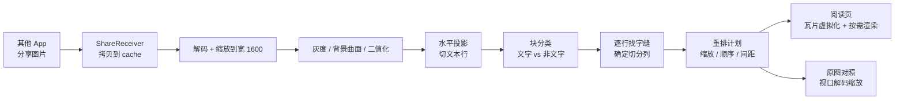

# 00 · 概览

## 1. 问题可以算出来

一部 1080×2400 的手机，屏幕宽 393dp，系统密度 2.75。一张 1080 宽的截图在"按屏宽显示"时是 1:1 的，图里 22px 的中文落到屏幕上就是 22px ≈ **8sp**。中文正文的可读下限大约在 14–16sp（38–44px），也就是说这张图的字只有"能读"的三分之一大。

用户能做的只有两件事：双指放大（然后左右拖动，每读三行丢一次位置），或者放弃。

**屏幕宽度是常量。** 想把字放大，唯一的办法是减少每行字数——也就是把一条长行拆成多条短行。这就是"重排"的全部意义。

```
原图   一行 46 字，字高 22px
       [在手机上打开一张信息密度很高的长图，最直接的感受是字太小……]

重排   一行 23 字，字高 44px
       [在手机上打开一张信息密度很高的长图，最直接]
       [的感受是字太小。手指不断放大、拖动，视线在屏]
```

## 2. 方案全貌



整条链路没有任何"理解"动作：不识别字，不判断语义，只利用**文字在图像上的几何规律**：

- 同一段文字的行高相近、行距相近；
- 行与行之间有一条水平空白带（投影波谷）；
- 一行里字与字之间有竖直的字缝（垂直投影的低点）；
- 大面积连续色块、超高墨迹游程，通常不是字。

> 上图是 v1 全链路（0.5 的发行版就是这条）。v2 曾在“块分类”之前插入一个版面模型（给区域/顺序），
> 但第 4–7 步的像素级行带与字缝仍由投影负责。**0.5 起 v2 已从发行包里剥离**（只留 `:cli` 技术验证，
> 由 `scripts/verify-v1-only.ps1` 机检），详见 [07 · V2 计划](07-v2-plan.md) 与 [03 §14.2](03-architecture.md)。

## 3. 为什么不 OCR

| | OCR + 重排文字 | 本文方案（图像重排） |
|---|---|---|
| 中文识别错误 | 每几百字必有错，且错得看不出 | **零**，像素原样搬运 |
| 排版还原 | 丢字号、丢粗体、丢缩进、丢行内公式 | 像素级保真 |
| 图表/公式/手写 | 乱码或丢失 | 当图块整体放大 |
| 依赖与体积 | ML Kit ~10MB / PaddleOCR 更大 | **0** |
| 速度 | 百毫秒到秒级，视模型 | 纯整型循环，几十毫秒 |
| 隐私 | 部分方案要联网 | 全程离线 |
| 代价 | 可搜索、可复制、可翻译 | 不可搜索、不可复制 |

对一个"就是想把这张图看清楚"的工具，**保真**比**可编辑**重要得多。OCR 是另一条产品线（见第 7 节）。

## 4. 为什么不用 OpenCV

OpenCV4Android 的 `opencv_java4` 单 ABI 约 20MB，四 ABI 打包 60MB+，还要处理 `jniLibs` 和 16KB page size 兼容。而本方案真正需要的算子只有：

- 灰度化、积分图/滑动窗口统计；
- Otsu 阈值；
- 行/列投影与游程统计；

全部是 `ByteArray`/`IntArray` 上的一维循环，Kotlin 写 600 行以内，2.5MP 图上几十毫秒。**用 OpenCV 换来的只是开发省事，代价是安装包大 10 倍。**

### 4.1 为什么是投影，而不是 MSER / 扫描线 / 纹理

你列的几种思路都成立，差别在于"为了切出一行字，需要付多少复杂度"：

| 方法 | 原理 | 在本场景的实际表现 | 结论 |
|---|---|---|---|
| 连通域 / MSER | 找稳定的极值区域，按面积、长宽比过滤成"字" | 中文笔画粘连时一个词是一个连通域，标点又被切成碎片；MSER 对低对比度敏感，参数多；标准实现依赖 OpenCV | 不做主路径。需要"这块是不是文字"的额外证据时，可作为校验 |
| 扫描线分析 | 逐行估计背景色，遇到反差大的像素段就标记 | 本质是投影的逐行版；单行成立，但把像素段聚成"行"还是要回到投影 | 可以用，但没有比投影更简单 |
| 纹理（Gabor / DCT） | 文字区域边缘密集、方向一致 | 计算量比二值化大一个量级，参数（频率、方向、窗口）难调；它回答"像不像文字"，不回答"行边界在哪" | 不适合 |
| 版面分析模型（PP-DocLayout-S 等） | 端侧小模型识别 20+ 类版面元素 | 官方 4.834MB / 23 类 / mAP(0.5)=70.9（500 张文档图）/ Apache-2.0；对手机截图仍有漏检 | v2 试过：模型给区域/顺序、几何仍走投影；**0.5 起剥离出发行包**（只留 CLI 技术验证，见 [07](07-v2-plan.md) / [03 §14.2](03-architecture.md)） |
| **投影分析** | 行墨量 → 波谷 → 行；列墨量 → 字缝 → 切点 | O(N)、参数少、结果可解释、行边界精确到像素 | **选它** |

MSER 真正的价值在"版面复杂、背景不干净"的图片上。而我们的约束是"简单背景、普通排版"，二值化后的 `mask` 已经足够干净，投影直接在 `mask` 上做，连连通域都不用算。

## 5. 成功标准

| 维度 | 指标 | 测量方式 |
|---|---|---|
| 效果 | 黄金图 3 张 + 程序化单测：文本行召回 ≥ 95%，非文字块误判 ≤ 1 块/张 | `:core:test`（269 个用例） |
| 效果 | 切点必须落在字缝里：要么 100% 干净，要么整页不切 | 原型同款判定（`line_gap`） |
| 效果 | 真机 20 张真实截图，主观"愿意读完"≥ 80% | 人工清单 |
| 速度 | 1080×2400 图片：分析 < 120ms，首屏 < 500ms | Macrobenchmark / 手测 |
| 内存 | 峰值 < 120MB，无 OOM | `:core:longPageMemoryTest`（1080×20000 @96MB）+ 真机 Profiler |
| 稳定 | 失败必降级为"看原图"，不允许白屏/崩溃 | 混沌输入 + 真机手测（`:app` 仪器测试待建） |
| 体积 | release APK < 8MB | `assembleRelease`（当前 1.18MB） |
| 剥离 | release 产物**不含 v2 逻辑**：`classes.dex` 无 v2 常量、R8 mapping 无 v2 业务类 | `scripts/verify-v1-only.ps1` |

## 6. 收益公式（决定"要不要切"）

原图按屏宽显示时，字在屏幕上的高度：

```
before = em_src × screenW / srcW
after  = em_src × scale
gain   = after / before = scale × srcW / screenW
```

- 1080 宽、22px 字的图，`scale≈2.0`，`gain≈2.0` —— 值得切；
- 600 宽、40px 字的图，`scale` 被"最大字身"限制在 1.1，`gain≈0.6` —— **切了反而更小**，直接看原图；
- 2160 宽、44px 字的 4K 截图，`scale≈1.0`（像素不放大），但按屏宽显示时被缩到 0.5，`gain≈2.0` —— 值得切。

所以判断标准不是"图宽不宽"，而是 `gain`。低于 1.25 就放弃重排，UI 给一句"文字已经够大，直接看原图"。

## 7. 与其它路线的关系

| 路线 | 适用 | 与本方案的关系 |
|---|---|---|
| 系统"放大镜"/无障碍缩放 | 临时看一处 | 不解决整篇阅读 |
| 浏览器阅读模式 | 网页 | 图片没有 DOM |
| OCR + 重排 | 需要复制、搜索、翻译 | v2 可叠加：用 OCR 文本做"可选中"，图像仍负责显示 |
| 版面分析模型（PP-DocLayout 等） | 复杂图文混排 | v2：区域/顺序由模型给，行/切点仍由投影给（[07](07-v2-plan.md)） |
| N 栏切分（K=3/4） | 超宽、超小字 | 本方案已预留：切点定位是"找字缝"，K 只是找几条缝 |

## 8. 最大的风险

不是算法，是**分类错了却悄悄丢内容**。因此：

1. 任何一步失败（无文字、切不干净、收益不足）都返回"不重排"，展示原图，绝不给空结果；
2. 重排永远只做裁剪 + 缩放 + 平移，不做重采样以外的修改；
3. 阅读页常驻"原图 / 重排"切换，一键可退回。

这三条在 [01 产品](01-product.md) 和 [05 测试](05-testing.md) 里都有对应的验收项。
