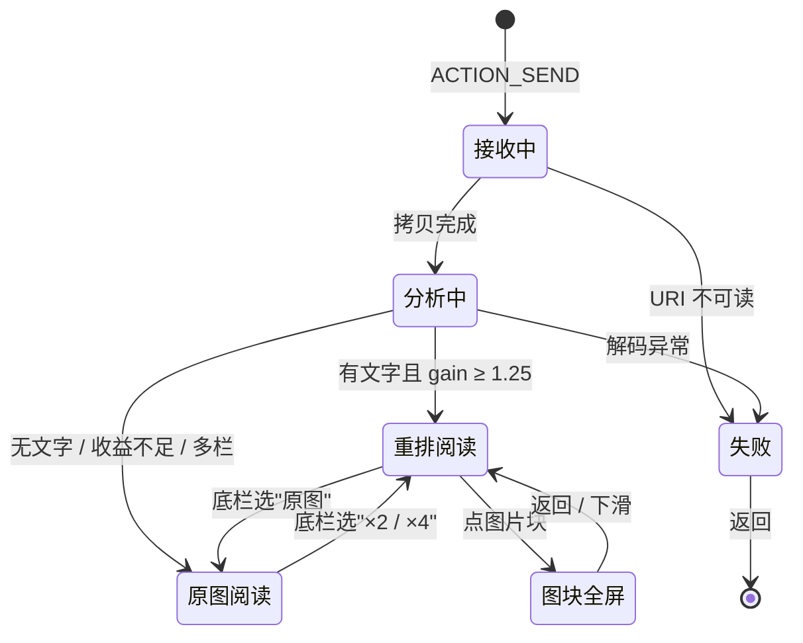

# 01 · 产品与交互

## 1. 用户与场景

**核心场景只有一句话：在别的 App 里看到一张字很小的长图，分享到"图读"，把它读完。**

| 故事 | 触发 | 期望 |
|---|---|---|
| A. 群里转发的长文截图 | 微信 → 长按图片 → 分享 → 图读 | 打开就能读，字号明显变大，不用来回拖 |
| B. 网页存下的科普图 | 浏览器 → 分享 → 图读 | 中间那张图表也在，而且能点开看大图 |
| C. 论文/报告页截图 | 文件管理器 → 分享 → 图读 | 双栏正文按行切开，图注保留 |
| D. 一次分享 3 张 | 相册多选 → 分享 → 图读 | 左右滑切换，每张独立重排 |

非目标用户：需要复制文字、需要搜索、需要翻译的人——那是 OCR 产品的事。

## 2. 入口

### 2.1 分享（主入口）

```xml
<activity
    android:name=".share.ShareReceiverActivity"
    android:exported="true"
    android:launchMode="singleTask"
    android:theme="@style/Theme.PicText.Transparent">
    <intent-filter>
        <action android:name="android.intent.action.SEND" />
        <category android:name="android.intent.category.DEFAULT" />
        <data android:mimeType="image/*" />
    </intent-filter>
    <intent-filter>
        <action android:name="android.intent.action.SEND_MULTIPLE" />
        <category android:name="android.intent.category.DEFAULT" />
        <data android:mimeType="image/*" />
    </intent-filter>
</activity>
```

要点：

- `ShareReceiverActivity` 本身就是阅读页，不再跳第二个 Activity——少一次转场，返回键直接回到来源 App；
- 收到 `content://` URI 后**立即**在 `Dispatchers.IO` 把文件拷进 `cacheDir/inbox/`，因为来源 App 授予的读权限只在本次 Activity 生命周期内有效；
- 多图取 `EXTRA_STREAM` 的 `ArrayList<Uri>` 或 `clipData`，上限 5 张，超出提示"最多一次读 5 张"；
- **完全没收到图片**（无 `EXTRA_STREAM`、裁剪后为空）→ `Toast` + `finish()`，不做空页面；
- **收到但读不了**（URI 失效、来源 App 已退出）→ 进错误页（`UNREADABLE`），**不自动退出**：
  页面上有"重试"（用最近一次打开的 URI 重走 intake）和"返回"。

### 2.2 应用内（v1 必须有）

桌面图标不能点开没反应。`MainActivity`（LAUNCHER）在 v1 里是一个极简首页，**只有三样东西**：

- 标题"图读"；
- 一个主按钮"选择图片" → `ActivityResultContracts.PickVisualMedia`（系统照片选择器，**不需要任何权限**）→ 进入阅读页；
- 一行提示"在其他 APP 里试试分享图片到图读。"，以及"关于"（版本号 + 隐私声明）。

P1（未实现）：下面追加"最近 10 张"，可删除、可清理。

这条入口的意义：用户第一次装完不知道怎么用，桌面点开必须能走通；同时它也是"分享"失败时的兜底。

## 3. 页面结构



页面只有三个：

1. **首页**（标题"图读" + "选择图片" + 一行提示 + "关于"）
2. **阅读页**（承载重排/原图两种模式 + 分析中的 loading + 错误态）
3. **图块全屏层**（Dialog）

v1.1 起阅读页**不再有设置面板**：字号改成直接缩放（底栏的三档 + 双指连续缩放）。
字号/切分方式/记住位置仍从 DataStore 读取（旧版本存下的值继续生效），但 App 里没有任何
写入入口——设置面板与它的 29 条文案已经删掉了。

## 4. 阅读页

### 4.1 线框

```
┌──────────────────────────────────────────────┐
│ ←   图读                                     │  56dp，滚动时隐藏
├──────────────────────────────────────────────┤
│                                              │
│  把长图读成书：小屏幕上的重排阅读             │  ← 标题行（未切分，等比放大）
│                                              │
│  在手机上打开一张信息密度很高的长图，最直接   │  ← 左半 A1
│  的感受是字太小。手指不断放大、拖动，视线在   │  ← 右半 A2
│  屏幕里来回游走，读三行就丢一次位置。这不是   │  ← B1
│  内容的问题，而是排版比例的问题：一张为宽屏   │  ← B2
│  ……                                          │
│                                              │
│  ┌────────────────────────────────────────┐  │
│  │              [ 图表 ]                  │  │  ← 非文字块：整宽放大，点按全屏
│  └────────────────────────────────────────┘  │
│              图 1 重排前后的行结构对比        │  ← 图注（居中短行）
│                                              │
├──────────────────────────────────────────────┤
│  [ 原图 ][ ×2 ][ ×4 ]        ▓▓▓▓░░░░░  12%  │  56dp
└──────────────────────────────────────────────┘
```

### 4.2 顶栏

| 元素 | 行为 |
|---|---|
| ← | `finish()`，回到来源 App |
| 标题 | 单图显示"图读"；多图显示"1 / 3" |

顶栏只有一个返回箭头和一个标题（0.2.2 起移除了右上角的"原图"和"⋮"）：
切换视图完全由底栏三档负责，关于/版本信息移到了首页。顶栏与底栏在**向上滚动时隐藏**，
向下滚动或点击正文时出现——**原图模式也一样**，图片已经让出了顶栏的高度，收起后是整屏。

### 4.3 底栏

| 元素 | 行为 |
|---|---|
| 原图 | 显示原始图片（1×，双指可放大 1–5×） |
| ×2 | 按算法重排（跳过“长行不足 / 收益不足 / 多栏”这些自动判断，用户点了就放大） |
| ×4 | 把 ×2 的结果当新图**再排一次**：字号翻倍，放不下的行按字缝再切成 2–4 段 |
| 进度 | `已滚动 / 可滚动` 的百分比 + 2dp 进度条 |

两档重排是同一条连续缩放轴的两端：在 ×2 或 ×4 上双指缩放，字号会连续变化，
行跟着重新切分，到达两端时底栏高亮自动切换（×2 ↔ ×4）。

进度条的意义不是"翻页"，而是让用户知道这张长图还有多长——重排后文章会变长 2 倍以上，没有进度会让人以为滑不到头。

### 4.4 正文

- 每一行是一个独立 item，高度由布局计划给出（px → dp）；
- 行与行之间没有额外 padding，间距已经烘焙在计划里，保证与原型一致；
- 背景色 = 源图背景色（亮图白、暗图黑），瓦片未渲染时先铺这个颜色，所以滚动不会闪白；
- 图片块水平居中，宽度不超过栏宽，点击进入全屏；
- 点击正文空白处切换顶/底栏；双击不缩放，双指缩放见 §4.3——重排模式放大不会出现横向滚动，
  因为松手后是按新字号重新排版。

### 4.5 原图模式

- 整页替换为一个可缩放视图，初始按屏宽显示（与系统相册一致）；
- 双指缩放 1×–5×，双击在 1× 与 2.5× 之间切换；
- 拖动方向与手指一致：手指往右/下移，画面跟着往右/下走（视口偏移取反，见 03 文档 6.5）；
- 上下留出与阅读页一致的 56dp + 系统栏空带，顶栏出现时**不会压住图片**；顶栏可以点正文收起；
- 关键：**放大后按视口解码**，不是把整张图解码到内存（见 03 文档 6.5）；
- 切换档位时按阅读比例保留位置。

## 5. 图块全屏

- 点正文里的非文字块 → 全屏 Dialog，黑色背景，图片按"适应屏幕"显示；
- 可双指缩放（1×–5×）、拖动、双击放大；下滑或点右上角"关闭"退出；
- 顶部一行小字"图块 · 点击外部关闭"，常驻（不做淡出动画）。

## 6. 三档：原图 / ×2 / ×4（取代设置面板与自由缩放）

底栏只保留一个三选一，用户不用先想“字号设多少”，直接选要多大：

| 档位 | 行为 |
|---|---|
| 原图 | 原始图片，双指可放大到 5× |
| ×2 | 按算法重排：跳过“长行不足 / 收益不足 / 多栏”这些自动判断，只要图上有文字行就重排 |
| ×4 | 把 ×2 的结果当一张新图**再排一次**：字号翻倍，放不下的行按字缝再切成 2–4 段 |

实现要点：

- 分享进入时仍走**自动判断**，结果决定初始档位落在“原图”还是“×2”，之后由用户手动切；
- ×4 不是“把倍率乘上去再把超宽的行压回列宽”（那会让同页出现两三种字号），而是**二次重排**：
  - 基准倍率和 ×2 相同，规划器把它 ×2；
  - 每条 BODY/HEADING 行按新倍率算需要几段，再从分析期预存的**候选字缝**里为每个理想分界点挑最近的一刀（2 或 4 段）；
  - 段与段之间用行距，行距、段距随字号同步放大；
  - 只有“这一行没有任何安全缝”时才整行放大并被列宽压小（拉丁/代码页受 P1-1 限制就是这条路）；
- 还是同一份版面分析结果上的重新规划（不重新解码、不重新分析图像），切换约 50–150ms；
- 强制档位下宁可比目标略小，也不在没有安全缝的地方硬切；审计只记录数值不判失败（自动模式仍然严格）；
- 强制档位只放大不缩小：算出 < 1× 的页面按 1× 输出（海报、大字截图）；
- **双指缩放**把两档之间变成连续的：手势期间画面按比例临时放大（即时反馈），松手后
  倍率（1.0–2.0）交给规划器重新排版；到达两端时底栏高亮自动切到 ×2 / ×4。
  上限就是 ×4，因为再往上一条满宽行要切 5 段以上，二次重排只能压小字号。

## 7. 手势

| 手势 | 重排模式 | 原图模式 |
|---|---|---|
| 单指上下滑 | 滚动 | 拖动（放大后） |
| 单指左右滑 | 切换上一张/下一张（多图） | 同左 |
| 双指捏合 | **连续缩放 ×2 ↔ ×4**（松手后重新排版，不出现横向滚动） | 缩放 1×–5× |
| 双击 | 无 | 1× ↔ 2.5× |
| 单击正文 | 切换顶/底栏 | 切换顶/底栏（顶栏现在也能收起） |
| 单击图块 | 全屏 | — |
| 下滑（图块全屏中） | 关闭 | 关闭 |

## 8. 状态与文案

| 状态 | 画面 | 文案 |
|---|---|---|
| 接收中 | 居中转圈（不显示文件名） | `正在读取图片…`，超过 500ms 换成 `正在分析版式…` |
| 分析中 | 转圈 + 一行说明 | `正在分析版式…` |
| 成功 | 阅读页 | 无 |
| 无文字 | 直接进原图模式 + 顶部条 | `这张图里没找到可重排的文字，已显示原图` |
| 收益不足 | 直接进原图模式 + 顶部条 | `文字已经足够大，不需要重排` |
| 切分失败（`weak_cut`） | 有收益时整页只放大；无收益时回退原图 | `已整页放大，但没有找到可切分的位置` / `这一页没有找到可放大的切分位置，已显示原图，可双指放大` |
| 可切分行太少 | 直接进原图模式 + 顶部条 | `可切分的文字行太少，已显示原图` |
| 多栏版面 | 直接进原图模式 + 顶部条 | `检测到多栏版面，重排会串行，建议看原图` |
| 没墨迹 / 计划过长 | 直接进原图模式 + 顶部条 | `这张图里没有可读内容，已显示原图` / `重排结果过长，已显示原图` |
| 解码失败 | 错误页 | `这张图打不开` + `重试` / `返回` |
| 图片过大 | 正常流程（降采样 / 条带分析） | 无 |

顶部条 6 秒后自动消失，也可以点"知道了"立即关闭；它不阻断阅读。
有"原图/重排"可切时（重排模式下），顶部条右侧还有"查看原图"按钮。
一句话原则：**回退永远有解释**，但同一页只提示一次。

## 9. 视觉规范

| 项 | 值 |
|---|---|
| 主色 | Material 3 动态取色（Android 12+），否则 `PicTextBlue`（见 `ui/theme/Color.kt`） |
| 阅读背景 | 取自**源图边界中位色**（`PageLayout.backgroundColor`）：白底图是白、深色图是深灰；应用自身的 surface 用主题色（亮 `#FAFAFC` / 暗 `#111214`） |
| 顶/底栏 | `surface` + 88% 不透明度 + 无分割线；滚动时内容从其下方穿过 |
| 字号 | 顶栏标题 `titleMedium`，辅助文字 `labelMedium`；正文是图片，不设字号 |
| 圆角 | 只有首页主按钮是 full（54dp 高 / 27dp 圆角）；图块与文字行不裁圆角 |
| 动效 | 顶/底栏用 `AnimatedVisibility` 淡入 + 滑入（默认时长）；**没有**模式切换的交叉淡入 |
| 图标 | 不引入图标库：返回箭头是文本字符 `←`，应用图标是 `@drawable/ic_launcher` |

**targetSdk 35 → Android 15 强制 edge-to-edge**：所有页面用 `WindowInsets` 处理状态栏与手势条，正文背景一直铺到屏幕边缘；系统栏图标明暗跟随文档背景色（`isAppearanceLightStatusBars = !plan.isDark`）。

## 10. 多图

- `HorizontalPager`，每页一个独立的 `DocumentSession`；
- 只有当前页 ±1 会被预处理；更远的页显示**整页转圈**（没有缩略图，P1 才做）；
- 顶栏"1 / 3"，页码随滑动更新；
- 单张失败不影响其它张，失败页显示错误卡片。
- 档位（原图/×2/×4）是**全局**的：某一页回退原图是因为它自己的计划是 `ORIGINAL`，
  不会把其它页也拖回原图。

## 11. 隐私与权限

- 清单里**没有** `INTERNET`、`READ_MEDIA_IMAGES`、`WRITE_EXTERNAL_STORAGE`；
- 图片只存在 `cacheDir/inbox/`，启动时清理 7 天前的文件；
- **导出（图片/PDF）还没实现**：计划走 SAF（`ACTION_CREATE_DOCUMENT`），不需要存储权限。
  0.5.x 的阅读页只有"看"，没有"存"；
- 隐私声明写在首页的"关于"对话框里（没有设置面板），不做隐私弹窗——因为没有可收集的数据。

## 12. 无障碍

- 所有按钮有 `contentDescription`（返回、图块、正文区域）；
- 正文是图片，TalkBack 只能读到"重排后的阅读内容"这一句描述，读不出文字——**这是方案本身的限制**，
  不假装解决；在"关于"里说明；
- 字号不放独立设置，靠底栏三档 + 双指缩放（低视力用户直接选 ×4）；
- 触控目标用 Material 默认尺寸（`IconButton`/`SegmentedButton` ≥ 48dp）。

## 13. 埋点

v1 只做本地诊断日志（`Log.d`）：图片尺寸、分析耗时、行数、图块数、scale、gain、回退原因、
渲染失败项数。不联网、不上报。

> 注意：release 构建**也会**打这些日志——`proguard-rules.pro` 里没有剔除 `android.util.Log`
> 的规则。要关闭需要加 `-assumenosideeffects`（或改用 `BuildConfig.DEBUG` 判断）。
