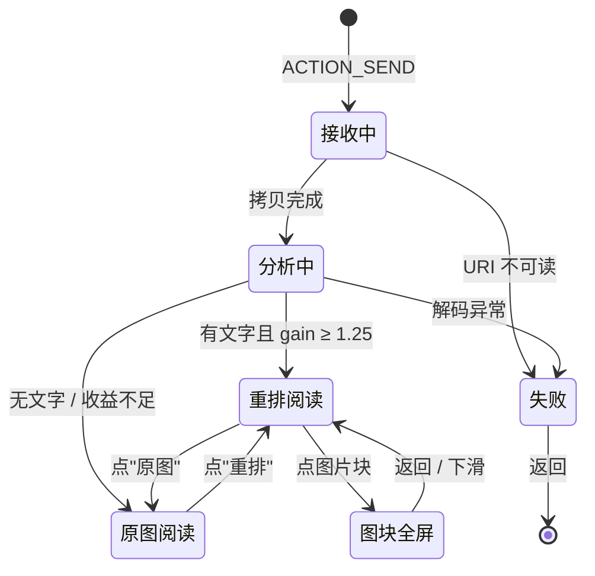

# 01 · 产品与交互

## 1. 用户与场景

**核心场景只有一句话：在别的 App 里看到一张字很小的长图，分享到"图读"，把它读完。**

| 故事 | 触发 | 期望 |
|---|---|---|
| A. 群里转发的长文截图 | 微信 → 长按图片 → 分享 → 图读 | 打开就能读，字号明显变大，不用来回拖 |
| B. 网页存下的科普图 | 浏览器 → 分享 → 图读 | 中间那张图表也在，而且能点开看大图 |
| C. 论文/报告页截图 | 文件管理器 → 分享 → 图读 | 双栏正文按行切开，图注保留 |
| D. 一次分享 3 张 | 相册多选 → 分享 → 图读 | 左右滑切换，每张独立重排 |

非目标用户：需要复制文字、需要搜索、需要翻译的人——那是 OCR 产品的事。

## 2. 入口

### 2.1 分享（主入口）

```xml
<activity
    android:name=".share.ShareReceiverActivity"
    android:exported="true"
    android:launchMode="singleTask"
    android:theme="@style/Theme.PicText.Transparent">
    <intent-filter>
        <action android:name="android.intent.action.SEND" />
        <category android:name="android.intent.category.DEFAULT" />
        <data android:mimeType="image/*" />
    </intent-filter>
    <intent-filter>
        <action android:name="android.intent.action.SEND_MULTIPLE" />
        <category android:name="android.intent.category.DEFAULT" />
        <data android:mimeType="image/*" />
    </intent-filter>
</activity>
```

要点：

- `ShareReceiverActivity` 本身就是阅读页，不再跳第二个 Activity——少一次转场，返回键直接回到来源 App；
- 收到 `content://` URI 后**立即**在 `Dispatchers.IO` 把文件拷进 `cacheDir/inbox/`，因为来源 App 授予的读权限只在本次 Activity 生命周期内有效；
- 多图取 `EXTRA_STREAM` 的 `ArrayList<Uri>` 或 `clipData`，上限 5 张，超出提示"最多一次读 5 张"；
- 无图片、URI 打不开、非图片 MIME → `Toast` + `finish()`，不做空页面。

### 2.2 应用内（v1 必须有）

桌面图标不能点开没反应。`MainActivity`（LAUNCHER）在 v1 里是一个极简首页：

- 一句说明："把图片分享到图读，或直接从相册选一张"；
- 一个主按钮"选择图片" → `ActivityResultContracts.PickVisualMedia`（系统照片选择器，**不需要任何权限**）→ 进入阅读页；
- P1：下面追加"最近 10 张"，可删除、可清理。

这条入口的意义：用户第一次装完不知道怎么用，桌面点开必须能走通；同时它也是"分享"失败时的兜底。

## 3. 页面结构



页面只有四个：

1. **首页**（只放标题"图读" + "选择图片"按钮；v1.1 起去掉了中间的说明文字）
2. **阅读页**（承载重排/原图两种模式 + 分析中的 loading）
3. **图块全屏层**（Dialog）

v1.1 起阅读页**不再有设置面板**：字号改成直接缩放（底栏 ×0.5 / ×2），
切分方式保留为一键 chip。设置项（字号/记住位置）仍存在数据层，但不再暴露入口。

## 4. 阅读页

### 4.1 线框

```
┌──────────────────────────────────────────────┐
│ ←   图读                    原图        ⋮    │  56dp，滚动时隐藏
├──────────────────────────────────────────────┤
│                                              │
│  把长图读成书：小屏幕上的重排阅读             │  ← 标题行（未切分，等比放大）
│                                              │
│  在手机上打开一张信息密度很高的长图，最直接   │  ← 左半 A1
│  的感受是字太小。手指不断放大、拖动，视线在   │  ← 右半 A2
│  屏幕里来回游走，读三行就丢一次位置。这不是   │  ← B1
│  内容的问题，而是排版比例的问题：一张为宽屏   │  ← B2
│  ……                                          │
│                                              │
│  ┌────────────────────────────────────────┐  │
│  │              [ 图表 ]                  │  │  ← 非文字块：整宽放大，点按全屏
│  └────────────────────────────────────────┘  │
│              图 1 重排前后的行结构对比        │  ← 图注（居中短行）
│                                              │
├──────────────────────────────────────────────┤
│  [ 原图 ][ ×2 ][ ×4 ]        ▓▓▓▓░░░░░  12%  │  56dp
└──────────────────────────────────────────────┘
```

### 4.2 顶栏

| 元素 | 行为 |
|---|---|
| ← | `finish()`，回到来源 App |
| 标题 | 单图显示"图读"；多图显示"1 / 3" |
| 原图 / 重排 | 文本按钮，切换模式；当前模式高亮。原图模式下按钮文案变"重排" |
| ⋮ | 保存长图（P1）/ 分享（P1）/ 关于（v1.1 起设置入口已移除） |

顶栏与底栏在**向上滚动时隐藏**，向下滚动或点击正文时出现。原图模式始终显示顶栏。

### 4.3 底栏

| 元素 | 行为 |
|---|---|
| 原图 | 显示原始图片（1×，双指可放大） |
| ×2 | 按算法重排（跳过“长行不足 / 收益不足 / 多栏”这些自动判断，用户点了就放大） |
| ×4 | 在 ×2 的倍率上再放大一倍（约 2×bodyScale），宽行允许再切一段 |
| 进度 | `已滚动 / 可滚动` 的百分比 + 2dp 进度条 |

进度条的意义不是"翻页"，而是让用户知道这张长图还有多长——重排后文章会变长 2 倍以上，没有进度会让人以为滑不到头。

### 4.4 正文

- 每一行是一个独立 item，高度由布局计划给出（px → dp）；
- 行与行之间没有额外 padding，间距已经烘焙在计划里，保证与原型一致；
- 背景色 = 源图背景色（亮图白、暗图黑），瓦片未渲染时先铺这个颜色，所以滚动不会闪白；
- 图片块水平居中，宽度不超过栏宽，点击进入全屏；
- 点击正文空白处切换顶/底栏；重排模式不做双击缩放（缩放由底栏 ×0.5 / ×2 负责），原图模式保留双击 1× ↔ 2.5×。

### 4.5 原图模式

- 整页替换为一个可缩放视图，初始按屏宽显示（与系统相册一致）；
- 双指缩放 1×–5×，双击在 1× 与 2.5× 之间切换；底栏的 ×0.5 / ×2 与手势共用同一个缩放值；
- 关键：**放大后按视口解码**，不是把整张图解码到内存（见 03 文档 6.5）；
- 顶部固定显示"重排"按钮，一键切回；
- 切换模式时保留各自滚动位置。

## 5. 图块全屏

- 点正文里的非文字块 → 全屏 Dialog，黑色背景，图片按"适应屏幕"显示；
- 可双指缩放、拖动、双击放大；下滑或点关闭按钮退出；
- 顶部一行小字："图块 · 点击外部关闭"（不抢注意力，2 秒后淡出）。

## 6. 三档：原图 / ×2 / ×4（取代设置面板与自由缩放）

底栏只保留一个三选一，用户不用先想“字号设多少”，直接选要多大：

| 档位 | 行为 |
|---|---|
| 原图 | 原始图片，双指可放大到 5× |
| ×2 | 按算法重排：跳过“长行不足 / 收益不足 / 多栏”这些自动判断，只要图上有文字行就重排 |
| ×4 | 在 ×2 的倍率上再 ×2（`scaleMultiplier = 2`），宽行允许切 4 段 |

实现要点：

- 分享进入时仍走**自动判断**，结果决定初始档位落在“原图”还是“×2”，之后由用户手动切；
- ×4 是同一份版面分析结果上的重新规划（不重新解码、不重新分析图像），切换约 50–150ms；
- 强制档位下，个别没有安全切点的超宽行会被压回较小倍率，审计只记录数值不判失败（自动模式仍然严格）。
## 7. 手势

| 手势 | 重排模式 | 原图模式 |
|---|---|---|
| 单指上下滑 | 滚动 | 拖动（放大后） |
| 单指左右滑 | 切换上一张/下一张（多图） | 同左 |
| 双指捏合 | 无（用底栏 ×0.5 / ×2） | 缩放 1×–5× |
| 双击 | 无 | 1× ↔ 2.5× |
| 单击正文 | 切换顶/底栏 | 切换顶/底栏 |
| 单击图块 | 全屏 | — |
| 下滑（图块全屏中） | 关闭 | 关闭 |

## 8. 状态与文案

| 状态 | 画面 | 文案 |
|---|---|---|
| 接收中 | 居中转圈 + 文件名 | `正在读取图片…` |
| 分析中 | 转圈 + 一行说明（>150ms 才出现） | `正在分析版式…` |
| 成功 | 阅读页 | 无 |
| 无文字 | 直接进原图模式 + 顶部条 | `这张图里没找到可重排的文字，已显示原图` |
| 收益不足 | 直接进原图模式 + 顶部条 | `文字已经足够大，不需要重排` |
| 切分失败 | 重排但整页不切（只放大） | `这一页没能找到合适的切分位置` |
| 解码失败 | 错误页 | `这张图打不开` + `重试` / `返回` |
| 图片过大 | 正常流程（降采样分析） | 无 |

顶部条 3 秒后自动消失，不阻断阅读。

## 9. 视觉规范

| 项 | 值 |
|---|---|
| 主色 | Material 3 动态取色（Android 12+），否则 `#2F6BFF` |
| 阅读背景 | 取自源图背景色；亮色页面 `#FFFFFF`，暗色页面 `#141518` |
| 顶/底栏 | `surface` + 88% 不透明度 + 无分割线；滚动时内容从其下方穿过 |
| 字号 | 标题 17sp / 正文（图片）自适应 / 辅助 13sp |
| 圆角 | 图块 8dp，面板 28dp，按钮 full |
| 动效 | 顶栏隐藏 180ms `FastOutSlowIn`；模式切换 220ms 交叉淡入 |
| 图标 | Material Symbols Outlined（仅用 core 集合，不引 extended） |

**targetSdk 35 → Android 15 强制 edge-to-edge**：所有页面用 `WindowInsets` 处理状态栏与手势条，正文背景一直铺到屏幕边缘；系统栏图标明暗跟随文档背景色（`isAppearanceLightStatusBars = !plan.isDark`）。

## 10. 多图

- `HorizontalPager`，每页一个独立的 `DocumentSession`；
- 只有当前页 ±1 会被预处理；更远的页显示缩略图 + 转圈；
- 顶栏"1 / 3"，页码随滑动更新；
- 单张失败不影响其它张，失败页显示错误卡片。

## 11. 隐私与权限

- 清单里**没有** `INTERNET`、`READ_MEDIA_IMAGES`、`WRITE_EXTERNAL_STORAGE`；
- 图片只存在 `cacheDir/inbox/`，退出时可清理，7 天后自动清理；
- 导出走 SAF（`ACTION_CREATE_DOCUMENT`），不需要任何存储权限；
- 设置里一行声明即可，不做隐私弹窗（因为没有可收集的数据）。

## 12. 无障碍

- 所有按钮有 `contentDescription`；
- 正文是图片，TalkBack 读不出内容——**这是方案本身的限制**，不假装解决；在"关于"里说明；
- 字号设置对低视力用户很重要，放在底栏一级入口；
- 触控目标 ≥ 48dp。

## 13. 埋点

v1 只做本地诊断日志（`debug` 构建），记录：图片尺寸、分析耗时、行数、图块数、scale、gain、回退原因。不联网、不上报，仅用于开发期调参，发布版关闭。
