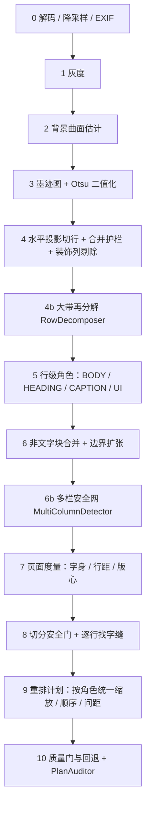
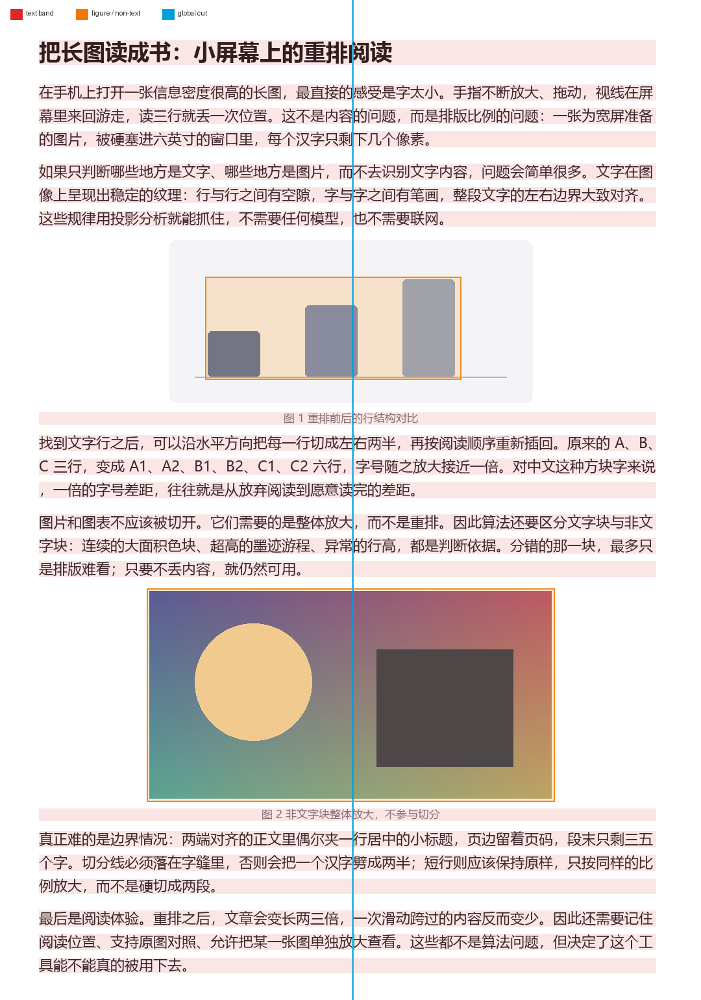
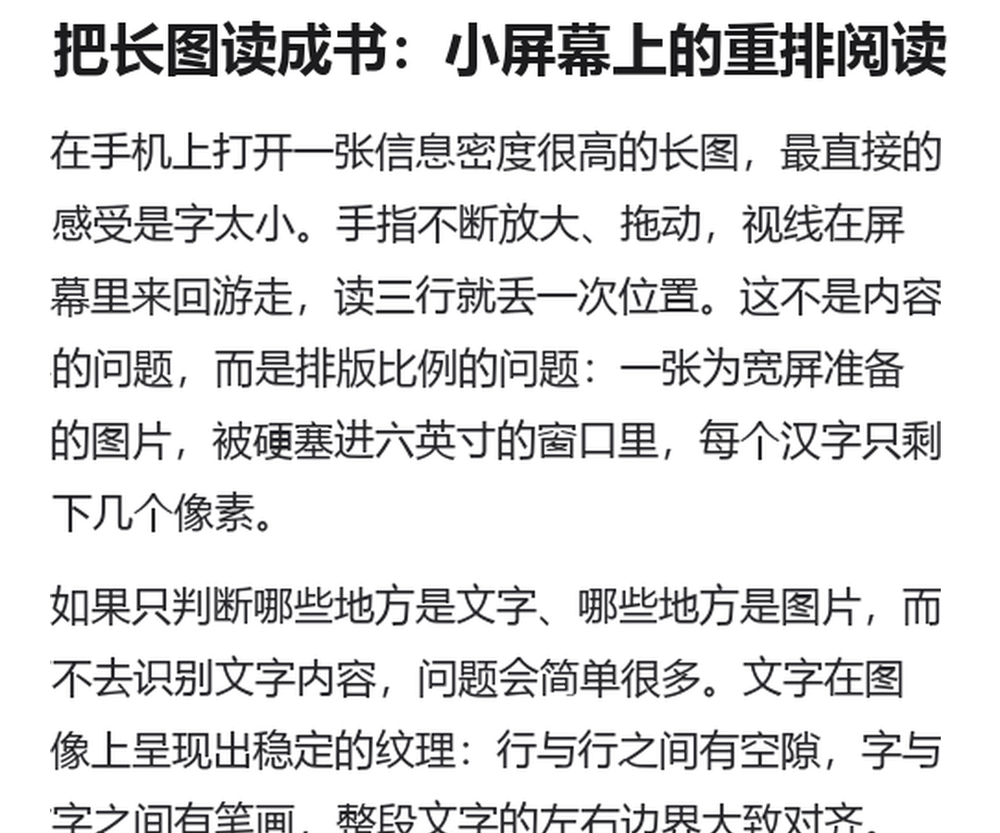
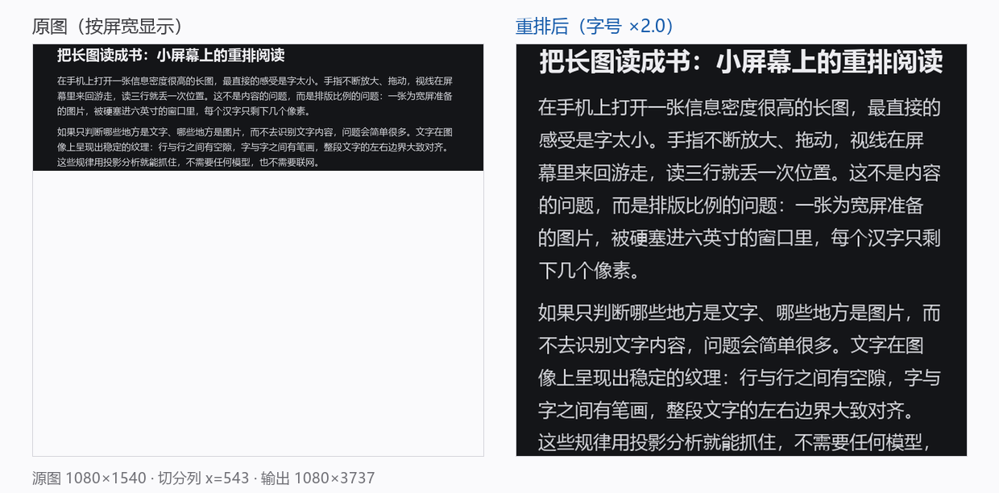
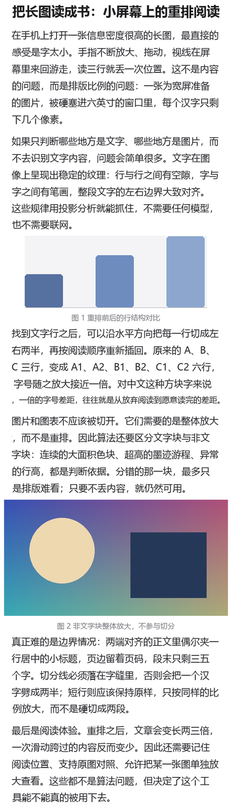

# 02 · 算法规格

> 这是整个项目的地基。`:core` 模块按本文实现，参数一个都不要改；要改先改黄金测试。
> v1.1（2026-10-29）在行/块/缩放三层加了护栏，变更点标了 **[v1.1]**；参数默认值与
> `core/.../analyze/AnalysisOptions.kt`、`plan/ReflowOptions.kt` 一一对应。
> **v2 不修改本文的 v1 参数与流水线**；v2 的模型区域、阅读顺序、强制切与 HTML 夹具见
> [07 · V2 计划](07-v2-plan.md)。

## 0. 坐标与单位

三个坐标系，任何实现都必须说清楚自己在哪一个里：

| 坐标系 | 记号 | 说明 |
|---|---|---|
| 源图 | S | 原始图片像素，`srcW × srcH` |
| 分析图 | A | 降采样后的图，**宽度优先**：`k = min(1, analysisMaxWidth / srcW)`；像素超预算（`analysisMaxPixels`）时按高度切条带，条带内宽度不变。`k = analysisW / srcW`（≤1） |
| 输出 | O | 重排结果，宽度 = 屏幕像素宽 `outW` |

- 分析全部在 A 里做，`PageLayout` 里的矩形都是 A 坐标；
- 生成渲染项时，把 A 坐标除以 `k` 换回 S（向外取整），输出尺寸用 O；
- 只有这样，"分析降采样"才不会影响渲染清晰度。

## 1. 输入输出契约

```kotlin
data class GrayImage(val width: Int, val height: Int, val data: ByteArray) // 0..255

// 以下是常用参数节选，完整字段见 core/.../analyze/AnalysisOptions.kt，两边默认值必须一致。
data class AnalysisOptions(
    // [P1] 宽度优先：长图的长边是高度，按长边定标会把宽度压成一条（690×10305 → 107×1598）。
    val analysisMaxWidth: Int = 1600,
    // [P2] 单张分析图/单条带的像素预算；超了就切条带，宽度不变。
    val analysisMaxPixels: Int = 8_000_000,
    val stripHeight: Int = 3000,
    val stripOverlap: Int = 48,
    val stripParallelism: Int = 0,       // 0 = 自动，上限 2（内存优先，见 §15）
    val bgCell: Int = 32,
    val bgPercentileLight: Int = 92,
    val bgPercentileDark: Int = 8,
    val bgCandidateDelta: Int = 22,
    val bgMinCellRatio: Float = 0.10f,
    val inkFloor: Int = 12,
    val inkCeil: Int = 80,
    val rowMinInkPx: Float = 0.003f,     // × 分析图宽，且 ≥ 3
    val rowMergeGapRatio: Float = 0.45f, // × 行高中位数
    val rowMinHeightRatio: Float = 0.35f,
    val rowMergeHeightRatio: Float = 1.25f,   // [v1.1] 合并后总高上限（× 行高）
    val rowDecomposeHeightRatio: Float = 1.8f,// [v1.1] 超过该倍数先尝试再分解
    val rowValleyInkRatio: Float = 0.15f,     // [v1.1] 再分解的谷值阈值
    val rowSubMinHeightRatio: Float = 0.5f,   // [v1.1] 子行高度下限
    val rowSubMaxHeightRatio: Float = 1.8f,   // [v1.1] 子行高度上限
    val rowSubMaxCv: Float = 0.25f,           // [v1.1] 子行行距变异系数上限
    val decorMaxWidthRatio: Float = 0.005f,   // [v1.1] 装饰线最大宽度（× 页宽）
    val decorMinBlankRatio: Float = 0.5f,     // [v1.1] 装饰线一侧最小留白（× 字高）
    val figHeightRatio: Float = 2.8f,
    val figDensity: Float = 0.62f,
    val figRunRatio: Float = 2.6f,
    val figRunFrac: Float = 0.008f,
    val figMergeGapRatio: Float = 4.0f,
    val roleHeadingHeightRatio: Float = 1.25f,// [v1.1] 标题最小高度倍数
    val roleCaptionHeightRatio: Float = 0.80f,// [v1.1] 图注最大高度倍数
    val roleHeadingMinWidthRatio: Float = 0.5f,//[v1.1] 标题最小宽度（× 页宽）
    val roleUiGapRatio: Float = 2.2f,         // [v1.1] UI 行的最大横向空白（× 行高）
    val roleUiSolidRunRatio: Float = 1.0f,    // [v1.1] UI 行的实心列组宽度（× 行高）
    val splitInsetRatio: Float = 0.04f,       // [v1.1] 切分安全门：左右贴版心容差
    val splitFullWidthRatio: Float = 0.72f,   // [v1.1] 切分安全门：行宽下限（⊗ 页宽）
    val splitLeftAlignedRatio: Float = 0.50f, // [v1.1] 左对齐正文行的放行宽度
    val cutWin0: Float = 0.06f,          // 首次找缝，× 图宽
    val cutWin1: Float = 0.05f,          // 围绕中位切点精修（v1.2 从 0.025 放宽）

    val cutCleanRatio: Float = 0.70f,
    val longLineRatio: Float = 0.70f,    // 长行门槛 = 该系数 × 文字行宽 90 分位
    val latinSplitEnabled: Boolean = false, // [v1.1] P1-1 实验开关，默认关
    val latinMinGapRatio: Float = 0.12f,    // [v1.1] 拉丁缝最小宽度（× 行高）
    val latinLikeClusterRatio: Float = 0.62f,  // [v1.1] 窄墨簇 → 拉丁/代码行
    val latinLikeClusterDensity: Float = 1.8f, // [v1.1] 且每字宽墨簇数 > 该值
    val multiColumnMinWidthRatio: Float = 0.05f, // [v1.1] 多栏：竖带最小宽度
    val multiColumnMaxInkRatio: Float = 0.01f,   // [v1.1] 多栏：竖带最大墨量
    val multiColumnMinCoverage: Float = 0.60f,   // [v1.1] 多栏：竖带最小覆盖高度
    val multiColumnMinSideLines: Int = 2,        // [v1.1] 多栏：两侧各需几条长行
)

data class ReflowOptions(
    val outputWidth: Int,                // 屏幕像素宽
    val targetEm: Int = 44,              // 1080 宽基准下的目标字身
    val insetRatio: Float = 0.018f,
    val maxScale: Float = 3.0f,
    val minGain: Float = 1.25f,
    val figMaxScale: Float = 2.2f,
    val paragraphGapRatio: Float = 1.35f,
    val uiMaxScale: Float = 1.5f,        // [v1.1] UI 行/图的最大放大（D-C）

```

```kotlin
interface LayoutAnalyzer {
    fun analyze(image: GrayImage): PageLayout
}

interface ReflowPlanner {
    fun plan(layout: PageLayout, options: ReflowOptions): ReflowPlan
}
```

`PageLayout` / `ReflowPlan` 的完整字段见 [03 架构](03-architecture.md#4-核心接口)。

## 2. 流水线



每一步都是 O(W·H) 或 O(W·H) 的常数倍，无迭代求解、无浮点矩阵、无第三方库。

### 2.1 一页伪代码

```kotlin
// 1) 墨迹
val (bg, dark) = estimateBackground(gray)                 // W×H
val ink  = if (dark) clamp(gray - bg) else clamp(bg - gray)
val t    = clamp(otsu(ink), 12, 80)
val mask = clean(binarize(ink, t))

// 2) 行（v1.1：合并有总高度上限，并剔除细竖直装饰列）
val decor = detectDecorationColumns(mask)          // 引用竖线、分隔线
val content = clearColumns(mask, decor)
var medH = robustMedian(runHeights)                // 去掉最高/最低 10%
var runs = runsOf(rowInk(content), thr = max(3, 0.003 * W))
runs = mergeWithHeightCap(runs, maxGap = 0.45 * medH, maxHeight = 1.25 * medH)
runs = runs.filter { it.height >= 0.35 * medH }

// 3) 块与角色（v1.1）
for (band in runs) {
    if (isPhoto(band))                      -> FIGURE(PHOTO)
    else if (band.height > 1.8 * medH) {
        val subs = decomposeByValley(band)  // 谷值 + 子行高度/行距稳定性
        if (subs != null) { 对每个子行递归; continue }
        if (band.height > 2.8 * medH)       -> FIGURE(UI)
    }
    role = classifyRole(band)               // UI 优先，其次 HEADING / CAPTION / BODY
}

// 4) 版心（v1.1：只用 BODY/HEADING 的长行；v1.3：门槛 = 0.70 × 文字行宽 90 分位）
val refW = p90(bodyLines.map { it.width })      // 不看图块，避免图文混排把门槛顶高
val long = lines.filter { role in {BODY, HEADING} && width >= 0.70 * refW }
val left = long.minOf { it.x0 }; val right = long.maxOf { it.x1 }

// 4b) 多栏安全网：中线附近有贯通竖带 + 两侧都有长行 → 直接回退原图
if (isMultiColumn(content, long)) return layout(MULTI_COLUMN)

// 5) 切点（v1.1：角色门 + 版心门 + 词门）
for (line in lines) {
    eligible = role in {BODY, HEADING}
               && line.left  <= textLeft  + 0.04*pageW
               && line.right >= textRight - 0.04*pageW
               && line.width >= (HEADING ? 0.72 : 0.50) * pageW
               && !centered
    if (!eligible) continue
    if (isLatinLike(line) && !latinSplitEnabled) { refused++; continue }
    cut = nearestSafeGap(line, center ± win)   // 拒绝劈字/劈词，否则 null
}
cleanRatio = clean / candidates   // 被拒绝的行也算分母
if (cleanRatio < 0.70) weak_cut

// 6) 计划（v1.1：全页一个 bodyScale，再按角色换算）
bodyScale = min(contentW / slot, contentW / widestUnsplitBodyLine, targetEm / (0.92*medH), 3.0)
if (gain < 1.25) return plan(ORIGINAL, weak_cut ? WEAK_CUT : GAIN_TOO_SMALL)
```

伪代码省略了细节（短行判定、段间距、图块缩放、居中），每一节正文里有完整规则。

---

## 3. Step 0 · 解码与降采样

| 项 | 规则 |
|---|---|
| 方向 | 读 EXIF `Orientation`，旋转/镜像后再处理；分享来的图经常是"躺着的" |
| 格式 | JPEG/PNG/WebP 用 `BitmapFactory`；HEIF 在 API 28+ 用 `ImageDecoder`，API 26–27 直接报"格式不支持" |
| 动图 | 只取第一帧 |
| 透明 | 画到背景色（默认白）上，避免 PNG 透明区域变成黑 |
| 尺寸 | 先用 `inJustDecodeBounds` 拿 `srcW/srcH`；`AnalysisScale` 按**宽度**算出分析尺寸（`k = min(1, analysisMaxWidth/srcW)`）；解码时 `inSampleSize` 取 2 的幂，使解出的图不小于 2× 分析尺寸，再用 Canvas 精确缩到分析尺寸 |
| 超大图 | 源图像素 > 8MP 时改走 `BitmapRegionDecoder` 条带解码（一条带 ≤ 8MP），宽度不变；灰度化按 256 行分块写进目标数组，不整图 `getPixels` |

降采样因子 `k = analysisW / srcW` 必须记进 `PageLayout`，渲染时用。

> **为什么不是 4K 分析**：行投影只需要能分辨"行"与"行间空白"。宽度 1600 以内按 1:1 分析，22px 的字仍是 22px；再往上翻倍不会提高切点质量，只会让耗时 ×4。
>
> **[P1] 为什么改成按宽度定标**：长图的长边是高度，按长边降采样会把宽度压成一条（690×10305 → 107×1598，一行只剩 30 个像素列，字缝全是假的）。现在宽度优先，高度超预算时切条带（见 `StripLayoutAnalyzer`）。

---

## 4. Step 1 · 灰度

```kotlin
Y = (77 * r + 150 * g + 29 * b) shr 8
```

整数运算，结果存 `ByteArray`（按无符号用 `and 0xFF` 读）。

---

## 5. Step 2 · 背景曲面

目标：得到每个像素的"纸面颜色"，让后续 `ink = 背景 - 灰度` 在阴影、渐变、深色图上都成立。

**朴素做法（错误示范）**：把图切成 24×24 的格子，每格取 90 分位当背景。
一张深色图表占满几个格子时，格子的 90 分位就是图表自己的颜色，图表会被当成本地背景"吃掉"，只剩边缘噪声——原型第一版就踩了这个坑，柱状图被切成三条细线。

**正确做法：只用"接近纸色"的像素估计背景。**

```
1. 取边界像素中位数，<110 判为暗色图（dark = true）
2. 种子色 bg0 = 全图 8 分位（暗图）或 92 分位（亮图）
3. 候选像素 cand = 亮图 ? (g >= bg0 - 22) : (g <= bg0 + 22)
4. 按 32×32 分块：
      若块内候选像素 ≥ 10%：grid = 候选像素的中位数
      否则：grid = NaN
5. NaN 用 bg0 填，再做 3×3 中值（去掉格子跳变）
6. 双线性放大回原尺寸 → bg
7. ink = clamp(dark ? g - bg : bg - g, 0, 255)
```

效果：深色图块内部没有候选像素 → 格子为 NaN → 用种子色填 → `ink` 很大 → 图块被正确识别为"墨"。浅色卡片（如 244 的灰底）是候选像素 → 进入背景 → 卡片内部不算墨，只有卡片上的元素算墨。

> 边界情况：整张图都是深色照片时，边界中位数判定为 dark，bg0 取 8 分位，候选很少 → 全图 NaN → 背景=bg0 → 整幅图都是"墨"，行投影为一个巨大的 run → 分类为非文字 → 不重排。正确。

---

## 6. Step 3 · 墨迹与二值化

```
t = clamp(otsu(ink 直方图), 12, 80)
mask = (ink > t)
mask &= (8 邻域墨点数 >= 1)      // 去掉孤立噪点
```

- **不做形态学腐蚀**：中文细笔画在 22px 字号下只有 1.5–2px 宽，3×3 腐蚀会把"一、二、十"整根吃掉；
- Otsu 在 `ink` 上算（背景大量为 0，文字形成一个峰），比在灰度上算稳；
- 上限 80 是保护浅灰小字（图注、页码）：若 Otsu 落到 100+，浅灰字会被整段丢掉——对阅读工具来说，丢内容比多切一刀严重。原型在样例上跑出 77。

---

## 7. Step 4 · 行切分

### 7.1 投影

```
rowInk[y] = mask 第 y 行的墨点数量
```

**阈值必须是绝对值，不能是"相对峰值"**：图注的墨量只有正文的 1/5，用 `0.22 × median(正密度)` 这类相对阈值会把整行图注判成空白，直接丢内容（原型踩过）。

```
rowThr = max(3, 0.003 × analysisW)
run    = rowInk 平滑(1,1,1) 后 ≥ rowThr 的连续区间
```

平滑会把 1px 的缝抹掉，但也会抬高单行图注的边缘——所以平滑后再用绝对值比较，阈值取 3。

### 7.2 合并与过滤

```
medH = robustMedian(run 高度)                 // [v1.1] 排序后去掉最高/最低 10%
runs = mergeWithHeightCap(
           runs,
           maxGap    = 0.45 × medH,           // 同一个字的上下结构
           maxHeight = 1.25 × medH)           // [v1.1] 不允许并成两行
refH = percentile60(runs 高度)                // [0.5.4] 合并后高度的 60 分位
runs = runs.filter { h >= 0.35 × max(medH, refH) }   // 去掉噪点、标点残片、图标边框
medH = robustMedian(runs 高度)（重算）
```

**[0.5.4] 为什么基准是 60 分位、而且是合并后的高度**：图标按钮的上/下边框、分隔线会在
正文页里造出几条 5px 的带。中位数一旦被它们拉低（4 条带里 2 条细带，中位数就落在两者
中间），`0.35 × medH` 就只剩 1.7px，什么也拦不住。60 分位始终落在真实行高那一档。
实测 690×1708 与 699×1730 只差 1.3% 缩放时，这两条假行的有无会让整页计划翻转
（lines 38→40、items 61→63、段落 7→8）。

**[v1.1] 为什么必须加总高度上限**：行距 10px、行高 22px 的紧排正文，行间空隙 10px 小于
`0.45 × 22 ≈ 10`，旧实现会把两行并成一个 52px 的带；随后 Step 5 因为“带太高”判成图块，
整段文字就变成了图片。上限 1.25 只允许“同一个字的上下结构”（两段总高 ≈ 1 个字）通过。

`1.25` 的边界：两行正文（总高 ≈ 2 个字高）不合并；上下结构的字（≈1 个字高）合并。
真正紧贴到 2px 缝隙的标题交给 [4b 再分解](#72b-大带再分解v11)。

### 7.2b 大带再分解（v1.1）

行投影的 1 像素平滑会把 1–2 行的缝隙抹平，形成“看起来是一整块”的紧排段落。`RowDecomposer`
在这类带上**用未平滑的原始投影**找谷值：

```
if (band.height > 1.8 × medH) {
    rowInk    = 带内每行墨量（不平滑）
    valley    = 0.15 × median(带内 >0 的 rowInk)
    subs      = 连续 rowInk ≥ valley 的区间
    接受条件：subs ≥ 2；每个子行高度 ∈ [0.5, 1.8] × medH；
              子行宽度中位数 ≥ 0.5 × 带宽；子行行距变异系数 < 0.25
    否则返回 null（保持图块/UI，绝不硬切）
}
```

---

## 8. Step 5 · 行级角色与图块判定

逐行带先判“是不是图”，再判“像什么文字”。判定顺序（v1.1）：

| 顺序 | 判据 | 结果 |
|---|---|---|
| ⓪ | `height ≥ 40px` 且带内存在一条贯通整带高度的空白竖缝 | 竖切成左右两区，各自重做行投影后回到 ①（**先左后右**） |
| ① | `density > 0.62` 或 `maxRun > 2.6×medH && frac > 0.008` | `FIGURE(PHOTO)` |
| ② | `height > 1.8×medH` 且 `RowDecomposer` 成功 | 拆成多行，逐行回到 ① |
| ③ | `height > 2.8×medH` 且拆不开 | `FIGURE(UI)`（头像带、按钮条、海报） |
| ④ | 其余 | `TextLine.role = BODY / HEADING / CAPTION / UI` |

### 8.1 [v1.3] 带内竖切：图文混排

一张图右侧有几行字时，图的纵向范围让水平投影出一条**超高行带**，右侧文字被并进同一条带；
之后整条带按高度判成图块，那几行字只能跟着图一起缩放（≈1.0×），既没重排也没放大。

`BandRegionSplitter` 在带内找一条**贯通整带高度**的空白竖缝，把带拆成左右两个子区：

```
每列墨量 ≤ max(1, 2% × 带高)          // 允许抗锯齿噪点
连续缝宽 ≥ max(4, 0.8% × 分析宽)      // 字距 2–4px 不算
切点到左右边界 ≥ 15% × 带宽           // 过于靠边就不处理
两侧都要有墨；多条候选缝取离带心最近的
```

拆开后左右各自 `RowSegmenter.segmentRegion` 重做行投影，回到 ① 重新判“是图还是字”。
验收两条都要满足，否则**放弃拆分**、按原来的整块图处理：

1. 子区里必须验出文字行（两侧都是图 → 那条缝只是照片里的一道亮纹）；
2. `带高 ≥ 2.5 × 子行高中位数`（否则是“一行字里的宽字距”被当成竖缝，拆开会把一句话劈成两行）。

子区判角色时用的行高：默认沿用整页 `medH`；**只有整页中位数被这条带自己带偏**
（`medH ≥ 0.9 × 带高`，即整页只有这张图）时才改用两侧中位数里更小的那个。

> 这是**区域分割**，与 11 节的**行内字缝切分**是两件事：拿 `ColumnSplitter` 去切图会把照片
> 劈成两半；拿 `BandRegionSplitter` 去切一行正常文字会把一句话拆成两行（由验收 2 兜住）。

角色判据（`RowClassifier`，全部来自一次 `mask` / `vrun` 扫描）：

| 角色 | 判据 | 缩放上限 |
|---|---|---|
| UI | 实心列组 ≥ 1.0×行高（头像/图标），或最大横向空白 ≥ 2.2×行高（按钮行/工具条），或 ≥3×行高（稀疏图标行） | 1.5× |
| HEADING | `h/medH ≥ 1.25` 且宽度 ≥ 0.5×页宽 | 见 §12 |
| CAPTION | `h/medH ≤ 0.80` | 0.9 × bodyScale（切分后仍受此限） |
| BODY | 其余 | bodyScale |

**为什么 UI 优先**：把头像/按钮行误判成正文并切开，会把图标裁成两半（不可逆）；判成 UI
最多是“这行没放大”，内容完整。所以分类不确定时宁可 UI。

**[v1.1] 细竖直装饰列**：引用竖线在整段引用里每一行都有墨，会让行投影永远不出现空白行。
`RowSegmenter` 在投影前先把它清掉，判据是“该列最长竖直游程 ≥ `max(3×典型竖笔, 15%×页高, 10px)`、
列宽 ≤ 3px、且至少一侧有 ≥ 0.5×典型字高的空白”。四张真实样例都是 0 命中（细线本来就在
`max(3, 0.003W)` 的行阈值以下），这条规则由合成用例覆盖。

`maxRun` 用一次自上而下的游程扫描得到：

```
run[x] = mask[y][x] ? run[x] + 1 : 0
vrun[y][x] = run[x]
```

这一步把"柱状图的柱子""照片里的黑色方块"抓出来；普通汉字的最大游程约等于字身（≈medH），不会误伤。

> 标题（44px）在 22px 正文里 `h/medH ≈ 2.0`，仍判为文字；只有 ≥ 3 倍行高的块才无条件判图。这是有意的：**标题应当参与重排**，只是不切分。

---

## 9. Step 6 · 非文字块合并与边界扩张

### 9.1 合并

照片中间若有一条浅色天空，会被行投影切成两段。相邻两个 FIGURE 带若间距 `≤ 4 × 行距中位数`，合并为一个块（取 y/x 的并集）。

### 9.2 扩张

行带只覆盖"有墨的部分"，而图表的卡片底、坐标轴、浅色边框的反差很低，不在 `mask` 里。直接按行带裁剪会把卡片切掉半截。

```
lowc = (ink > 4) && (ink < 45)        // 低反差墨迹
从行带四边向外生长：
    某一行/列在 [x0,x1] 范围内 lowc 占比 ≥ 50% → 扩张一格
    最多扩张 30% 的块高/块宽
```

白色间隔的 lowc 占比为 0，扩张自然停止；正文行虽然有低反差边缘，但覆盖率达不到 50%，也不会被吞。

### 9.3 结果

FIGURE 块最终得到 S 坐标下的矩形 `bounds`，渲染时整块裁剪、整体缩放，**绝不做左右切分**。

---

## 10. Step 7 · 页面度量

| 量 | 定义 |
|---|---|
| `textLeft` / `textRight` | **长行**（宽度 ≥ `longLineMinWidth`）的 `x0` 最小值 / `x1` 最大值 |
| `longLineMinWidth` | `0.70 × 文字行宽的 90 分位`（v1.3：只用文字行，不看图块） |
| `medH` | 文字行带高度中位数（含抗锯齿，比真实字身大约 8%） |
| `medGap` | 相邻行带间距中位数 |
| `pitch` | 相邻行 `y0` 差值中位数（真正的行距） |
| `isDark` | Step 2 的判定 |
| `bgArgb` | 边界像素中位色，用于阅读页底色 |

> **版心为什么用长行而不是全部行**：截图里常有一行页码、一个水印、一个状态栏图标，它们比正文靠边得多。用 min/max 会把版心拉到图片边缘，所有行都多出一截空白，切分列也会偏。用"长行"定义版心，短行仍然照常渲染（它们的裁剪范围可以超出版心，见 12.6），只是不参与版心估计。
>
> 原型第一版用的是全部行的 min/max，导致顶部的截图 UI 一出现版心就漂移，改成"长行最值"后稳定。
>
> **[v1.3] 版面宽与长行门槛都只用文字行算**：图文混排时图块的包围盒会并进右侧几行字，
> 用它算出来的版面宽被撑宽，长行门槛跟着抬高，正常的正文也不再算"长行"，
> 整页被 `too_few_long_lines` 判死（`05-chat` / `09-poster` 两个夹具都是这个原因才回退原图）。
> 参考宽度取文字行宽的**90 分位**而不是 max：一条通栏插图行不该把全页门槛顶上去。


---

## 11. Step 8 · 找切分列（本方案的关键）

### 11.1 为什么不能用几何中点

一行 46 个汉字，字宽 22px。几何中点在 506px 处，大概率落在一个字的**笔画中间**。在那个位置切：

- 左半的最后半个字缺笔画；
- 右半的第一个字缺笔画；
- 两半拼起来时中间出现两条残字。

必须切在**字缝**里。

### 11.2 逐行找缝，再取中位数

```
对每个"长行"（x1-x0 ≥ longLineMinWidth）：
    counts[x] = mask[y0:y1, x] 的墨点数   （x 在 center ± 0.06W 内）
    thr    = max(1, 0.10 × median(counts 中 >0 的值))
    候选   = { 连续列组 | counts[x] ≤ thr }，逐组取组中点
    对每个候选打分，取最高分：
        center  = 1 - |x - center| / win            // 离目标列越近越好
        gap     = min(1, 缝宽 / (0.35 × 行高))       // 字距 2–4px 只有一半分
        balance = 2 - 2 × max(左半, 右半) / 行宽     // 两半越均衡越好
        ink     = 1 - 组内最干净列的墨量 / thr        // 零墨满分
        score   = 0.45·center + 0.30·gap + 0.15·balance + 0.10·ink

cut = median(cut_i)
```

**[v1.4] 为什么从字典序改成加权**：旧实现是「离中心最近 → 缝更宽」的字典序，1px 的噪点缝
只要离得近就永远赢过 12px 的真字缝。加权之后宽缝可以用 `gap` 分补回一点距离差，
但 `center` 仍是最大权重，切分列不会随参差的右边缘漂移。
逐行贴回切点时 `center` 与 `balance` 的权重**互换**（全局列要稳、逐行下刀要均衡）。

> **局限（已实测，暂不修）**：这套打分只解决"多条缝里选哪条"，不解决"这条缝本身穿过了字形"。
> 典型例子是大字海报的「重|排」：`重` 的右缘和 `扌` 粘成一个 47px 的墨簇，`扌` 与 `非` 之间
> 是一条 3px 的**真零墨缝**，`splitsWord` 判「左侧整簇」直接放行。
>
> 两条看起来能修的路都试过，都不成立：
> 1. **用字宽(pitch)替代行高当窄簇基准**——这条线的 pitch(≈29) 反而小于行高(29–31)，
>    且左侧墨簇 47px 在 22/29/31/35 任何单位下都算"整簇"，判据不触发；
> 2. **拒绝"两侧都是满高实心竖笔"的窄缝**——能挡住 `扌|非`，但切点立刻挪到下一个字
>    `列` 的 `夕|刂`，只是把缺陷换了个字，净收益为零，已撤回。
>
> 结论：纯投影在"大字 + 连笔/粘连"的展示型文字上无法可靠定位字缝，
> 需要字形级信息。v1 的兜底是"宁可整块不切"，海报这类页面本来就允许回退原图。

**为什么逐行而不是一条全局垂直投影**：中文正文按字格对齐，全局投影上几乎不存在连续的空白列（每个 x 都会穿过某些行的笔画），求全局最小值等于在噪声里挑一个。逐行找缝的语义是"这一行的字与字之间"，永远成立。

### 11.3 精修与有效性（v1.1：三道门）

```
候选行 = BODY（和通过同一几何门的 HEADING）
    role 门：UI 一律不切；BODY / HEADING / CAPTION 可切（v1.5 起图注也切）
    版心门：line.left  <= textLeft  + 0.04 × 页宽
            line.right >= textRight - 0.04 × 页宽
            宽度 ≥ (BODY ? 0.50 : 0.72) × 页宽，且不居中
    终点门：全局切点必须落在这一行内部（短于切点的行按“普通行缩放”处理，不进分母）
    词门：  切点两侧的墨簇都窄于 0.62 × 行高 → 判为劈字/劈词，拒绝
            拉丁行额外允许“空白 ≥ 1.5 × 本行空白中位数”豁免（词间空格）；
            中文行不豁免，否则会把“引”切成“弓 + 丨”

对每个候选行：在 cut ± 0.05W 内找最近的安全缝；找不到再把窗口放宽一倍
    ink_at_cut ≤ 1.5 记为 clean

cleanRatio = clean / 候选行数        // 拒绝了也算分母：宁可回退也不劈字
若 cleanRatio < 0.70 → 放弃切分（notes = weak_cut），整页只放大不切
```

**[v1.1] 为什么“拒绝了也算分母”**：拉丁/代码行找不到零墨缝时，如果把它从分母里去掉，
页面会带着“少数行被压缩”的效果通过门槛——正是旧版本 XERJ 那种“看起来切了、其实切在
单词中间”的来源。算进分母后，拉丁页面的 `cleanRatio` 会自然跌破 0.70，触发整页回退。

### 11.4 行的三种处置

| 类型 | 条件 | 处置 |
|---|---|---|
| 切分行 | 通过 11.3 三道门 | 切成左右两半，各自占一行 |
| 短行（左对齐） | 未通过版心门 | 不切，整体等比放大，宽度不足时缩放上限为列宽 |
| 短行（居中） | 左右边距差 < 0.06 版心宽且左边距 > 0.04 版心宽 | 不切，整体放大并居中 |

标题、图注、段末短句都落在“短行”里——**它们是内容的一部分，必须保留，只是不参与切分**。

```
       ┌─────────── 版心 ───────────┐
       │ 汉字汉字汉│字汉字汉字汉字汉 │
       │ 汉字汉字汉│字汉字汉字汉字汉 │
       └──────────┴─────────────────┘
                  ↑
            切点落在字缝（墨量≈0）
```

---

## 12. Step 9 · 重排计划

### 12.1 缩放（v1.1：全页一个 bodyScale）

```
contentW = outW - 2 × inset            // inset = 1.8% × outW
slot     = max over 待切行 ( max(cutX - line.left, line.right - cutX) )
unsplitW = 不参与切分的 BODY 行里最大的行宽
sFit     = contentW / slot
sUnsplit = contentW / unsplitW         // [v1.1] 不切的行也必须装得下
sEm      = targetEm / (0.92 × medH)    // 目标字身限制
bodyScale = min(sFit, sUnsplit, sEm, maxScale)
gain      = bodyScale × k × srcW / outW   // k = analysisScale，见下
若 gain < 1.25 → 放弃重排，直接看原图
```

- `0.92` 是把“行带高度”换回“字身”的经验系数（行带含抗锯齿）；
- `targetEm` 是**像素**，由 sp 换算：`with(density) { 16.sp.toPx() }`。在 1080×2.75 的设备上就是 44px；换一台 1440×3.5 的设备是 56px，不能写死 44；
- `outputWidth` 取屏幕像素宽，旋转、分屏时要重新规划（重新 planner，不重新 analyze）；
- `slot` 取所有待切行的最大值，而不是中点：逐行切点在 ±2% 内浮动，按最大值缩放才能保证**每一行都不会被二次压缩**；
- **[v1.1] `sUnsplit`**：只切“整行放不下”的行，同时保证不切的行也能按同一倍率放下。没有这一条，一行切不开的宽行只能被压进列宽，字号比同段小一截（`PlanAuditor` 会报 `body_scale_inconsistent`）；
- `sEm` 限制让 4K 大字号截图不会被切成一屏五个字；
- **[0.5.4] `maxScale` 不能低于 `sEm`**：640dpi 屏上 16sp = 64px、`sEm ≈ 4.1`，上限写死 3.0
  等于把用户选的字号压回 11.7sp——1440×2560 实测 `bodyScale=3.0`，正文只占内容宽的 73%。
  App 的 ×2 档传 4.0（结果由 `sFit` 定档，正好填满列宽），×4 档仍传 3.0（二次重排后最终上限 6）；
- **[0.5.1] `k` 必须乘进 `gain`**：`bodyScale` 是**分析图像素**上的倍率，`srcW/outW` 是**源图像素**口径。
  漏掉 `k` 时（长图尤其明显，690×10305 只剩 107px 宽）gain 会虚高 `1/k` 倍，本该回退的页面
  被当成"有收益"，最后渲染成左边一条窄列。

### 12.1b 按角色换算（v1.1）

| 角色 | 缩放 | 切分 |
|---|---|---|
| BODY | `bodyScale` | 通过 §11.3 的门就切 |
| HEADING | `min(bodyScale, contentW / 标题宽)`；装不下 `bodyScale` 且它是可切行 → 按 BODY 切分并打 `heading_split` | 条件切分 |
| CAPTION | `min(0.9 × bodyScale, contentW / 段宽)` | 满宽行切半（v1.5） |
| UI | `min(1.5, contentW / 行宽)` | 不切 |
| PHOTO | `clamp(contentW / 图宽, 1.0, figMaxScale)` | 不切 |
| UI 图块 | `min(1.5, contentW / 图宽)` | 不切 |
| DECOR | `min(1.0, contentW / 图宽)` | 不切 |

标题允许切分（D-A 方案 A）的前提是“不切就会比正文小”：新闻样例外，两行标题在 2.73× 下按 BODY 切成 3 行，输出字高比正文大 31%。

### 12.1c 二次重排：×4 把 ×2 的结果再排一次（v1.2）

×4 的语义不是“倍率乘 2 再压回列宽”——那样放不下的行会被 `min(s, colW/w)` 压回 ×2 的字号，
同一页出现 2–3 种字号（Twitter 样例 21 项里 10 行是 ×2、身高差 50%）。

现在的做法是**把 ×2 的输出当成一张新图重新排**：

```text
1) 基准倍率与 ×2 相同（同一套 sFit / sUnsplit / sEm），再乘 scaleMultiplier 得到 s4；
2) 对每条 BODY / HEADING 行：
     need   = ceil(行宽 × s4 / contentW)          // 这一行在新字号下需要几段
     pieces = 2 或 4（need 向上取 2 的幂，上限 maxSegments）
     分界点 = 从「候选字缝」里为每个理想分界点（行宽 × i / pieces）挑最近的一刀
3) 段与段之间用 lineGap，行距/段距随 outEm 同步放大；CAPTION / UI / 图块不参与二次切分；
4) 没有任何候选缝的行 → 整行放大并被列宽压小（不再硬切），拉丁/代码页（P1-1 关）走这条路。
```

**候选字缝**在分析期一次算好（`TextLine.cuts`）：扫描行内每一段“零墨列组（≥2 列）或低墨列组”，
取组中心，过 `splitsWord` 检查后按 x 升序存下。它和 ×2 的切分门**互不影响**：

- ×2 的 `split` 只标“这一行要不要切左右两半”，仍然只对左对齐、够宽、非 UI 的行生效；
- `cuts` 对所有 BODY / HEADING 行都算——×4 时每条 ×2 输出行都要能继续对半，包括 ×2 里
  因为“整行装得下”而没切的行。

为什么不用固定刀位（1/4、1/2、3/4 各找一刀）：字缝疏密不是均匀的，固定刀位会切出
`197 / 18 / 56 / 158` 这种碎片；按理想分界点挑最近的缝才能得到接近等分的段。

效果（`scripts` 同机、1080 出宽）：Twitter 21 → 31 项、BODY 字号偏差 0.395 → 0.010；
日本新闻 12 → 22 项、0.168 → 0.001；xerj（英文）受 P1-1 限制，仍会有“没有候选缝的行”被压小。

强制档位还有两条兜底：算出倍率 < 1 时按 1× 输出（只放大不缩小）；二次重排真的切了段时
模式记为 `REFLOW`（×2 里“整页不切”的页面在 ×4 可能又被切开了）。

### 12.2 列宽与居中

```
colW = contentW          // 列宽固定为整个版心宽
left = inset             // 左右留白对称
```

**列宽不再按 `slot × s` 收窄**（v1.1 的改动）：按行槽收窄会让"放得下的行"也被压缩，
同一段出现忽大忽小的字号。切分后的半行靠左排；只有 `min(s, colW / 行宽)` 这一层压缩
会真正收窄某一行的目标宽度。

### 12.3 顺序

```
源：  A 行 [A1][A2]   B 行 [B1][B2]   C 行 [C1][C2]
输出：A1
      A2
      B1
      B2
      C1
      C2
```

**不是** A1 B1 C1 A2 B2 C2。切分后的 A2 是 A 句的后半句，必须紧跟 A1；按行优先是最小惊讶原则，也是眼睛回扫距离最短的排法。

### 12.4 垂直间距

```
outEm     = 0.92 × medH × s
sourceLineGap = max(0, medianPitch - medianLineHeight)
lineGap   = clamp(round(sourceLineGap × s), 0.15 × outEm, 0.55 × outEm)
paraExtra = max(0.8 × lineGap, 0.25 × outEm)
blockGap  = max(1.6 × lineGap, 0.45 × outEm)
段间距：若某行与上一文字行的源间距 > 1.35 × medGap，行前额外加 lineGap + paraExtra
```

均匀行距会让文章变成一堵墙；源图里的段间距是重要的结构信息，必须保留。
行距上限跟着**输出字身**走（不再写死 6–40px），字号放大时行距同步放大，×4 才不会挤在一起。

### 12.5 非文字块

```
sf = clamp(contentW / figW, 1.0, 2.2)
若 figW > contentW：sf = contentW / figW     // 超宽图整体缩小，绝不裁切
dest = 居中，宽度 figW × sf
```

"非文字部分直接放大处理"就落在这里：它不参与切分，只按栏宽等比缩放；点按可进全屏看细节。

### 12.6 渲染项

```kotlin
sealed interface RenderItem {
    val src: RectI     // S 坐标
    val dest: RectI    // O 坐标
    data class TextRow(
        val src: RectI, val dest: RectI, val lineIndex: Int,
        val role: LineRole = LineRole.BODY, val scale: Float = 1f,
    ) : RenderItem
    data class Figure(
        val src: RectI, val dest: RectI, val blockIndex: Int,
        val kind: FigureKind = FigureKind.PHOTO, val scale: Float = 1f,
    ) : RenderItem
}
```

`dest` 只决定位置，不改变顺序——顺序就是 `items` 的先后。

---

## 13. Step 10 · 质量门与回退

按顺序检查，任一不满足即回退，**回退不是错误**：

| 检查 | 条件 | 回退结果 |
|---|---|---|
| G1 | `mask` 墨点总数 > 0.0005 × 面积 | `no_ink` → 原图 |
| G2 | 文字行 ≥ 1 | `no_text` → 原图 |
| G3 | 长行 ≥ 2 | `too_few_long_lines` → 原图 |
| G4 | `cleanRatio ≥ 0.70` | `weak_cut` → 整页不切，只按 `sFit` 放大 |
| G5 | `gain ≥ 1.25` | [v1.1] `weak_cut` 且无收益 → `ORIGINAL / WEAK_CUT`；其他无收益 → `GAIN_TOO_SMALL`；**不再输出 1.0–1.25× 的伪重排** |
| G6 | 计划高度 ≤ 300000px（防疯） | `too_tall` → 原图 |
| G7 | [v1.1] 中线附近有贯通低墨竖带且两侧都有长行 | `multi_column` → 原图（只检测、不重排） |

回退时 `ReflowPlan.fallbackReason` 非空，UI 按 01 文档第 8 节给提示。

> **G5 的一个例外**：`splitEnabled = false`（切分关闭）时整段跳过 `minGain` 门槛——
> 用户要的是"只放大不切"，不该因为收益不足被踢回原图。代价是这类页面**可能输出更小的字**
> （`bodyScale < 1` 时没有下限保护，只有 `forceReflow` 有）。0.5 的 UI 已经不提供这个开关
> （见 [01 §6](01-product.md)），属于潜在路径；若要恢复设置面板，先补上 `bodyScale ≥ 1` 的夹取。

---

## 14. 参数总表

| 参数 | 默认 | 作用 | 调大的后果 |
|---|---|---|---|
| `analysisMaxWidth` | 1600 | 分析分辨率（宽度上限，不再按长边） | 更准更慢（平方关系） |
| `analysisMaxPixels` | 8_000_000 | 单张分析图/单条带的像素预算 | 更省内存；超了自动切条带 |
| `stripHeight` / `stripOverlap` | 3000 / 48 | 条带高度与重叠（分析像素） | 重叠要盖住一行，否则跨边界行会被切两半 |
| `bgCell` | 32 | 背景网格 | 更能跟光照，更容易受大色块影响 |
| `bgCandidateDelta` | 22 | 纸色容差 | 更大→更多像素算背景，可能吃掉浅色图 |
| `inkFloor / inkCeil` | 12 / 80 | 二值化夹取 | 上限更高→浅灰字更易丢 |
| `rowMinInkPx` | 0.003·W（≥3） | 行阈值 | 更大→图注、页码丢失 |
| `rowMergeGapRatio` | 0.45 | 行合并 | 更大→相邻行粘连 |
| `figHeightRatio` | 2.8 | 图块判定 | 更小→大标题被当成图 |
| `figDensity` | 0.62 | 图块判定 | 更小→密集正文被当成图 |
| `figRunRatio / Frac` | 2.6 / 0.008 | 图块判定 | 更小→表格、下划线被当成图 |
| `longLineRatio` | 0.70 | 长行门槛 = 该系数 × 文字行宽 90 分位 | 更小→短标题也被当成“长行”参与切分 |
| `cutWin0 / cutWin1` | 0.06 / 0.05 | 找缝窗口（× 图宽） | 更大→切点偏离中线，左右不等宽 |
| `cutCleanRatio` | 0.70 | 切分有效性 | 更严→更多页退回不切 |
| `targetEm` | 44 @1080 | 目标字身 | 更大→每行字更少，文章更长 |
| `minGain` | 1.25 | 收益门槛 | 更大→更多图直接看原图 |
| `figMaxScale` | 2.2 | 图块放大上限 | 更大→小图标被拉糊 |
| `rowMergeHeightRatio` | 1.25 | [v1.1] 合并后总高上限 | 更大→两行正文被并成图块；更小→字被拆开 |
| `rowDecomposeHeightRatio` | 1.8 | [v1.1] 触发再分解的高度 | 更小→更多带被拆；更大→紧排标题留在图块里 |
| `roleHeadingHeightRatio` | 1.25 | [v1.1] 标题高度倍数 | 更大→标题当正文；更小→大号正文当标题 |
| `roleCaptionHeightRatio` | 0.80 | [v1.1] 图注高度倍数 | 更小→小字被当正文放大 |
| `roleUiGapRatio / SolidRunRatio` | 2.2 / 1.0 | [v1.1] UI 行判据 | 更小→正文行被误判成按钮行 |
| `splitInsetRatio / FullWidthRatio / LeftAlignedRatio` | 0.04 / 0.72 / 0.50 | [v1.1] 切分安全门 | 更松→引用行、按钮行被切开 |
| `latinMinGapRatio` | 0.12 | [v1.1] 拉丁缝最小宽度 | 更小→更容易切在字母缝里 |
| `latinLikeClusterRatio / Density` | 0.62 / 1.8 | [v1.1] 拉丁/代码行判据 | 更松→中文行被当成拉丁行拒绝切分 |
| `multiColumn*` | 0.05 / 0.01 / 0.60 / 2 | [v1.1] 多栏安全网 | 更松→单栏页误判多栏、直接回退 |
| `uiMaxScale` | 1.5 | [v1.1] UI 行/图放大上限 | 更大→头像、按钮被放大得很突兀 |

---

## 15. 复杂度与性能

| 步骤 | 复杂度 | 1080×1540 原型实测（Python） | Kotlin 目标 |
|---|---|---|---|
| 灰度 + 背景 | O(N) | ~25ms | < 15ms |
| Otsu + 二值化 | O(N) | ~15ms | < 8ms |
| 行投影 + 分类 | O(N) | ~30ms | < 12ms |
| 找缝 + 计划 | O(行数 × 窗口) | ~5ms | < 3ms |
| 合计 | — | **约 90–100ms** | **< 60ms（中端机）** |

- 全部是一维数组循环，无浮点矩阵、无 JNI 边界；
- 分析位图按 `analysisMaxPixels` 切条带，常驻 ≈ **7 字节/像素**（灰度 1 + 墨迹 1 + 候选 1 +
  二值 mask 1 + 竖直游程 2（`ShortArray`）…），单遍 8MP 峰值约 60–70MB；
- **条带并发是内存旋钮，不是 CPU 旋钮**：每条并发条带各自持有 ink/mask/游程，
  1080×3000 约 16MB。0.5.2 时把自动值从 4 降到 2，并把"先全切再并行"改成
  "取一条、分析一条、丢一条"（`StripLayoutAnalyzer.runSlices`）：1080×20000 的峰值从
  ~124MB 降到 ~54MB；同机实测分析耗时 782ms（串行）/ 817ms（2 路）/ 636ms（4 路），
  即并行带来的收益不到 25%，而内存是 2 倍以上的差别——所以默认值取 2；
- 回归护栏：`:core:longPageMemoryTest`（`-Xmx96m`）跑 1080×20000，任何一条回退都会 OOM；
- 渲染不在这一步：见 03 文档的瓦片渲染。

---

## 16. 已知失败模式

| 输入 | 现象 | 当前行为 | 处理建议 |
|---|---|---|---|
| 竖排文字 | 行投影呈"竖条"，切不出行 | 文字行 < 3 → 原图 | v2：检测主方向后旋转 90° |
| 图片下方图注 + 右侧正文 | 两者在同一行带 | v1.3 的带内竖切会把左右拆开；拆不开时仍并成一条输出行（内容不丢但读起来夹生） | 记录为已知限制（v1.1 手写标记样例暴露） |
| 报刊双栏 | 中线正好是栏沟，切完内容错位 | `cleanRatio` 可能通过，**结果会错** | [v1.1] 已实现 `MultiColumnDetector`：中线附近贯通竖带 + 两侧各有 ≥2 条长行 → `MULTI_COLUMN` → 原图 |
| 表格 | 横线成为行，竖线成为"超高游程" | 多半整块判为 FIGURE → 整体放大，可用 | 可接受；表格切行本来就没有意义 |
| 截图带状态栏/按钮 | 被当作短行或图块重排 | 内容保留，排版略怪 | v2：检测顶部/底部 UI 条并裁掉 |
| 手写/艺术字 | 行带断裂、切点乱 | 可能仍能切行，切点可能劈字 | 有 `cutCleanRatio` 兜底 |
| 极低对比度 | 墨点太少 | `no_text` → 原图 | 可加"增强对比度"开关 |
| 深色底 + 浅字 | — | 已支持（dark 分支） | 黄金测试覆盖 |
| 纯图无文字 | — | `no_text` → 原图 | 已验证（`photo_only`） |
| 图片带白边/黑边 | 边框成为长游程 | 可能整页判为 FIGURE | 检测纯色边框并裁掉（P2） |

> **双栏报刊是唯一"会安静地做错"的场景**。v1 的兜底是：`cleanRatio` 只统计"切点干净"，不保证"语义正确"。因此 UI 必须始终提供"原图"切换，并且默认在首次使用时给一次轻提示。

---

## 17. 原型验证结果



红 = 文本行带，橙 = 非文字块，蓝 = 全局切分列，绿 = 逐行实际切点。可以看到：

- 21 个文字行全部被框住，包括两行浅灰图注；
- 柱状图和照片被整体框住，没有参与切分；
- 蓝色全局切分列（x=543）与绿色逐行切点几乎重合，说明中文正文的字格是对齐的。

| 场景 | 结果 |
|---|---|
| 亮色正文 + 图表 + 照片 | 21 行 / 2 图块，scale 1.993，输出 1080×3738 |
| 深色正文（夜间模式截图） | 同上，背景色正确继承 |
| 纯图片（无文字） | `no_text` → 不重排 |

重排结果 1:1 局部（这才是用户在手机上实际看到的字号）：







---

## 18. 原型对照表

实现时按这张表找参考实现，不要凭记忆重写：

| 原型函数（`prototype/reflow_prototype.py`） | Kotlin 类 |
|---|---|
| `to_gray` | `analyze/Binarizer.gray` |
| `estimate_background` | `analyze/BackgroundEstimator.estimate` |
| `otsu_threshold` | `util/Otsu.threshold` |
| `neighbor_count` | `analyze/Binarizer.clean` |
| `runs_of` / `merge_runs` | `util/Runs.runsOf` / `Runs.merge` |
| `vertical_run_length` | `analyze/BlockClassifier.verticalRuns` |
| `expand_figure` + `lowc` | `analyze/BlockClassifier.expandLowContrast` |
| `line_gap` | `analyze/ColumnSplitter.gapNear` |
| `analyze`（Step 1–8） | `analyze/LayoutAnalyzer.analyze` |
| `plan_reflow` | `plan/ReflowPlanner.plan` |
| `render_plan` / `compare_sheet` | 只在原型里，Android 侧是 `render/TileRenderer` |

## 19. 移植到 Kotlin 的注意事项

1. **只用 `ByteArray` / `IntArray` / `FloatArray`**，不要在像素循环里创建对象、用 `List<Point>`、用 `Color`；
2. 直方图用 `IntArray(256)`，Otsu 一次遍历；
3. 背景网格的中位数：块内像素最多 1024 个，用 `IntArray` 计数排序取分位，不要 `sortedBy`；
4. 所有循环 `for (i in 0 until n)`，避免 `forEach` 的 lambda 开销（2.5MP 时会被放大）；
5. 缓冲区按分析尺寸预分配，跨图片复用（一个 `AnalyzerScratch`）；
6. 每步的中间结果（`ink`、`mask`、`rowInk`）只保留需要的，其余尽早释放；
7. **算法必须可重入**：`LayoutAnalyzer` 不持有可变状态，或每个会话一个实例；
8. 所有边界用 `RectI` 且做 `coerceIn`，分享来的图什么样都有，越界必须不崩；
9. 在 `:core` 里实现，纯 JVM，不 import 任何 `android.*`——这样单测可以直接跑，不用 Robolectric；
10. 与原型对齐时，用同一张输入比对：行数、`cutX`、`scale`、`items.size`，误差 ±1 视为通过。
