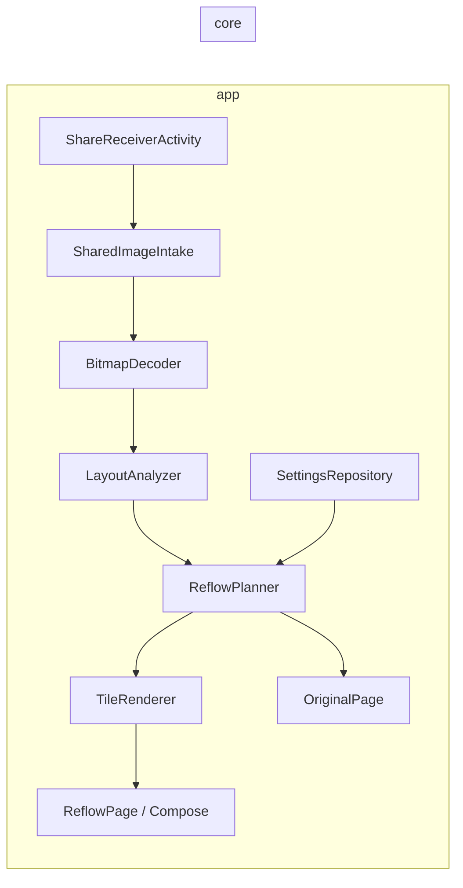
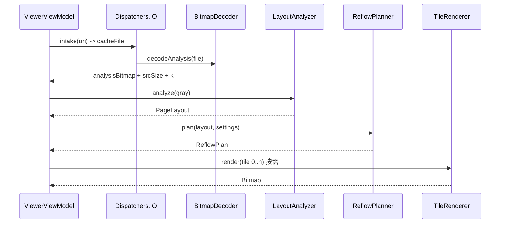

# 03 · 工程架构

> 本文是 **v1 基线**。v2 新增的 `core/layout/`、ORT 适配器、HTML 夹具与
> `PageLayout.regions` 见 [07 · V2 计划](07-v2-plan.md)；v1 的模块边界与渲染契约不变。

## 1. 模块划分

```
:app    Android 壳：入口、解码、渲染、Compose UI、存储
:core   纯 Kotlin/JVM：版面分析 + 重排计划。不 import android.*
:cli    JVM 命令行：把一张 PNG 跑成重排长图 + 调试图，用于调参与对拍
```

`core` 不依赖 Android 是硬约束：算法单测在 JVM 上跑，秒级反馈，不需要模拟器。



## 2. 目录

```
pictext/
├─ settings.gradle.kts
├─ build.gradle.kts
├─ gradle/libs.versions.toml
├─ core/
│  ├─ build.gradle.kts                     # kotlin("jvm")，无 Android
│  ├─ src/main/kotlin/app/pictext/core/
│  │  ├─ model/Geometry.kt                 # RectI / 坐标换算
│  │  ├─ model/GrayImage.kt
│  │  ├─ model/PageLayout.kt               # TextLine / Block / Paragraph / Figure / Diagnostics
│  │  ├─ model/ReflowPlan.kt               # RenderItem / PlanMode / FallbackReason / LayoutSummary(v2)
│  │  ├─ analyze/AnalysisOptions.kt
│  │  ├─ analyze/AnalysisScale.kt          # 宽度优先定标 + 是否需要切条带
│  │  ├─ analyze/LayoutAnalyzer.kt         # 编排 Step 1..8（必要时转 StripLayoutAnalyzer）
│  │  ├─ analyze/BackgroundEstimator.kt    # Step 2
│  │  ├─ analyze/Binarizer.kt              # Step 3 + Otsu
│  │  ├─ analyze/RowSegmenter.kt           # Step 4（含装饰列剔除、子区分块投影）
│  │  ├─ analyze/RowDecomposer.kt          # Step 4b 大带再分解
│  │  ├─ analyze/BlockClassifier.kt        # Step 5 + Step 6（含 v1.3 带内竖切）
│  │  ├─ analyze/BandRegionSplitter.kt     # v1.3 图文混排的区域级竖切
│  │  ├─ analyze/RowClassifier.kt          # 行级角色特征与判定
│  │  ├─ analyze/ColumnInk.kt              # 行内列墨剖面（字缝/劈词判定）
│  │  ├─ analyze/WordGapFinder.kt          # 拉丁/URL 安全切分（实验）
│  │  ├─ analyze/PageMetrics.kt            # Step 7
│  │  ├─ analyze/MultiColumnDetector.kt    # P1-4 多栏安全网
│  │  ├─ analyze/ColumnSplitter.kt         # Step 8
│  │  ├─ analyze/StripAnalysis.kt          # P2 条带分析 + 合并
│  │  ├─ plan/ReflowOptions.kt
│  │  ├─ plan/PlanGeometry.kt              # outW / inset / contentW（v1 与 v2 共用）
│  │  ├─ plan/ReflowPlanner.kt             # Step 9 + Step 10（v1，不引用 v2）
│  │  ├─ plan/PlanAudit.kt                 # 计划审计（块丢失/越界/倍率一致）
│  │  └─ util/{Runs.kt, Otsu.kt, MovingAverage.kt, Stats.kt, Grayscale.kt}
│  └─ src/test/kotlin/app/pictext/core/
│     ├─ TestSupport.kt                    # 灰度/合成页工具
│     ├─ BackgroundEstimatorTest.kt
│     ├─ RowSegmenterTest.kt
│     ├─ BlockClassifierTest.kt
│     ├─ ColumnSplitterTest.kt
│     ├─ ReflowPlannerTest.kt
│     ├─ GoldenTest.kt                     # 端到端，容忍 ±1px
│     └─ RealImageRegressionTest.kt        # 真实样例：目录在即必须全过
├─ cli/
│  └─ src/main/kotlin/app/pictext/cli/Main.kt
├─ app/
│  ├─ build.gradle.kts
│  └─ src/main/
│     ├─ AndroidManifest.xml
│     ├─ kotlin/app/pictext/
│     │  ├─ PicTextApp.kt
│     │  ├─ AppContainer.kt
│     │  ├─ home/MainActivity.kt
│     │  ├─ share/ShareReceiverActivity.kt
│     │  ├─ share/SharedImageIntake.kt
│     │  ├─ image/BitmapDecoder.kt
│     │  ├─ image/SourceImage.kt
│     │  ├─ image/SourceStripCache.kt
│     │  ├─ image/ViewportImageLoader.kt
│     │  ├─ render/TileRenderer.kt
│     │  ├─ ui/home/HomeScreen.kt
│     │  ├─ ui/viewer/ViewerScreen.kt
│     │  ├─ ui/viewer/ViewerViewModel.kt
│     │  ├─ ui/viewer/ViewerUiState.kt
│     │  ├─ ui/viewer/ReflowPage.kt
│     │  ├─ ui/viewer/OriginalPage.kt
│     │  ├─ ui/viewer/FigureDialog.kt
│     │  ├─ ui/viewer/TopBar.kt / BottomBar.kt   （v1.1：底栏 = 缩放 ×0.5/×2 + 切分 chip + 进度）
│     │  ├─ ui/theme/{Color.kt, Theme.kt, Type.kt}
│     │  ├─ data/SettingsRepository.kt
│     │  └─ data/ProgressStore.kt
│     └─ res/{values/strings.xml, values/themes.xml, mipmap-*/...}
└─ docs/
```

## 3. 依赖与版本

`gradle/libs.versions.toml`：

```toml
[versions]
agp = "8.7.3"
kotlin = "2.0.21"
composeBom = "2024.10.01"
coreKtx = "1.15.0"
activityCompose = "1.9.3"
lifecycle = "2.8.7"
datastore = "1.1.1"
coroutines = "1.9.0"
junit = "4.13.2"
androidxTest = "1.6.1"
espresso = "3.6.1"

[libraries]
androidx-core-ktx = { module = "androidx.core:core-ktx", version.ref = "coreKtx" }
androidx-activity-compose = { module = "androidx.activity:activity-compose", version.ref = "activityCompose" }
androidx-lifecycle-viewmodel-compose = { module = "androidx.lifecycle:lifecycle-viewmodel-compose", version.ref = "lifecycle" }
androidx-lifecycle-runtime-compose = { module = "androidx.lifecycle:lifecycle-runtime-compose", version.ref = "lifecycle" }
androidx-datastore-preferences = { module = "androidx.datastore:datastore-preferences", version.ref = "datastore" }
compose-bom = { module = "androidx.compose:compose-bom", version.ref = "composeBom" }
compose-ui = { module = "androidx.compose.ui:ui" }
compose-material3 = { module = "androidx.compose.material3:material3" }
compose-ui-tooling-preview = { module = "androidx.compose.ui:ui-tooling-preview" }
compose-ui-test-junit4 = { module = "androidx.compose.ui:ui-test-junit4" }
kotlinx-coroutines-android = { module = "org.jetbrains.kotlinx:kotlinx-coroutines-android", version.ref = "coroutines" }
junit = { module = "junit:junit", version.ref = "junit" }
androidx-test-core = { module = "androidx.test:core", version.ref = "androidxTest" }
androidx-test-runner = { module = "androidx.test:runner", version.ref = "androidxTest" }
espresso-core = { module = "androidx.test.espresso:espresso-core", version.ref = "espresso" }
```

**显式不引入**：OpenCV、ML Kit、Coil、Hilt、Room、Retrofit、WorkManager、任何图片加载库。
所有版本以仓库实际可用为准；如果某个版本拉不下来，允许升小版本，不允许换技术栈。

### 3.1 构建配置要点

- `core`：`kotlin("jvm")` + `jvmToolchain(17)`，target 17；
- `app`：`compileSdk 35`、`minSdk 26`、`targetSdk 35`、`buildFeatures.compose = true`、`composeOptions` 不需要（Kotlin 2.0 用 `org.jetbrains.kotlin.plugin.compose`）；
- `release` 开 `isMinifyEnabled = true` + `isShrinkResources = true`；
- 无 NDK、无 `abiFilters`——因为没有 native 库；
- `packaging.resources.excludes += "/META-INF/{AL2.0,LGPL2.1}"`。

## 4. 核心接口

```kotlin
// ---------- model/Geometry.kt
data class RectI(val left: Int, val top: Int, val right: Int, val bottom: Int) {
    val width: Int get() = right - left
    val height: Int get() = bottom - top
    fun scale(f: Float): RectI
    fun intersect(o: RectI): RectI
    companion object { val EMPTY = RectI(0, 0, 0, 0) }
}

// ---------- model/GrayImage.kt
class GrayImage(val width: Int, val height: Int, val data: ByteArray) {
    operator fun get(x: Int, y: Int): Int = data[y * width + x].toInt() and 0xFF
}

// ---------- model/PageLayout.kt
data class TextLine(
    val band: RectI,        // A 坐标：行带（y 范围 + 墨迹 x 范围）
    val cutX: Int,          // A 坐标：该行的切点；-1 表示不切
    val split: Boolean,
    val centered: Boolean,
)

sealed interface Block {
    val bounds: RectI
    data class Paragraph(val lines: List<TextLine>) : Block {
        override val bounds: RectI get() = lines.fold(RectI.EMPTY) { acc, l -> acc.union(l.band) }
    }
    data class Figure(override val bounds: RectI) : Block
}

data class Diagnostics(
    val inkPixels: Int = 0,
    val inkThreshold: Int = 0,
    val rowCount: Int = 0,
    val figureCount: Int = 0,
    val cleanRatio: Float = 0f,
    val notes: List<String> = emptyList(),
)

data class PageLayout(
    val srcWidth: Int,
    val srcHeight: Int,
    val analysisScale: Float,      // k = analysisW / srcW
    val blocks: List<Block>,
    val textLeft: Int,             // A
    val textRight: Int,            // A
    val splitX: Int,               // A
    val cleanRatio: Float,
    val medianLineHeight: Float,   // A
    val medianGap: Float,          // A
    val medianPitch: Float,        // A
    val isDark: Boolean,
    val backgroundColor: Int,      // ARGB
    val diagnostics: Diagnostics,
) {
    fun toSource(r: RectI): RectI  // A -> S，向外取整
}

// ---------- model/ReflowPlan.kt
enum class PlanMode { REFLOW, NO_SPLIT, ORIGINAL }

enum class FallbackReason {
    NONE, NO_INK, NO_TEXT, TOO_FEW_LONG_LINES, WEAK_CUT, GAIN_TOO_SMALL, TOO_TALL
}

sealed interface RenderItem {
    val src: RectI      // S 坐标
    val dest: RectI     // O 坐标
    data class TextRow(override val src: RectI, override val dest: RectI, val lineIndex: Int) : RenderItem
    data class Figure(override val src: RectI, override val dest: RectI, val blockIndex: Int) : RenderItem
}

data class ReflowPlan(
    val outputWidth: Int,
    val height: Int,
    val scale: Float,
    val gain: Float,
    val mode: PlanMode,
    val fallback: FallbackReason,
    val items: List<RenderItem>,
    val tileHeightPx: Int = 1024,
    val notes: List<String> = emptyList(),
) {
    val tileCount: Int get() = (height + tileHeightPx - 1) / tileHeightPx
    fun tileTop(i: Int) = i * tileHeightPx
    fun tileHeight(i: Int) = minOf(tileHeightPx, height - tileTop(i))
}
```

```kotlin
// ---------- 分析入口
class LayoutAnalyzer(private val options: AnalysisOptions = AnalysisOptions()) {
    fun analyze(image: GrayImage, srcWidth: Int, srcHeight: Int): PageLayout
}

class ReflowPlanner {
    fun plan(layout: PageLayout, options: ReflowOptions): ReflowPlan
}
```

约定：

- `PageLayout` 里的所有坐标是 **A**；
- `RenderItem.src` 是 **S**（由 planner 用 `analysisScale` 换算，`floor(left/k)`…`ceil(right/k)`）；
- `RenderItem.dest` 是 **O**；
- 分析器是纯函数，线程安全；planner 同理。

## 5. 会话生命周期

```kotlin
class DocumentSession(
    val id: String,
    val sourceFile: File,
    val sourceImage: SourceImage,
) : Closeable {
    var layout: PageLayout? = null
    var plan: ReflowPlan? = null
    var renderer: TileRenderer? = null
    var planVersion: Int = 0          // 改字号/切分方式后自增，触发瓦片重渲染
    override fun close() { sourceImage.close() }
}
```



- 分析在 `Dispatchers.Default`，解码/拷贝在 `Dispatchers.IO`；
- 设置变化只重跑 planner + 重渲染，**不重跑分析**；
- 页面销毁时 `session.close()`，`BitmapRegionDecoder` 必须释放。

## 6. 渲染

### 6.1 为什么不做一整张长图

1080 × 3738 的 ARGB 位图 16MB，勉强能开；1080 × 20000 就是 86MB，必 OOM。重排后的文档长度是原图的 2–3 倍，长图场景轻松破两万像素。所以：

- 计划里只存 **渲染项**（源矩形 + 目标矩形），不存像素；
- 阅读页按 **1024px 高的瓦片** 按需渲染；
- 一屏最多同时存在 3 张瓦片（约 13MB）。

### 6.2 TileRenderer

```kotlin
class TileRenderer(
    private val layout: PageLayout,
    private val plan: ReflowPlan,
    private val source: SourceImage,
    private val strips: SourceStripCache,
    private val backgroundColor: Int,
) {
    private val mutex = Mutex()

    suspend fun render(tileIndex: Int): Bitmap = mutex.withLock {
        withContext(Dispatchers.Default) {
            val top = plan.tileTop(tileIndex)
            val h = plan.tileHeight(tileIndex)
            val canvasBitmap = Bitmap.createBitmap(plan.outputWidth, h, Bitmap.Config.ARGB_8888)
            val canvas = Canvas(canvasBitmap).apply { drawColor(backgroundColor) }
            val tileRect = RectI(0, top, plan.outputWidth, top + h)
            for (item in itemsIntersecting(tileRect)) {
                drawItem(canvas, item, top, strips)
            }
            canvasBitmap
        }
    }
}
```

`drawItem`：

```kotlin
val dst = item.dest.offset(dy = -tileTop)
val strip = strips.stripFor(item.src.top)         // 按需解码 + LRU
val bmp = strip.bitmap
val srcRect = strip.toBitmapRect(item.src)        // 处理 sample 与条带偏移
val paint = Paint(Paint.FILTER_BITMAP_FLAG or Paint.ANTI_ALIAS_FLAG)
canvas.drawBitmap(bmp, srcRect, dst.toAndroidRect(), paint)
```

要点：

- **先清屏再画**：瓦片底色 = 源图背景色，未覆盖区域不会闪白；
- **一个 item 跨两条条带**时，分两次 `drawBitmap`，各自裁剪 `srcRect`；
- 条带解码失败（越界 1px 之类）→ 用背景色填充，不抛异常；
- `itemsIntersecting` 用二分查找 `dest.top`，不要线性扫全部 items。

### 6.3 SourceStripCache

```kotlin
class SourceImage(file: File) : Closeable {
    val width: Int; val height: Int
    @Synchronized fun decodeRegion(src: RectI, sample: Int): Bitmap?
}

class SourceStripCache(
    private val source: SourceImage,
    private val stripSrcHeight: Int = 512,
    maxBytes: Int = 32 * 1024 * 1024,
) {
    fun stripFor(srcY: Int): Strip
}

class Strip(val srcTop: Int, val sample: Int, val bitmap: Bitmap) {
    fun toBitmapRect(src: RectI): Rect
}
```

- 目标解码宽度 `targetW = clamp(srcW, 1.5 × outW, 2400)`；`sample` 取最大的 2 的幂且 `srcW / sample ≥ targetW`。
  这样 1080 的输出至少有 1.5 倍源像素，也不会为 8000px 的扫描件解出 8000px 宽的条带；
- 条带按 `srcY / 512` 编号，LRU 上限 32MB；
- `BitmapRegionDecoder` 不是线程安全的，`decodeRegion` 必须加锁；
- 所有解码都走 `try/catch (OutOfMemoryError)` → 降级 `sample × 2` 重试一次 → 仍失败则返回底色。

### 6.4 阅读页 Compose 结构

```kotlin
@Composable
fun ReflowPage(session: DocumentSession, plan: ReflowPlan, modifier: Modifier) {
    val listState = rememberLazyListState()
    LazyColumn(state = listState, modifier = modifier) {
        items(plan.tileCount) { index ->
            val density = LocalDensity.current
            val h = plan.tileHeight(index)
            TileImage(
                session = session,
                index = index,
                modifier = Modifier.fillMaxWidth().height(with(density) { h.toDp() })
            )
        }
    }
}
```

```kotlin
@Composable
private fun TileImage(session: DocumentSession, index: Int, modifier: Modifier) {
    val bitmap by produceState<Bitmap?>(null, index, session.planVersion) {
        value = session.renderer.render(index)
    }
    Box(modifier.background(Color(session.plan.backgroundColor))) {
        bitmap?.let {
            Image(bitmap = it.asImageBitmap(), contentDescription = null,
                  modifier = Modifier.fillMaxSize(),
                  contentScale = ContentScale.FillWidth,
                  filterQuality = FilterQuality.Medium)
        }
    }
}
```

- `produceState` 在 item 滚出屏幕时自动取消，避免快速滑动时堆积任务；
- **必须回收位图**：`DisposableEffect(bitmap)` 里把组合期取到的旧位图 `recycle()`（0.2.2 起）。
  ×4 的瓦片 1080×1024 一张约 4MB，只靠 GC 的话快速滚动会把几十张丢给 finalizer，
  低内存机器直接 OOM。注意写成 `val held = bitmap; onDispose { held.recycle() }`——
  直接在 `onDispose` 里读 `bitmap` 会读到已经替换后的新值，把正在显示的那张回收掉；
- 高度用 px → dp 精确换算，**不要** `wrapContent`，否则瓦片之间会出现 1px 缝；
- 瓦片之间没有 `Arrangement.spacedBy`，间距都烘焙在计划里。

### 6.4b 重排模式的双指缩放

字号是计划的一部分，所以缩放也走“重新规划”而不是缩放画布：

```kotlin
// ReflowPage：Initial pass 只消费“两指以上”的事件，单指滚动/翻页不受影响
awaitEachGesture {
    awaitFirstDown(requireUnconsumed = false, pass = PointerEventPass.Initial)
    ... event.calculateZoom() → factor.coerceIn(minFactor, maxFactor) → preview = factor
}
```

- 手势期间 `graphicsLayer(scaleX = preview)` 做临时放大（即时反馈，不重新排版）；
- 松手后把目标倍率 `(当前倍率 × factor)` 夹到 `[1.0, 2.0]` 交给 ViewModel：
  `level.baseMultiplier × zoom` 决定 `scaleMultiplier`，`replanAll()` 重新排版；
- 倍率上限 2.0 = ×4：再往上一条满宽行要切 5 段以上，二次重排只能压小字号；
- 到达两端时档位一起切过去（1.0 → ×2，2.0 → ×4），底栏高亮才跟得上。

### 6.5 原图模式

不能把整张图解码进内存。做法是**视口解码**：

```kotlin
class ViewportImageLoader(private val source: SourceImage) {
    /**
     * @param scale  相对"按屏宽显示"的缩放，1..5
     * @param offset 视口在缩放后图像中的偏移（px）
     * @param viewport 视口尺寸（px）
     */
    suspend fun load(scale: Float, offset: Offset, viewport: IntSize, maxPx: Int = 2048): Bitmap?
}
```

- 手势进行中：只对上一张位图做 `graphicsLayer` 变换，不重新解码；
- 手势结束 120ms 后（`snapshotFlow().debounce`）：按当前视口解码一块新的位图，尺寸 ≤ 2048×2048；
- 缩放上限 5×；低于 1× 回弹；
- **拖动方向**：`offset` 是“视口左上角在缩放后图像上的位置”，画面画在 `-offset` 处，
  所以 `detectTransformGestures` 的 `pan` 要**减**掉（`offset - pan`）。加 pan 会变成
  手指往右、画面往左的镜像拖动；缩放部分仍按“两指中点为锚点”计算：
  `offset' = (offset + centroid) × factor - centroid - pan`；
- **上下留白**：与原图页一致，`padding(top = statusTop + 56.dp, bottom = navBottom + 56.dp)`，
  顶栏出现时不会压住图片；顶栏/底栏都可以点正文收起（`Visible = state.showBars`）；
- **位图回收**：新的视口帧到达时回收上一帧（同样把值取成局部变量再 `onDispose`），
  反复缩放/拖动不会把整屏位图堆在 finalizer 里；解码失败只显示转圈，不让异常冒到 Compose；
- 图块全屏复用同一个类，只是把 `source` 的可见范围限定为图块矩形。

### 6.6 渲染耗时

| 操作 | 目标 |
|---|---|
| 单张瓦片（30 行 + 1 图块） | < 25ms |
| 首屏（分析 + tile 0） | < 500ms |
| 改字号后首屏 | < 250ms |

不做磁盘瓦片缓存：重渲染一屏约 25ms，缓存带来的失效逻辑不值得。

## 7. 存储

```
cacheDir/
  inbox/<uuid>.<ext>          # 分享进来的源图副本；启动时清理 7 天前的文件
filesDir/
  datastore/settings.preferences_pb
  progress.json               # 阅读位置（P1 可用）
```

- 不写外部存储；
- 不申请任何存储权限；
- 导出用 SAF：`ActivityResultContracts.CreateDocument("image/png")`；
- 启动时清理：`inbox` 里 `lastModified < now - 7d` 的文件直接删。

## 8. 权限与清单

```xml
<uses-permission android:name="android.permission.INTERNET" /> <!-- 不要加 -->
```

最终清单里**只有**以下内容：

```xml
<manifest ...>
    <application
        android:name=".PicTextApp"
        android:allowBackup="false"
        android:icon="@mipmap/ic_launcher"
        android:label="@string/app_name"
        android:supportsRtl="true"
        android:theme="@style/Theme.PicText">
        <activity
            android:name=".home.MainActivity"
            android:exported="true"
            android:theme="@style/Theme.PicText">
            <intent-filter>
                <action android:name="android.intent.action.MAIN" />
                <category android:name="android.intent.category.LAUNCHER" />
            </intent-filter>
        </activity>
        <activity
            android:name=".share.ShareReceiverActivity"
            android:exported="true"
            android:launchMode="singleTask"
            android:theme="@style/Theme.PicText.Transparent">
            <intent-filter>
                <action android:name="android.intent.action.SEND" />
                <category android:name="android.intent.category.DEFAULT" />
                <data android:mimeType="image/*" />
            </intent-filter>
            <intent-filter>
                <action android:name="android.intent.action.SEND_MULTIPLE" />
                <category android:name="android.intent.category.DEFAULT" />
                <data android:mimeType="image/*" />
            </intent-filter>
        </activity>
    </application>
</manifest>
```

- 没有 `INTERNET` → 系统层面保证不联网，这是最好的隐私声明；
- 没有 `READ_MEDIA_IMAGES` / `READ_EXTERNAL_STORAGE` → 分享进来的 URI 自带临时读权限；
- `allowBackup=false`，避免把用户图片备份到云。

### 8.1 接收 intent

```kotlin
val uris: List<Uri> = when (intent.action) {
    Intent.ACTION_SEND -> listOfNotNull(intent.getParcelableExtra(Intent.EXTRA_STREAM, Uri::class.java))
    Intent.ACTION_SEND_MULTIPLE -> intent.getParcelableArrayListExtra(Intent.EXTRA_STREAM, Uri::class.java).orEmpty()
    else -> emptyList()
}.take(5)
```

- API 33+ 用带类型的 `getParcelableExtra`，低版本用兼容重载；
- `singleTask` 意味着**应用已打开时再次分享会走 `onNewIntent`**：必须在那里重新 intake、重置页码与滚动位置，否则用户会看到上一张图；
- 拷贝时用 `contentResolver.openInputStream(uri)`，目标文件名 `UUID.randomUUID() + 扩展名`（扩展名从 MIME 推）；
- 拷贝失败（来源 App 已退出、URI 失效）→ 错误态，不崩溃。

## 9. 状态与错误

```kotlin
enum class ViewerMode { REFLOW, ORIGINAL }

sealed interface ViewerUiState {
    data object Loading : ViewerUiState
    data class Ready(
        val pages: List<PageState>,
        val current: Int,
        val showBars: Boolean,
    ) : ViewerUiState
    data class Failed(val kind: FailureKind) : ViewerUiState
}

data class PageState(
    val key: String,              // 源图内容 SHA-256，用于阅读进度
    val mode: PlanMode,
    val plan: ReflowPlan?,
    val fallback: FallbackReason,
    val loading: Boolean,
    val failure: FailureKind?,
    val progress: Float,
    val version: Int,             // 重新规划后自增，瓦片按它重渲染
    val multiplier: Float,        // 生成当前计划时的重排倍率（1.0 = ×2，2.0 = ×4）
)
```

错误分类：

| FailureKind | 触发 | UI |
|---|---|---|
| `UNREADABLE` | URI 打不开 | 错误页 + 重试 |
| `UNSUPPORTED_FORMAT` | HEIF on API 26 | 错误页 + 说明 |
| `DECODE_FAILED` | OOM / 损坏 | 错误页 + 重试（降采样重试一次） |
| `INTERNAL` | 未捕获异常 | 错误页 + "反馈"（本地日志路径） |

**所有异常必须收敛到 `Failed`，禁止让异常冒到 Compose。**

## 10. 设置

```kotlin
enum class SplitMode { AUTO, FORCE_TWO, OFF }

data class AppSettings(
    val targetSp: Float = 16f,                 // 14 / 16 / 18，规划时换算成 px
    val splitMode: SplitMode = SplitMode.AUTO, // AUTO / FORCE_TWO / OFF
    val rememberProgress: Boolean = true,
)
```

- DataStore Preferences，`Flow<AppSettings>`；
- **0.5 起没有设置面板**：字号与切分方式固定为默认值（16sp / AUTO），由底栏三档
  （原图 / ×2 / ×4）取代（见 [01 §6](01-product.md)）。`AppSettings` 仍然从 DataStore 读取，
  旧版本存下的值继续生效；仓库里不再有写入路径，改设置后重规划的逻辑保留在 ViewModel 里；
- `FORCE_TWO`：忽略长行门槛，所有非居中 BODY/HEADING 行都切（用于调试/特殊版面）；
- `OFF`：只放大不切（`PlanMode.NO_SPLIT`）；注意它同时会跳过 `minGain` 回退，
  见 [02 §13](02-algorithm.md) 的 G5；
- 修改后 `planVersion++`，触发重新规划与瓦片重渲染。

## 11. 并发

| 任务 | 调度器 | 取消 |
|---|---|---|
| 拷贝 URI | IO | 页面销毁 |
| 解码分析图 | Default | 页面销毁 |
| 分析 | Default | 页面销毁 |
| 规划 | Default（极快，可直接调用） | — |
| 瓦片渲染 | Default + `Mutex` | item 滚出屏幕 |
| 视口解码 | Default + `Mutex` | 手势结束前的新请求 |

瓦片渲染串行化：多个瓦片同时解码条带会打爆内存，`Mutex` 让它们排队；排队中的请求若已被取消，直接返回。

## 12. 导出（P1）

- `导出为图片`：按 12000px 高度切段，每段渲染成一张 PNG，逐个写入 SAF 创建的目录（`ACTION_OPEN_DOCUMENT_TREE`）或让用户选一个文件后追加序号；
- `导出为 PDF`：`PdfDocument`，每 2000px 输出一页，页面尺寸 = 1080×2000 pt（阅读器会按宽度适配）；
- 导出过程显示进度条，可取消；
- 导出**复用 TileRenderer**，不写第二套渲染逻辑。

## 13. 历史记录（P1）

- `filesDir/history.json`，字段 `{id, fileName, srcW, srcH, addedAt}`；
- 缩略图不落盘：列表用 `SourceImage.decodeRegion` 解 200px 高的条带；
- 最多 20 条，超出删最旧；源文件被清理时对应记录也删。

## 14. 构建与产物

- `./gradlew :core:test`：算法单测（CI 必跑；`testdata/samples/` 存在时会连带跑真实图回归）
- `./gradlew :core:longPageMemoryTest`：长图内存回归（1080×20000 @ `-Xmx96m`，`:check` 已挂）
- `./gradlew :cli:run --args="in.png out/ --out-width 1080"`：桌面调参
- `./gradlew :app:assembleDebug`
- `./gradlew :app:assembleRelease`：开 R8，检查 APK < 8MB
- `scripts/verify.ps1`：一键（单测 + debug 构建）
- `scripts/verify-v1-only.ps1`：一键（release 构建 + v1-only 门禁，见 14.2）

### 14.1 签名（v1.1）

签名材料**不进仓库**：

| 文件 | 位置 | 说明 |
|---|---|---|
| `pictext-release.jks` | `D:\SRC\keys\`（仓库外） | 私钥。换掉它 = 老用户必须卸载重装，务必离线备份 |
| `keystore.properties` | 仓库根目录，已被 `.gitignore` 忽略 | `storeFile / storePassword / keyAlias / keyPassword` |

`app/build.gradle.kts` 读取 `keystore.properties` 建 `signingConfigs.release` 并挂到 release
构建类型上，所以 `:app:assembleRelease` **一步产出已签名 APK**（`app-release.apk`）。
文件不存在时（别人 clone 下来）只是退回未签名产物，不会让构建失败。

口令用 `keytool -storepasswd -keystore … -storepass <旧> -new <新>` 轮换；改口令只保护文件本身，
**私钥一旦外泄就必须换新 keystore**（私钥在文件里，改口令不能挽回）。
对外的正式发版建议另配一把新钥匙 + Google Play 的 Play App Signing。

### 14.2 v1-only 发布口径（0.5.1）

v2（版面模型那一套）**只留在 `:core` / `:cli` 做技术验证，不进入发行包**。这条约束由两道
机检保证，不是靠"记得别引用"：

| 检查 | 手段 | 失败表现 |
|---|---|---|
| 代码不可达 | v1 的 `ReflowPlanner` **不引用** `ReflowPlannerV2`；v1/v2 分流在 `SmartReflow`（只有 CLI 用） | 若有人把 v2 分支加回 v1 planner，R8 会把 v2 整条链路保留下来，第二道检查报错 |
| 产物不含 v2 | `scripts/verify-v1-only.ps1`：`classes.dex` 不得出现 v2 专有常量；R8 `mapping.txt` 不得出现 v2 业务类 | 门禁直接失败并列出命中的类/常量 |

允许残留的只有被 v1 模型字段引用的**类型**（当前实际只剩 `LayoutStrategy` / `CutKind` 两个枚举，
没有方法体逻辑）；`LayoutPipeline`、`CutPolicy`、`CoverageAuditor`、`ReflowPlannerV2` 等
都会整类消失。APK 实测 1.19MB（0.5 之前的 v2 包是 24.59MB）。

**注意**：这只保证 release 产物；`assembleDebug` 不做 R8，debug 包里仍能看到 v2 代码。

## 15. 为什么不用 Hilt / Room / Coil

| 库 | 不用的理由 |
|---|---|
| Hilt | 只有 3 个单例，`AppContainer` 手写 20 行；引入 KSP 会让构建慢一倍 |
| Room | 唯一的持久化是"设置 + 最多 20 条历史"，DataStore + JSON 足够；避免 schema 迁移负担 |
| Coil | 瓦片是我们自己渲染的 `Bitmap`，不是 URL；原图是本地文件且需要视口解码，Coil 的尺寸策略反而碍事 |

依赖越少，agent 写出来的东西越可预测。
