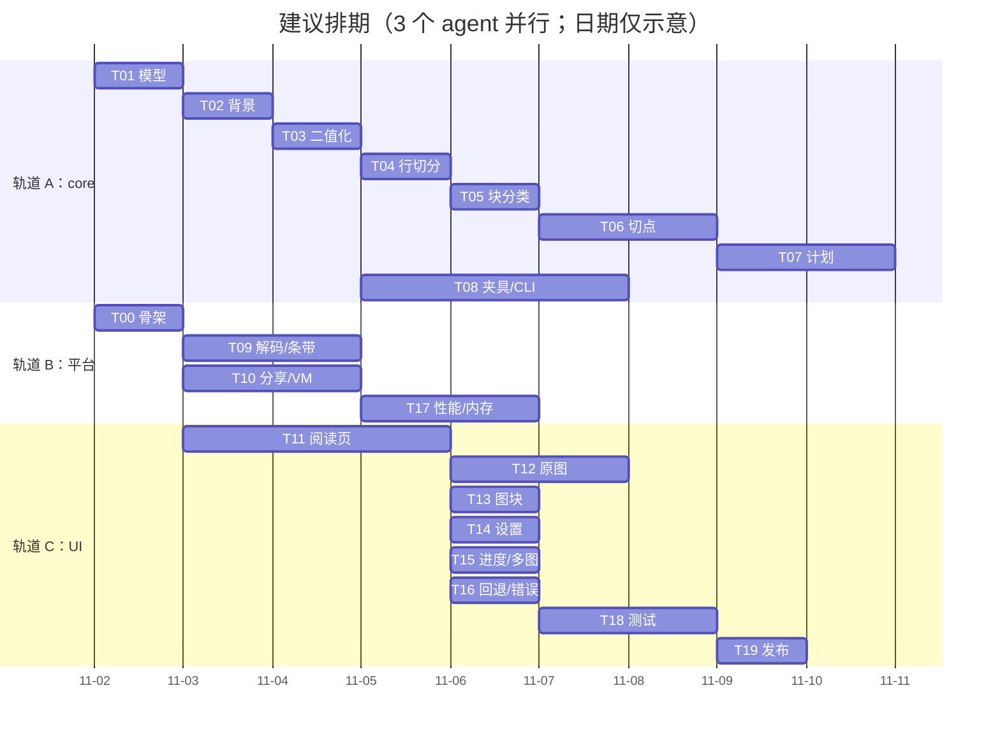

# 04 · 实施计划（交给你安排的 agent）

> **本文是 2026-10 的初始实施计划（历史文档）。** T00–T19 大部分已落地，但其中的接口签名、
> 文件清单与页面交互按"当时的计划"写，**与现状不一定一致**：
> - 接口与参数以 [02 算法](02-algorithm.md)、[03 架构](03-architecture.md) **和代码**为准；
> - 页面与交互以 [01 产品](01-product.md) 为准（例如 T14 的"设置面板"后来被底栏三档取代）；
> - 文中提到的 `closePage` / `SyntheticPage.kt` / `ui/settings/SettingsSheet.kt` 都不存在，
>   不要照着找文件。
>
> 保留本文是为了记录当时的任务切分与验收口径，不要把它当现状说明书。

## 0. 怎么用这份计划

- 每个任务卡是**一个可独立验收的 PR**，按 ID 顺序做，依赖列里没有的任务可以并行；
- 卡里的"验收"是硬门槛，不通过不算完成；
- 接口在 [03 架构](03-architecture.md#4-核心接口) 里已经冻结，实现可以改内部，签名不要改；确需改动，在 PR 描述里写清楚并同步文档；
- **不许新增第三方依赖**（包括"就一个很小的库"）；
- 不许改 `docs/02-algorithm.md` 里的参数默认值来"让测试通过"——要改先改黄金基线并说明理由。

先读：`README.md` → `00-overview.md` → `02-algorithm.md`，然后跑一遍原型。

```bash
python prototype/reflow_prototype.py --make-fixture
# 看 prototype/out/compare_main.png、debug_main.png
```

## 1. 里程碑

| 里程碑 | 内容 | 出口条件 |
|---|---|---|
| M0 | 工程骨架 | `assembleDebug` 成功，空壳 App 能装能开 |
| M1 | 算法核心 | `:core:test` 全绿；CLI 能从 fixture 生成重排 PNG，数值与原型一致 |
| M2 | 端到端打通 | 从相册分享一张图 → 看到重排结果（UI 可以丑） |
| M3 | 阅读体验 | 顶底栏、原图、图块全屏、设置、多图全部可用 |
| M4 | 健壮与性能 | 20 张真实截图通过；长图不 OOM；失败必降级 |
| M5 | 发布 | release APK < 8MB，图标/文案/隐私声明齐备 |



总工作量约 15 个 agent-day；三轨并行约 6–7 个自然日。

## 2. 并行边界（防冲突）

| 轨道 | 拥有这些文件 | 不碰 |
|---|---|---|
| A core | `core/**`、`cli/**`、`prototype/**` | `app/**` |
| B 平台 | `app/src/main/kotlin/app/pictext/{image,share,data,render,home}/**`、`AppContainer.kt`、`AndroidManifest.xml` | `app/ui/**`（`ui/viewer/ViewerUiState.kt` 由 B 在 T00 一次性创建后交给 C） |
| C UI | `app/src/main/kotlin/app/pictext/ui/**`、`app/src/main/res/**` | `core/**`、`image/**`、`data/**` |

共享文件 `ViewerViewModel.kt` 由 B 在 T10 里**先提交接口 + 假实现**，C 按接口写 UI，B 再补实现。接口如下，先冻结：

```kotlin
class ViewerViewModel : ViewModel() {
    val state: StateFlow<ViewerUiState>
    fun open(uris: List<Uri>)
    fun setMode(mode: ViewerMode)            // REFLOW / ORIGINAL
    fun setTargetSp(sp: Float)
    fun setSplitMode(mode: SplitMode)
    fun setCurrentPage(index: Int)
    fun closePage(index: Int)
    fun retry()
}
```

C 需要的 `ViewerUiState` / `PageState` 见 03 文档第 9 节，T00 里先把这些 data class 建出来。

---

## M0 · 工程骨架

### T00 初始化三模块工程

**目标**：能 `assembleDebug`、能跑空 Compose 页面、`:core:test` 能跑。

**产出**
```
settings.gradle.kts
build.gradle.kts
gradle/libs.versions.toml
core/build.gradle.kts
app/build.gradle.kts
app/src/main/AndroidManifest.xml
app/src/main/kotlin/app/pictext/PicTextApp.kt
app/src/main/kotlin/app/pictext/AppContainer.kt
app/src/main/kotlin/app/pictext/ui/theme/{Color,Theme,Type}.kt
app/src/main/kotlin/app/pictext/ui/viewer/ViewerUiState.kt   // 只放 data class
app/src/main/kotlin/app/pictext/share/ShareReceiverActivity.kt // 空壳，只显示 "ok"
app/src/main/kotlin/app/pictext/home/MainActivity.kt          // 空壳首页
app/src/main/kotlin/app/pictext/ui/home/HomeScreen.kt         // 空壳，一个标题
app/src/main/res/values/{strings.xml,themes.xml}
```

**要点**
- 版本与依赖严格按 03 文档第 3 节；
- `core` 用 `kotlin("jvm")`，`jvmToolchain(17)`；
- `app` 的 `minSdk 26 / compileSdk 35 / targetSdk 35`；
- `android:theme` 用 `Theme.Material3.DayNight.NoActionBar` 的桥接，Compose 里用 `PicTextTheme`；
- 建一个 `scripts/verify.ps1`（或 `.sh`）：`./gradlew :core:test :app:assembleDebug`。

**验收**
```bash
./gradlew :core:test          # BUILD SUCCESSFUL（0 个测试也算过）
./gradlew :app:assembleDebug  # 产出 apk
```
- 装到真机/模拟器，桌面图标能打开，显示一个 "图读" 占位页；
- 从相册分享任意图片给它，能打开并显示 "收到了 1 张图"。

---

## M1 · 算法核心

### T01 数据模型与几何工具

**目标**：把 03 文档第 4 节的 `RectI`、`GrayImage`、`TextLine`、`Block`、`PageLayout`、`RenderItem`、`ReflowPlan`、枚举全部落地，带 KDoc。

**产出**：`core/model/*.kt`、`core/util/Runs.kt`（`runsOf(BooleanArray): List<IntRange>`）。

**验收**：`./gradlew :core:test --tests "*Geometry*"`；
- `RectI.union/intersect/offset/scale` 的边界测试（空矩形、负偏移、越界）；
- `runsOf` 对 `[]`、`[true]`、`[true,true,false,true]` 的断言。

**注意**：这一步不要写算法，只写模型。模型稳了后面才不返工。

---

### T02 灰度与背景曲面

**目标**：实现 `BackgroundEstimator`：输入 `GrayImage`，输出 `bg: FloatArray`（或 `ByteArray`）+ `isDark` + `ink: ByteArray`。

**产出**：`core/analyze/BackgroundEstimator.kt`、`core/analyze/BackgroundEstimatorTest.kt`。

**实现**：严格按 02 文档第 5 节；参数来自 `AnalysisOptions`。

**验收**（单测，手工构造小图，16×16 就够）：
1. 纯白图 → `isDark=false`，`ink` 全 0；
2. 纯黑图 → `isDark=true`，`ink` 全 0；
3. 白底 + 中间一块 20×20 的深色方块 → 方块内部 `ink > 100`（这一条专门防"深色图块被吃成背景"）；
4. 白底 + 10% 的浅灰卡片（`0xF4`）→ 卡片内部 `ink < 5`，卡片上的黑字 `ink > 100`；
5. 水平亮度渐变（100→255）+ 黑字 → 黑字的 `ink` 在左侧和右侧都 > 80。

**风险**：分位数实现要排序，块内最多 1024 个值，用计数排序；不要 `sortedArray()` 反复分配。

---

### T03 Otsu、二值化与清洗

**目标**：`Binarizer`：输入 `ink`，输出 `mask: BooleanArray`（或 `ByteArray` 0/1）+ 阈值。

**实现**：02 文档第 6 节。`t = clamp(otsu(ink), 12, 80)`；8 邻域孤立点清除。

**验收**
1. 合成双峰直方图（0 与 200 各一半）→ `otsu ≈ 100`；
2. 全 0 图 → 阈值取 floor=12，`mask` 全 false，不崩；
3. 一个 3×3 的孤立亮点 → 被清掉；
4. 一条 1px 粗的横线（长 50）→ **保留**（这是中文"一"字，不能清）。

---

### T04 行切分

**目标**：`RowSegmenter`：`mask` → `List<RowBand>`（y0/y1/x0/x1/inkCount）。

**实现**：02 文档第 7 节。注意：
- 阈值用绝对墨量 `max(3, 0.003*W)`；
- 先平滑 `[1,1,1]/3` 再比较；
- 合并间距 `maxGap = 0.45 * medH`，过滤 `h < 0.35*medH`。

**验收**（在 T08 的合成页上，也可用小图构造）：
1. 3 行等距黑条 → 3 个 band，y 范围误差 ≤ 1px；
2. 行间加一条 2px 的噪声线（墨量 < 阈值）→ 不产生 band；
3. 一行图注（墨量是正文的 1/5）→ **必须被检出**（专门防相对阈值回归）；
4. 上下结构的字（某行中间有 1px 水平空白）→ 合并成一个 band。

---

### T05 块分类与非文字块处理

**目标**：`BlockClassifier`：`List<RowBand>` + `mask` + `vrun` → `List<Block>`，完成图文分类、图块合并、边界扩张。

**实现**：02 文档第 8、9 节。

**验收**：
1. 正文行 + 一条 150px 高的实心柱 → 柱判 FIGURE，正文判 TEXT；
2. 一张 200×200 的照片（中间有一行浅色天空被切成两段）→ 合并为一个 FIGURE；
3. 浅灰卡片（`0xF4`）上的柱状图 → 扩张后 `bounds` 覆盖整张卡片（误差 ≤ 4px）；
4. 48px 的大标题（正文 22px）→ 仍判 TEXT（`h/medH ≈ 2.2 < 2.8`）；
5. 纯图无文字 → 一个 FIGURE，无 TEXT。

---

### T06 版面度量与切分列

**目标**：`PageMetrics` + `ColumnSplitter`：算出 `textLeft/textRight/medH/medGap/pitch`，以及 `splitX`、每行 `cutX`、`split`、`centered`、`cleanRatio`。

**实现**：02 文档第 10、11 节。

**验收**（这一卡最重要，宁可多写测试）：
1. 合成 40 行中文（22px，字宽 22）→ `splitX` 落在版心中线 ±15px 内；
2. 每一行的 `cutX` 处 `mask` 列墨量 ≤ 1.5（即切点干净）；
3. 人为把某一行整体右移 11px（半字）→ 该行 `cutX` 自动偏移，仍然切在缝里；
4. 居中标题（宽 40% 版心）→ `split=false` 且 `centered=true`；
5. 左对齐段末短行 → `split=false` 且 `centered=false`；
6. 把 40% 的行切点污染（在切点处画一条竖线）→ `cleanRatio ≈ 0.6 < 0.7`，返回 `WEAK_CUT`；
7. 竖排文字测试图 → `cleanRatio < 0.7` 或行数不足，总之**不返回可切分结果**。

---

### T07 重排计划

**目标**：`ReflowPlanner`：`PageLayout` + `ReflowOptions` → `ReflowPlan`，实现 02 文档第 12、13 节全部规则。

**验收**：
1. 顺序：给 3 行可切分行，`items` 的 `lineIndex` 序列必须是 `0,0,1,1,2,2`，且 `dest.top` 单调递增；
2. `scale` 与 `gain`：`slot=480` → `sFit = 1042/480 ≈ 2.17`；`medH=24` → `sEm = 44/(0.92×24) ≈ 1.99`；`scale = min(...) ≈ 1.99`，`srcW=1080, outW=1080` → `gain ≈ 1.99`；
3. `gain` 门槛：`srcW=600, targetEm=44, medH=40` → `mode=ORIGINAL`，`fallback=GAIN_TOO_SMALL`；
4. 段间距：两段之间源间距 30px（`medGap=15`）→ 输出中该处的间距 > 相邻行距的 1.5 倍；
5. 图块：宽 560 的图 → `dest.width == contentW`，水平居中，不裁切；宽 1200 的图 → `dest.width == contentW`，等比缩放；
6. 短行：宽 200 的居中标题 → `dest` 水平居中，`dest.width ≈ 200*scale`；
7. 所有 `src` 必须落在 `[0, srcW] × [0, srcH]` 内（用 property test 断言）。

---

### T08 合成夹具、黄金测试与 CLI

**目标**：把 `prototype/reflow_prototype.py` 的 fixture 复刻成 JVM 版（Java2D 绘制），产出黄金数据；CLI 能出图。

**产出**
```
core/src/test/kotlin/app/pictext/core/SyntheticPage.kt   // 用 BufferedImage + Font 画
core/src/test/resources/golden/*.json
cli/src/main/kotlin/app/pictext/cli/Main.kt
```

**fixture 清单**（与原型一致，允许字体不同）：
| 名称 | 内容 | 期望 |
|---|---|---|
| `plain` | 22px 中文 30 行 | 行数 28–32，`cleanRatio ≥ 0.9`，`scale 1.8–2.1` |
| `figures` | 正文 + 柱状图 + 照片 | 图块 2 个，正文行数 ≥ 15 |
| `dark` | 深底浅字 | 与 `plain` 同 |
| `caption` | 正文 + 小字图注 | 图注行必须存在 |
| `title` | 34px 标题 + 正文 | 标题不切分，`centered` 或左对齐短行 |
| `no_text` | 纯照片 | `mode=ORIGINAL`，`fallback=NO_TEXT` |
| `narrow` | 600 宽、40px 字 | `fallback=GAIN_TOO_SMALL` |
| `garbage` | 纯色 / 1×1 / 噪声 | 不崩，走回退 |

**黄金测试**：把 `analyze` + `plan` 的关键输出写成 JSON（行数、`splitX`、`scale`、`item` 数量、每个 item 的 `src.top`），断言误差 ±1。**不要**做像素级截图对比——字体渲染差异会让它永远红。

**CLI 验收**：
```bash
./gradlew :cli:run --args="core/src/test/resources/fixtures/figures.png /tmp/out --out-width 1080"
# /tmp/out/after.png /tmp/out/debug.png /tmp/out/plan.json
```
- `after.png` 与原型 `prototype/out/after_main.png` 视觉一致（人眼）；
- `plan.json` 的 `lines/figures/cutX/scale` 与原型输出同量级。

---

## M2 · 端到端打通

### T09 解码、SourceImage 与条带缓存

**产出**：`app/image/BitmapDecoder.kt`、`SourceImage.kt`、`SourceStripCache.kt` + 仪器测试。

**要点**
- EXIF 旋转；HEIF（API 28+）；透明图铺背景色；动图取首帧；
- 分析图长边 ≤ 1600，`inSampleSize` 用 2 的幂；
- `SourceImage` 用 `BitmapRegionDecoder`，`decodeRegion` 加锁 + OOM 降级；
- 条带 512 源行，LRU 32MB。

**验收**
1. 一张 4000×3000 的 JPEG → 分析图长边 1600，`k ≈ 0.4`；
2. 带 EXIF `Orientation=6` 的图 → 解码后宽高互换；
3. `decodeRegion(右边界越界 2px)` → 自动裁剪，不抛异常；
4. 连续请求 20 个条带 → 缓存不超过 32MB，旧的被回收；
5. 主线程不做任何解码（StrictMode 无线程告警）。

---

### T10 分享入口、Intake 与 ViewModel

**产出**：`share/ShareReceiverActivity.kt`、`share/SharedImageIntake.kt`、`ui/viewer/ViewerViewModel.kt`、`data/SettingsRepository.kt`、`data/ProgressStore.kt`。

**流程**
1. 解析 intent（SEND / SEND_MULTIPLE，最多 5 张）；
2. 立即拷贝到 `cacheDir/inbox/`（`Dispatchers.IO`），失败 → `Failed(UNREADABLE)`；
3. 逐张：解码 → 灰度 → `analyze` → `plan`；
4. `state = Ready(...)`；第一张先出结果，其余后台继续；
5. 启动清理 7 天前的 inbox 文件；
6. `MainActivity` 里接 `PickVisualMedia`：选中一张 → 复用同一条 intake 流程打开阅读页。

**验收**
- 从 Google Photos / 微信 / 文件管理器分享 1080×2400 图片 → 5 秒内进入阅读页；
- 从桌面打开 → "选择图片" → 选中后进入阅读页；
- 分享 3 张 → `pages.size == 3`；
- 分享一个已被删除的 URI（用测试代码构造）→ 错误页，不崩；
- 旋转屏幕 → 不重新分析（ViewModel 持有）；
- 切到后台 30 秒回来 → 状态还在。

---

### T11 阅读页与瓦片渲染

**产出**：`render/TileRenderer.kt`、`ui/viewer/ViewerScreen.kt`、`ReflowPage.kt`、`TopBar.kt`、`BottomBar.kt`。

**要点**
- `LazyColumn` + `items(tileCount)`，每项高度 `tileHeight(index).toDp()`；
- `produceState` 渲染瓦片，滚出屏幕自动取消；
- 底色 = `plan.backgroundColor`，避免闪白；
- 顶/底栏 `AnimatedVisibility`，滚动方向驱动；
- 进度 = `listState.firstVisibleItemIndex * tileH + offset` / `plan.height`。

**验收**
1. 打开 `figures` 样例 → 首屏 < 500ms，滚动到第 4 屏无白块；
2. 快速甩动 3 秒 → 无 ANR、无明显空白停留 > 300ms；
3. 瓦片接缝处无 1px 白线（截图放大 4 倍检查）；
4. 顶栏在向上滚动时隐藏、向下滚动时出现；
5. 点"原图"能切换（此卡可先做成空白页占位）。

---

## M3 · 阅读体验

### T12 原图模式

**产出**：`ui/viewer/OriginalPage.kt`、`image/ViewportImageLoader.kt`。

**要点**：03 文档 6.5。手势用 `detectTransformGestures` + `graphicsLayer`；手势结束 debounce 120ms 再解码；缩放 1–5×，双击 1↔2.5×。

**验收**
1. 4000×3000 图片，放大到 4× 后文字清晰（不是把 1600 的分析图放大）；
2. 拖动时不掉帧（用 Macrobenchmark 或 `Choreographer` 统计）；
3. 内存：连续缩放 30 秒，峰值 < 150MB，无 OOM；
4. 双击 → 2.5×，再双击 → 1×。

---

### T13 图块全屏

**产出**：`ui/viewer/FigureDialog.kt`。

**验收**
1. 点正文里的柱状图 → 全屏，图块完整（不裁边）；
2. 双指可放大；下滑关闭；
3. 关闭后阅读位置不变。

---

### T14 设置面板与即时重排

**产出**：`ui/settings/SettingsSheet.kt`、`data/SettingsRepository.kt` 接线。

**验收**
1. 字号 小/标准/大 → `plan.scale` 变化，画面 300ms 内更新；
2. 切分"关闭" → 全部文本行不切，只放大；
3. 设置持久化：杀进程重开仍是上次的值；
4. 改设置**不重新分析**（日志确认 `analyze` 只跑一次）。

---

### T15 阅读进度与多图

**产出**：`ui/viewer/ViewerScreen.kt` 的 `HorizontalPager`、进度持久化接线（`data/ProgressStore.kt` 由 T10 提供，B 负责）。

**验收**
1. 读到 40% 退出，重新打开同一张图 → 回到 40%（±1 屏）；
2. 多图左右滑切换，页码正确；
3. 第 3 页在滑到之前不分析（日志确认），滑到后 1 秒内出画面；
4. 删除 inbox 文件后打开历史 → 提示"图片已清理"，不崩。

---

### T16 回退、错误与空状态

**产出**：`ui/viewer/ViewerScreen` 的状态分支、错误页 Composable。

**验收**
1. `no_text` 样例 → 直接进原图模式 + 顶部提示条；
2. `narrow` 样例 → 原图模式 + "文字已经足够大"；
3. 损坏的 JPEG → 错误页 + 重试；
4. 强制抛异常（debug 开关）→ 错误页，不白屏不崩；
5. 所有提示文案来自 `strings.xml`，无硬编码。

---

## M4 · 健壮与性能

### T17 性能与内存

**目标**：达到 00 文档的指标。

**做法**
1. 用 Macrobenchmark 或手测记录：冷启动 → 首屏；
2. 分析 10 次取中位数，若 > 120ms，用 `Debug.startMethodTracing` 找热点（大概率在背景分位数）；
3. 长图测试：1080×20000 的合成图 → 滚动全程无 OOM，峰值 < 120MB；
4. 瓦片渲染串行化后若滚动掉帧，改为"预取下一张 + 当前优先"的两级队列。

**验收**
- 首屏 < 500ms（中端机，1080×2400 输入）；
- 分析 < 120ms；
- 峰值内存 < 120MB（`adb shell dumpsys meminfo`）；
- 滚动掉帧率 < 5%（`dumpsys gfxinfo`）。

---

## M5 · 测试与发布

### T18 测试补齐

按 [05 测试](05-testing.md) 执行：单元、黄金、仪器、真机清单。产出测试报告（Markdown）。

### T19 发布准备

- 图标（自适应图标，前景/背景各一层）、应用名"图读"；
- `strings.xml` 全量中文，无硬编码；
- "关于"页：版本号、开源许可、隐私声明（无网络权限、图片不离开设备）；
- `release` 构建：R8、资源压缩、`versionCode 1 / versionName 0.1.0`；
- 检查 APK < 8MB。

---

## 3. 集成节奏

| 检查点 | 时间 | 内容 |
|---|---|---|
| C1 | M1 结束 | `:core:test` 全绿，CLI 出图与原型一致 |
| C2 | T09+T10+T11 完成 | 真实分享 → 看到重排画面（UI 可丑） |
| C3 | M3 结束 | 全交互可用，录一段 60 秒演示 |
| C4 | M4 结束 | 20 张真实截图验收表 |
| C5 | M5 结束 | release APK |

每个检查点做一次 **30 分钟 dogfooding**：用自己手机上的真实图片走一遍，记录所有卡顿/错位/看不懂的地方，进 backlog。

## 4. Definition of Done（每个任务通用）

- [ ] 代码在约定文件里，未越界修改其它轨道
- [ ] public API 有 KDoc（一句话说明 + 参数含义）
- [ ] 新增逻辑有单测；UI 有可手测的验收路径
- [ ] `./gradlew :core:test :app:assembleDebug` 通过
- [ ] 没有 `TODO()`、没有注释掉的大段代码
- [ ] 没有新增依赖
- [ ] PR 描述里贴了验收证据（测试输出 / 截图 / 录屏）

## 5. 风险清单

| 风险 | 概率 | 影响 | 应对 |
|---|---|---|---|
| 中文正文找不到干净字缝 | 中 | 切点劈字 | `cleanRatio` 兜底 + 逐行 ±2.5% 窗口；实在不行整页不切 |
| 真实图片背景不干净（渐变、纹理） | 中 | 行切分碎 | 背景曲面 + 行合并；黄金集加入真实截图 |
| 长图滚动 OOM | 中 | 崩溃 | 瓦片 + 条带 + 32MB 上限；T17 专项压测 |
| 文本行虚拟化的接缝 | 低 | 观感 | 高度精确到 px + 统一底色 |
| 字号计算导致"越切越小" | 中 | 体验倒退 | `gain` 门槛 + 黄金用例 `narrow` |
| agent 引入 OpenCV"省事" | 中 | 体积爆炸 | 计划里明令禁止；review 检查 `build.gradle` |
| 双栏报刊被错误重排 | 中 | 内容错位 | 已知限制；UI 常驻原图切换；v1.1 加多栏检测 |
