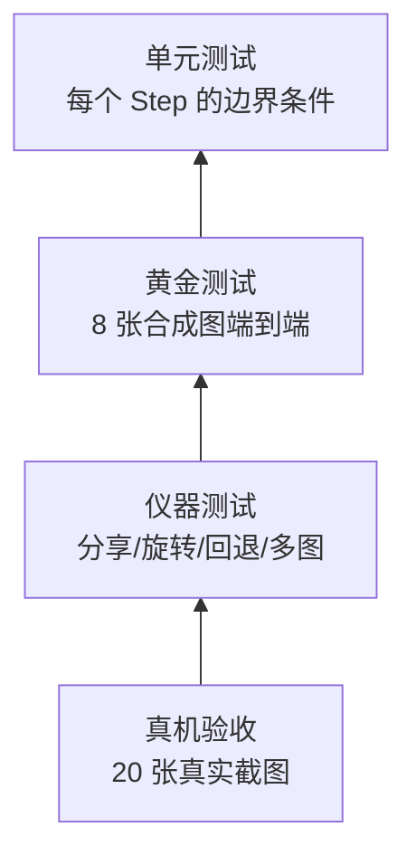

# 05 · 测试与验收

## 1. 策略

这个产品的质量风险不在"代码写错"，而在**悄悄地做错**：把一行字切成了两半、把图注丢了、把窄图切得更小。所以测试的重心是**行为断言**，不是覆盖率数字。



下层不过，上层不测。

| 层 | 数量目标 | 运行时间 | 何时跑 |
|---|---|---|---|
| 单元（`:core:test`） | 60+ | < 5s | 每个 PR |
| 黄金 | 8 fixture × 1 | < 10s | 每个 PR |
| 仪器（`:app:connectedDebugAndroidTest`） | 12+ | < 3min | 每日 / 合并前 |
| 真机人工 | 20 张 | 1 小时 | 每个里程碑 |

## 2. 单元测试清单（core）

| 类 | 必测点 | 对应任务 |
|---|---|---|
| `RectI` | union / intersect / offset / 空矩形 / 负坐标 | T01 |
| `runsOf` | 空数组、全 true、全 false、单点 | T01 |
| `BackgroundEstimator` | 纯白、纯黑、深色块不吃成背景、浅灰卡片、光照渐变 | T02 |
| `Otsu` | 双峰、全 0、全 255、单峰 | T03 |
| `Binarizer` | 孤立点清除、1px 长线保留、阈值夹取 | T03 |
| `RowSegmenter` | 等距行、噪声行、低墨量图注、上下结构字合并、**合并总高上限、装饰竖线** | T04 |
| `RowDecomposer` | 平滑吃掉缝隙的紧排段再分解、照片不带拆分、正常带不拆 | T04b |
| `BlockClassifier` | 实心柱、浅色卡片、大标题、纯图、**高带判 UI 而不是硬切** | T05 |
| `RowClassifier` | **BODY/HEADING/CAPTION/UI 五种合成行**（按钮行、头像带、大标题、图注） | T05b |
| `ColumnSplitter` | 中线切点、整行位移半字、切点污染、居中标题、**引用行/UI 行不切、拉丁行拒绝、cleanRatio 分母** | T06 |
| `ColumnInk` / `WordGapFinder` | **词内缝 vs 词间空格、URL 行无切点、汉字偏旁不劈开** | T06b |
| `ReflowPlanner` | 顺序、scale/gain、段间距、超宽图、短行、src 越界、**角色缩放、weak+无收益回退、多栏回退** | T07 |
| `PlanAuditor` | **块被丢弃、BODY 缩放不一致、越界/乱序** | T07b |
| `PageLayout.toSource` | 向外取整、边界不越界 | T01/T07 |

**边界条件的写法**：不要用随机图，用**手工构造的 16×16 / 64×64 小图**，断言具体数值。随机图只能证明"不崩"，不能证明"对"。

例：

```kotlin
@Test
fun `深色图块不会被当成背景`() {
    val img = whitePage(64, 64).apply { fillRect(20, 20, 40, 40, gray = 30) }
    val bg = BackgroundEstimator().estimate(img)
    assertTrue(bg.inkAt(30, 30) > 100)   // 块中心必须被判为墨
    assertTrue(bg.inkAt(5, 5) < 5)       // 纸面必须不是墨
}
```

## 2b. 真实图片回归（v1.1）

`core/src/test/.../RealImageRegressionTest.kt` 直接读 `testdata/samples/`（用 Gradle 传
`-Dpictext.root=<仓库根>`，不复制图片），对 4 张样例断言**结构区间**而不是像素：

| 样例 | 断言 |
|---|---|
| twitter | 0 个 FIGURE；`REFLOW`；scale > 2.2；BODY 行 ≥ 10；UI/CAPTION 行 `split=false`；每个 BODY item 的缩放与 `bodyScale` 偏差 ≤ 5%；审计 ok |
| news_jp | 1 个 FIGURE；`REFLOW`；≥1 个 HEADING、≥1 个 CAPTION；标题输出字高 ≥ 正文；审计 ok |
| xerj | 不允许 1.0–1.25× 伪重排：要么 `ORIGINAL`，要么 `gain ≥ 1.5` 且审计 ok |
| arknights | 固定 `ORIGINAL`、无渲染项、不崩溃 |

样例缺失时用 JUnit `assumeTrue` 跳过（CI 未带 testdata 也不会红）。每次运行都会打印一行
`sample=… lines=… figures=… roles=… audit=[…]`，可直接贴进报告。

## 3. 黄金测试

### 3.1 fixture 集

| 名称 | 生成方式 | 断言重点 |
|---|---|---|
| `plain` | Java2D：22px 中文 30 行 | 行数 28–32、`cleanRatio=1.0`、`scale 1.9–2.1` |
| `figures` | 正文 + 柱状图 + 照片块 | `figures=2`、正文行 ≥ 15、图块不参与切分 |
| `dark` | 同上，深底浅字 | `isDark=true`，其余与 `plain` 同 |
| `caption` | 正文 + 17px 浅灰图注 | 图注行存在（防"相对阈值丢小字"回归） |
| `title` | 34px 标题 + 正文 | 标题 `split=false` |
| `no_text` | 900×1200 纯图片 | `mode=ORIGINAL`、`fallback=NO_TEXT` |
| `narrow` | 600 宽 40px 字 | `fallback=GAIN_TOO_SMALL` |
| `garbage` | 1×1、纯色、随机噪声 | 不崩，必回退 |

生成器放 `core/src/test/.../SyntheticPage.kt`，用 `BufferedImage` + `Font("Microsoft YaHei", ...)` 或打包一个 1.5MB 的开源中文字体子集（**注意许可证**，推荐 Noto Sans SC 子集，OFL）。

### 3.2 断言格式

不比对像素，比对**结构数值**：

```json
{
  "fixture": "figures",
  "src": [1080, 1540],
  "analysis": [1080, 1540],
  "lines": 21,
  "figures": 2,
  "splitX": 543,
  "cleanRatio": 1.0,
  "scale": 1.993,
  "gain": 1.993,
  "mode": "REFLOW",
  "items": 37,
  "firstThree": [
    {"kind": "text_full", "src": [59, 63, 606, 98]},
    {"kind": "text_half", "src": [60, 131, 543, 154]},
    {"kind": "text_half", "src": [543, 131, 1010, 154]}
  ]
}
```

容差：坐标 ±1px，`scale` ±0.02，计数 ±1。
**不比对 `dest`**——字号微调会让 dest 全变，噪声太大；只比对 `src` 与顺序。

### 3.3 更新基线

只允许在"算法有意变更"时更新，且必须：

1. 在 PR 里贴出变更前后的 CLI 出图（`after.png`）与 `plan.json` diff；
2. 说明为什么旧基线是错的；
3. 由第二个人（或另一个 agent）review 过。

禁止为了让红变绿直接 `--update-golden`。

## 4. 仪器测试

| 用例 | 步骤 | 断言 |
|---|---|---|
| `shareSingleImage` | 用 `Intent.ACTION_SEND` + `FileProvider` URI 启动 | 10s 内出现重排内容 |
| `shareMultiple` | 3 个 URI | 页码 1/3，可滑到第 3 页 |
| `shareInvalidUri` | 不存在的 URI | 错误页，返回键可用，无崩溃 |
| `rotationKeepsState` | 阅读中旋转 | 不重新分析，滚动位置保持 |
| `processDeath` | `ActivityScenario.recreate()` | 恢复到同一页 |
| `fallbackNoText` | 注入 `no_text` fixture | 原图模式 + 提示文案 |
| `backFromViewer` | 返回 | 回到来源 App（`finish()`） |
| `darkDocument` | 深色图 | 系统栏图标变浅色，无白闪 |
| `multiWindow` | 分屏 | 布局不崩，瓦片宽度随窗口变化重算 |
| `fontScale` | 系统字体 1.3× | 工具栏文字不截断 |
| `noInternetPermission` | 读合并后的 manifest | 不包含 `INTERNET` |

`shareSingleImage` 需要把测试图放 `androidTest/assets/`，用 `FileProvider` 暴露给自身。

## 5. 性能基准

| 指标 | 目标 | 方法 |
|---|---|---|
| 冷启动到首屏 | < 500ms（1080×2400，中端机） | `adb shell am start -W` + 日志打点 |
| 分析耗时 | < 120ms | 代码内打点，10 次取中位数 |
| 改字号后首屏 | < 250ms | 同上 |
| 瓦片渲染 | < 25ms/张 | 同上 |
| 滚动掉帧 | < 5% 帧 | `dumpsys gfxinfo <pkg> framestats` |
| 峰值内存 | < 120MB | `dumpsys meminfo <pkg>`，含 1080×20000 长图 |
| APK | < 8MB | `assembleRelease` 产物 |

长图测试图：用脚本拼一张 1080×20000 的重复文本图（不要提交进仓库，测试时生成）。

**JVM 层基准**：`core/src/test` 里加一个 `AnalyzerBenchmark`（普通 JUnit，跑 20 次取中位数），防止某次改动把 O(N) 变成 O(N²)。阈值设宽一点（比如 < 400ms，CI 机器慢），只抓数量级回归。

## 6. 真机验收（20 张）

准备一组真实图片，覆盖：

| # | 来源 | 特征 | 期望 |
|---|---|---|---|
| 1–5 | 微信文章截图 | 1080 宽、22–26px 字 | 重排后明显变大，行数正确 |
| 6–8 | 微博/知乎长图 | 极长（>8000px） | 不 OOM，滚动顺 |
| 9–11 | 桌面网页截图 | 1920 宽 | 重排，字号变大 |
| 12–13 | 论文 PDF 截图 | 双栏 | **允许失败**，但必须能看原图 |
| 14–15 | 带图表 | 图表清晰、不被切 | 图块完整 |
| 16 | 夜间模式截图 | 深底浅字 | 正确继承背景色 |
| 17 | 竖排/书法 | 竖排 | 回退原图 |
| 18 | 表格截图 | 网格 | 不崩，内容完整 |
| 19 | 纯照片 | 无文字 | 原图 + 提示 |
| 20 | 极小字（12px） | 模糊 | 尽量重排，允许效果差 |

评分：**可用 / 勉强 / 不可用**。

发布门槛：可用 ≥ 16/20，且"不可用"里没有"内容丢失"。

### 6b. 批量评分脚本（v1.1，P1-2）

```powershell
# 自动跑一遍目录里的所有图片，生成评分表骨架
powershell -ExecutionPolicy Bypass -File scripts/score-samples.ps1 -Dir testdata/samples2

# 只重新生成表格（复用上次的 plan.json，不重跑 CLI）
powershell -ExecutionPolicy Bypass -File scripts/score-samples.ps1 -SkipRun
```

- 输出 `testdata/scoreboard.md`：尺寸/行数/图块/角色/cleanRatio/scale/gain/模式/审计 + 自动结论；
- 人工评分写在同目录的 `notes.csv`（`name,score,note`），脚本会合并进表格，重新生成不会丢；
- 文件名带空格/中文时脚本会先复制成安全名字再交给 CLI（`--args` 按空格切分）。

当前 `testdata/samples2` 18 张：重排 11、回退 7、审计失败 0；人工评分 可用 11 / 勉强 4 / 不可用 0。

### 6c. 模拟器功能验收（2026-10-29，MuMu Android 15）

> 注：模拟器只有横屏（`cur=1920x1080`），竖屏相关的布局没有在真机上验证。

用 `adb connect 127.0.0.1:16384` 连模拟器，`install -r app-debug.apk` 后逐项验证
（性能不在这一步测，模拟器数据无参考价值）：

| 用例 | 结果 |
|---|---|
| 冷启动首页 | ✓ 标题、"选择图片"、隐私说明正常 |
| 分享进入（ACTION_SEND，`content://`） | ✓ 正确 intake 并进入阅读页；URI 未授权时走"这张图打不开"错误页，不崩 |
| 重排渲染 | ✓ Twitter 样例 `REFLOW` scale 2.391（日志 `analysis=586ms`），tile 渲染正常 |
| 原图/重排切换 | ✓ 顶栏按钮双向切换，阅读位置不丢 |
| 回退提示条 | ✓ Arknights 样例显示"这一页没有找到可放大的切分位置，已显示原图，可双指放大"+"知道了"；原图页面不显示"查看原图" |
| 设置面板 | ✓ 字号（小/标准/大）与切分方式可见可选，关闭后回到阅读页 |
| 低收益回退 | ✓ 在 1920 宽窗口下 gain=1.11 → `ORIGINAL / GAIN_TOO_SMALL`，提示"文字已经足够大，不需要重排" |
| 首页精简（v1.1） | ✓ 标题与"选择图片"之间不再有说明文字 |
| 三档（原图 / ×2 / ×4） | ✓ 分享进入自动落在 ×2；点 ×4 后倍率翻倍（2.39 → 4.78）；点原图回到 1× |
| 设置入口移除（v1.1） | ✓ 底栏无 "Aa"、⋮ 菜单只剩"关于"、SettingsSheet.kt 已删除 |

## 7. 异常输入矩阵

必须逐个跑，**只允许出现错误页或原图，不允许崩溃**：

| 输入 | 期望 |
|---|---|
| 0 字节文件 | 错误页 |
| 截断的 JPEG | 错误页 |
| 1×1 PNG | 原图（或错误页） |
| 100000×10 的极端长条 | 降采样后正常/回退 |
| 纯透明 PNG | 铺白底，`no_text` |
| GIF 动图 | 取第一帧 |
| HEIC（API 26 设备） | "格式不支持" |
| 带 EXIF 旋转 | 方向正确 |
| 文件名含 emoji/超长 | 不影响 |

## 8. 设备矩阵

| 设备 | 系统 | 关注点 |
|---|---|---|
| Pixel 6 / 7 | Android 14/15 | 基准性能、动态取色 |
| 红米/荣耀中低端 | Android 11/12 | 分析耗时、内存 |
| 小屏（5.5"，720p） | Android 10 | 排版、字号 |
| 平板 | Android 13 | 宽度变化、多窗口 |

没有真机时至少用两个不同分辨率的模拟器（720×1280 与 1440×3120），并开"不保留活动"测进程死亡。

## 9. 缺陷分级与发布门槛

| 级别 | 定义 | 例子 | 发布 |
|---|---|---|---|
| S0 | 崩溃 / OOM / 内容丢失 | 切分把字切没了；长图 OOM | 阻断 |
| S1 | 结果错误但可退回 | 整页切错、图块被切开 | 阻断 |
| S2 | 排版难看但内容完整 | 段间距过大、留白不均 | 可延后 |
| S3 | 观感问题 | 动画不跟手、图标不齐 | backlog |

发布前检查：

- [ ] S0 / S1 清零
- [ ] `:core:test` 全绿，黄金基线已 review
- [ ] 仪器测试全绿
- [ ] 20 张验收 ≥ 16 可用，无内容丢失
- [ ] 性能指标达标（第 5 节）
- [ ] APK < 8MB
- [ ] 清单无 INTERNET / 存储权限
- [ ] 关于页隐私声明存在

## 10. 每次改动的回归清单

| 改动 | 必跑 |
|---|---|
| 任意 `core` 改动 | `:core:test` + 黄金 + CLI 出图肉眼对比 |
| 解码 / 条带 | 仪器：分享、旋转、大图；内存 |
| 渲染 / UI | 仪器：滚动、切换、旋转；掉帧 |
| 设置 / 存储 | 仪器：进程死亡、重启 |
| 依赖 / 构建 | `assembleRelease`，检查 APK 体积与清单 |

## 11. 手工验收脚本（每次里程碑）

1. 从相册分享 1 张长文截图 → 5 秒内可读，滚动到底不卡；
2. 点图块 → 全屏 → 双指放大 → 关闭 → 位置不变；
3. 切"原图" → 放大到 4× 看清小字 → 切回"重排"；
4. 字号调到"大" → 画面更新，行数变少；
5. 切分关掉 → 对照"没切开"的样子；
6. 返回 → 回到相册；
7. 再分享同一张 → 回到上次阅读位置；
8. 分享 3 张 → 左右滑，页码正确；
9. 分享一张纯照片 → 提示"没找到文字"；
10. 分享一张 600 宽的窄图 → 提示"文字已经足够大"。
