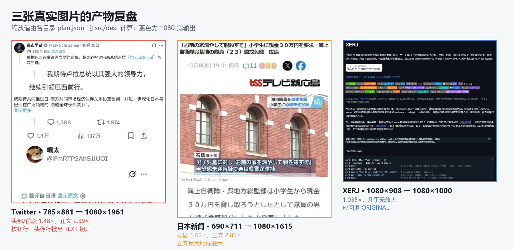

# 06 · 下一步完善计划

> 依据：`testdata/report.md`、`testdata/samples/` 三张原图、`testdata/out/*/{after,debug}.png` 与 `plan.json`。
> 产物：[Twitter](../testdata/out/twitter/after.png) · [日本新闻](../testdata/out/news_jp/after.png) · [XERJ](../testdata/out/xerj/after.png) · [Arknights 硬样例](../testdata/out/arknights/after.png)
> 代码基线：当前 `core/`（`RowSegmenter` → `RowDecomposer` → `RowClassifier` → `ColumnSplitter` → `ReflowPlanner` → `PlanAuditor`）。
> 范围：v1.1（P0）/ v1.2（P1）/ v1.3（P2）。仍然不引入 OCR、模型、网络和第三方图像库。
> 状态：**v1.1 已完成**（2026-10-29，结果与偏差见 §0.1）；v1.2 的 P1-1/P1-3/P1-4 已实现，P1-2（样例扩到 12–20 张）未做。

---

## 0. 一句话结论

三张真实图片证明**链路能跑通、内容基本不丢**，但也证明当前失败的主因不是“某个阈值偏了一点”，而是缺少**版面角色模型**：

- 多行文字先被行切分合并成一个大行带，再被“高行带 = 图块”判成 FIGURE；
- 头像、按钮行、时间戳行反而被当成 TEXT，按 2.39× 切开；
- 图块按“宽度适配”缩放，正文按“目标字号”缩放，两套比例互不相干，导致新闻标题 1.62×、正文 2.81×，正文比标题还大；
- 拉丁文页面 `cleanRatio=0.5` 回退后仍输出 1.035× 的“伪重排”，用户看不到任何放大效果。

所以下一步的顺序应该是：**先把行和块分对，再把缩放统一，最后才扩拉丁文和多栏**。报告里“把 FIGURE 二次判回 TEXT”的建议方向是对的，但如果只加这一条，会把当前被误切成文字的头像/按钮行一起“救”成图块，顺序仍然不对。

---

## 0.1 v1.1 实施结果（2026-10-29）

P0-0 … P0-5、P1-1（默认关）、P1-3、P1-4 已落地，`./gradlew :core:test` 88 个用例全绿。
下表数字全部来自同一次运行（`scripts/test-samples.ps1` → `testdata/out/*/plan.json` + `manifest.json`）。

| 验收指标（§3.2） | 旧基线 | v1.1 实测 | 结论 |
|---|---|---|---|
| 含文字的 FIGURE 数（3 张样例） | 4 | **0**（Twitter 0、新闻 0、XERJ 0） | 达成 |
| Twitter 被切开的 UI 行 | ≥4 组 | **0**（`UI/CAPTION` 行 `split=true` 计数为 0） | 达成 |
| Twitter 正文类缩放一致性 | 1.48 / 1.62 / 2.20 / 2.39 | **全部 2.391**（审计 bodyDev=0.001） | 达成 |
| 新闻标题 : 正文（输出字高） | 0.58 | **1.31** | 达成 |
| XERJ 计划模式 | `NO_SPLIT` 1.035× | **`REFLOW` 1.915×**，cleanRatio 1.00，审计通过 | 见下方偏差 2 |
| 计划项覆盖率 | 靠肉眼 | **100%**（4 张样例 `itemsDropped=0`、`outOfBounds=0`） | 达成 |
| 硬样例回退 | 手工跑过一次 | **Arknights 固定 `ORIGINAL`**（原因由 `TOO_FEW_LONG_LINES` 变为 `WEAK_CUT`） | 见下方偏差 3 |
| 真实图片回归 | 0 个自动化 | **4 张进 `:core:test`**（`RealImageRegressionTest`） | 达成（v1.2 目标 12 张未做） |
| 拉丁文劈词 | 未知（靠回退） | XERJ 仍残留 **2 处词内切**（见偏差 4） | 未完全达成，P1-1 默认关 |
| 分析耗时（桌面 JVM） | 82–161ms | 100–200ms（含新增角色/找缝特征） | 未超预算 |

产物（同一次运行生成）：[Twitter](../testdata/out/twitter/after.png) · [日本新闻](../testdata/out/news_jp/after.png) · [XERJ](../testdata/out/xerj/after.png) · [Arknights](../testdata/out/arknights/after.png) · [报告](../testdata/report.md) · [manifest](../testdata/out/manifest.json)

### 0.2 P1-2 结果：样例扩到 4 + 18 张（2026-10-29）

`testdata/samples2/` 新增 18 张真实截图（贴吧/知乎/微博/X/新闻/韩语/希伯来语/横向长条等），
`scripts/score-samples.ps1` 逐张跑 CLI 并生成 [scoreboard](../testdata/scoreboard.md)；
人工评分写在同目录的 `notes.csv` 里（脚本会合并），重新生成不会丢。

自动统计：**重排（含整页放大）11 / 18，回退 7，审计失败 0**；
人工评分：**可用 14、勉强 4、不可用 0**（其中希伯来语 RTL 那张按“内容完整、阅读顺序会反”记为勉强）。
7 张回退里多数是“本来字就够大”或“长行不足”，属于合理回退，不是失败。

这批样例暴露出两个主样例没覆盖的问题，本轮已修第一个：

1. **标题比正文短一截时会被压小**（`006v119zgy1iihw7je1euj30jg0aimyi`，知乎回答）：
   标题 527px / 版心 639px，不满足“顶到右版心”，于是不参与切分，被压到 1.98×，
   而正文是 3.0×——审计直接报 `heading_smaller_than_body(0.82)`。
   修复分两步：① 切分安全门对 HEADING 也放行“左对齐 + ≥0.5 版心”；
   ② 规划器改成**按输出字高**判断标题要不要切（`标题高 × 适配倍数 < 正文高 × bodyScale`），
   避免新闻那类“整行装不下、但压完仍比正文大”的标题被无谓拆成两行。
2. **RTL（希伯来语）没有处理**：`0084Nct6ly1iifp2fqzqej30ob0zf7r2` 是希伯来语帖子，
   左右半边的阅读顺序会反过来。属于 P2 的新增项（检测到 RTL 应回退原图），本轮只记录。

`RealImageRegressionTest` 增加了一个**批量巡检**用例：遍历 `samples2` 的每一张，
断言与主样例相同的硬约束（不崩、`src/dest` 不越界、非回退模式审计通过），不锁具体结构值。

### 0.2b 带手写标记的样例（2026-10-29）

`testdata/samples_mark/` 两张“用户自己画过重点”的图：

| 样例 | 标记 | 结果 |
|---|---|---|
| `123841auyqywc6jfwlw207.webp`（1238×1444） | 红色手写下划线 | `REFLOW` 1.395，19 行 / 1 图块，clean 0.875，审计 OK |
| `屏幕截图 2026-10-29 152423.png`（1268×886） | 橙色手绘框 + 大表格 | `ORIGINAL / TOO_FEW_LONG_LINES`（长行只有 1 条），安全回退 |

结论与已知限制：

1. **红笔不丢内容**：笔画进入行带，跟着所在行一起被切分、缩放，没有丢像素；
   代价是被画线的行带会比纯文字行高几 px，行距看起来略不均。
2. **橙色框 + 表格整块判成图块**是正确的一侧：表格切开就废了；页面上正文行数太少（<2 条长行）
   于是按 G3 回退原图，用户可以用新增的 ×2 放大去看。
3. **真问题：图片下方的图注与右侧正文同行**。新闻那张里“文部省 = 千代田区 东京”在图注位置，
   与右侧“类型（如小学、初中和高中）…”处在同一行带，被并成了一条输出行（左边图注、右边正文）。
   内容没丢，但读起来夹生。根因是行带切分只在垂直方向做，没有“同一行左右分成两段”的处理，
   属于已知限制，记在 docs/02 的失败模式里。
4. CLI 读不了 webp（Java ImageIO 没有 webp 解码器），App 侧 BitmapFactory 可以——这条只影响桌面调试工具，
   已在 `scripts/score-samples.ps1` 里用“webp 跳过/先转 png”绕过。

### 与计划不一致的地方（需要 review）

1. **P0-2 的“细竖直装饰列”改成自校准检测**：最初按 `3×行高` 判长度，但行高本身会被这条线带偏，实测在所有样例上都检测不到。
   现在改为“该列最长竖直游程 ≥ `max(3×典型竖笔, 15%×页高, 10px)`，宽度 ≤ 3px，且至少一侧有 ≥0.5×典型字高的空白”。
   四张真实样例都是 0 命中（细线本来就在行阈值以下），合成用例 `thin vertical rule does not glue lines together` 覆盖它。
2. **XERJ 从“必须 ORIGINAL”改为“不允许伪重排”**：旧版本回退的原因是 `cleanRatio=0.5`；新链路把行分对了（25 行、角色清楚），
   这张图其实是**中文译文**，逐行找缝 `cleanRatio=1.00`，统一缩放 1.915×，审计 `bodyDev=0.002`。
   按“有收益且切点干净就重排”的原则，这是比 1.03× 伪页面和“原图”都更好的结果。
   验收条件因此改写为：**要么真正放大（gain ≥ 1.5 且审计通过），要么 ORIGINAL**；不允许 1.0–1.25× 的假重排。
3. **Arknights 回退原因变了**：行带合并护栏让海报里多分出一条文字行（3 行、2 条长行），于是不再触发 `TOO_FEW_LONG_LINES`，
   改为“找不到干净切分位置 + 文字本来就大”的 `WEAK_CUT`。验收仍只看 `ORIGINAL`、不崩溃、内容完整。
4. **拉丁切分只做到“不切坏”**：`WordGapFinder`（整行零墨 + 最小缝宽）与“切点两侧墨簇宽度”防劈字已实现并默认关闭；
   XERJ 里仍有两处切在英文单词/汉字偏旁内部（`Elas|ticsearch`、`索弓|l`），属于 S2（内容不丢、观感差），
   已作为 P1-1 的后续项记录（见 §5 P1-1 的“现状”）。

---

## 1. 报告与产物核对：先校正几处现象

> **本节是 2026-10-29 立项时的旧基线**（P0 之前的产物）。v1.1 完成后的数字见 §0.1 与
> 自动生成的 [testdata/report.md](../testdata/report.md)。

`report.md` 的结论方向成立（中文正文最好、Twitter 排版退化、XERJ 安全回退），但第一版的现象描述与 `plan.json`/`after.png` 有几处偏差，已在 2026-10-29 按产物校正。校正前后的差异如下，后续计划以产物为准。

### 1.1 实测缩放（由 plan.json 的 src/dest 计算）

| 样例 | 元素 | 源宽 → 目标宽 | 实际缩放 | 实际情况 |
|---|---|---|---|---|
| Twitter | 头部块 `[36,27,740,132]` | 704 → 1042 | **1.48×** | 头像+用户名+翻译行+**正文第一段**被包成一个 FIGURE |
| Twitter | 段落块 `[97,313,740,382]` | 643 → 1042 | **1.62×** | “我期待共同推进……”两行 + “显示更多”被当成图块 |
| Twitter | 评论块 `[36,529,468,668]` | 432 → 950 | **2.20×** | 翻译行+4 行评论被当成图块 |
| Twitter | 正文半行 | 352 → 842 | **2.39×** | 真正的正文行，切分后按目标字号放大 |
| Twitter | 按钮行/头像行 | 352 → 842 | **2.39×** | 被当成 TEXT 切开：评论/转发、点赞/收藏被拆成两行，头像被放大 |
| 日本新闻 | 标题块 `[18,12,662,64]` | 644 → 1042 | **1.62×** | 两行标题整体当图块 |
| 日本新闻 | 照片块 `[14,134,677,525]` | 663 → 1042 | **1.57×** | 照片完整，正确 |
| 日本新闻 | 正文半行 | 330 → 928 | **2.81×** | 正文按目标字号放大 |
| XERJ | 整页 | 1080 → 1080 | **1.035×** | `NO_SPLIT`，输出 1080×1000 |



### 1.2 第一版报告与产物的偏差（已校正）

1. **“头部字号过大”不准确。** 头部/首段是 1.48×，正文是 2.39×，首段实际只有正文的 62%。看起来“大”是因为整个头部块占的面积大，不是字大。
2. **“两条引用段被整块放大”不准确。** 引用行是 TEXT，被按 2.39× 切成左右两半，输出成两行；不是 FIGURE。
3. **“头像、按钮行导致 3 个文字块被判为 FIGURE”只说对了一半。** 3 个 FIGURE 是“头部混合块、正文段落、评论块”；头像/按钮行反而被判成 TEXT 并切开，后者对阅读的破坏更大。
4. **“日本正文 5 行全部切成两半”不准确。** 正文实际是 4 个视觉行，其中 2 行是长行（切成两半），2 行是短行（不切）。真正需要修的是标题与正文的缩放层级，而不是“全部切半”。
5. **XERJ 的 1.035× 不是“整页放大”**，而是重新排版成 1080×1000 的页面：高度多了 10%，字只大了 3.5%，用户感知不到收益。它应该走 `ORIGINAL`，把缩放交给原图手势。

### 1.3 对报告三条“后续改进”的评价

| 报告建议 | 评价 | 本计划的落点 |
|---|---|---|
| 对“整块文字 + 竖直装饰线”的 FIGURE 做二次判定，拆回 TEXT | 方向对，但这是**下游补救**。当前更上游的问题是 `Runs.merge` 把多行合成大带；如果不先修合并，二次判定会把头像/按钮行也“救”成图块 | P0-1 合并护栏 + P0-2 行级角色；竖直装饰列在 P0-2 的横向间隙计算里忽略 |
| 拉丁文加宽找缝窗口，或按空格切分 | **加宽窗口不够，且更危险**：拉丁字母之间也有低墨列，`inkAtCut ≤ 1.5` 可能在单词内部通过。必须同时要求“整行零墨 + 最小缝宽 + 词边界/URL 排除” | P1-1 独立 `WordGapFinder`，默认关；不通过则 `ORIGINAL` |
| UI 对 `WEAK_CUT`/英文页面更早提示“可切换原图” | 方向对。当前已有提示条，但 3 秒自动消失、没有按钮；且 XERJ 的 1.035× 页面本身就不该生成 | P0-5：`weak + gain<1.25` 直接 `ORIGINAL`，提示条加“查看原图”按钮 |

> 结论：报告可以继续作为“人工观察记录”，但下一轮必须让 `after.png`、`debug.png`、`plan.json` 和报告表格由**同一次运行**生成，并在 CI 里断言关键结构值。见 P0-0。

### 1.4 新增硬样例：Arknights 海报

2026-10-29 补充了 `testdata/samples/arknights.jpg`（1000×2100，明日方舟活动宣传图，© Hypergryph，仅本地测试用）。文字（特性、天赋、技能说明）叠在人物、雪景和大字标题上。

CLI 实测：

```text
mode=ORIGINAL fallback=TOO_FEW_LONG_LINES lines=1 figures=0 cut=-1
scale=1.000 items=0 analyze=161ms plan=4ms
after.png = 1000×2100（原图，未缩放）
```

结论：这张图**当前不适合作为“成功重排”正样例**。文字与复杂美术背景混在一起，行切分只得到 1 条文字行，长行不足 2 条，按 G3 回退原图；没有崩溃、没有丢内容。按“不强求”的原则，保留为**硬样例/负样例**，验收标准是“固定回退 `ORIGINAL`、内容完整”，不要求字号放大。若以后引入 OCR/文本区域分割或人工框选，再升级为正样例。

产物：[after](../testdata/out/arknights/after.png) · [debug](../testdata/out/arknights/debug.png) · [plan.json](../testdata/out/arknights/plan.json)

---

## 2. 根因（代码级）

> 本节的行号指 **v1.1 之前**的代码，用来解释当时的现象；v1.1 的实现见 §0.1 与 docs/02。

| 现象 | 代码位置 | 原因 |
|---|---|---|
| 多行文字被合成一个大行带 | `core/.../RowSegmenter.kt:46-50` | `Runs.merge(raw, maxGap)` 只限制“行间空隙”，没有限制“合并后的总高度”；多行正文/评论/标题会被合并成一个 3–6 倍行高的大带 |
| 大行带被判成 FIGURE | `core/.../BlockClassifier.kt:61-63` | `bh > 2.8×medianHeight` 是“任一条即 FIGURE”；大带没有“内部是否还有文字行”的检查 |
| 头像/按钮行被判成 TEXT 并切开 | `core/.../ColumnSplitter.kt:66-78` | 只按 `width ≥ 0.62×pageWidth` 决定切不切，不看行内是否有大间隙、图标、头像等“非连续文字”特征 |
| 图块与正文两套缩放 | `core/.../ReflowPlanner.kt:197-215` | FIGURE 用 `contentW/figW`（宽度适配，上限 2.2）；TEXT 用 `targetEm/(0.92×medH)`；两者没有统一约束 |
| 标题比正文小 | 同上 + `ColumnSplitter` 不处理 FIGURE | 标题被当图块后只能按宽度放大（1.62×）；正文按目标字号（2.81×）；标题源字只比正文大约 1.4 倍，输出后被反超 |
| `weak_cut` 仍输出伪重排 | `core/.../ReflowPlanner.kt:52-69` | `weak` 分支绕过了 `minGain` 门槛；XERJ 的 `gain=1.035` 仍然生成页面 |
| 提示条不可操作 | `app/.../ViewerScreen.kt:173-183` | 提示 3 秒后自动消失，没有“查看原图”按钮；用户看到 1.035× 页面时没有下一步 |
| 拉丁文是否切错靠运气 | `core/.../ColumnSplitter.kt:100-138` | `inkAtCut ≤ 1.5` 只保证“切点墨少”，不保证“切在词边界”；当前 `cleanRatio=0.5` 只是恰好没达到 0.70 阈值 |

可以用一张图概括当前链路和要插入的判断点：

```text
mask
 └─ RowSegmenter        ← ① 合并护栏 + 稳健 medH
     └─ RowDecomposer   ← ② 大带内部再切行（标题/紧排正文）
         └─ RowClassifier ← ③ BODY / HEADING / CAPTION / UI / PHOTO
             └─ ColumnSplitter ← ④ 只切 BODY 的整行；UI/标题不切
                 └─ ReflowPlanner ← ⑤ 按角色统一缩放 + 收益门槛
```

---

## 3. 目标与验收指标

### 3.1 产品目标

1. **不再把整段文字当图块**：文字块按文字缩放，图块只放图。
2. **不再把 UI 行当正文切**：头像、按钮、时间戳、logo、引用竖线不参与左右切分。
3. **字号层级不倒挂**：同一页里正文/引用/评论使用同一 `bodyScale`；标题不小于正文。
4. **没有收益就不装样子**：`gain < 1.25` 或 `weak_cut` 且无可放大空间时，直接 `ORIGINAL`，并给可操作提示。
5. **拉丁文不劈词**：要么在零墨空白/词边界安全切分，要么回退；不允许“看起来切了、其实切在单词中间”。
6. **每次改动可回归**：三张真实图片 + 合成样例 + 计划审计进入 `:core:test`，报告由脚本生成。

### 3.2 量化指标（基线 → v1.1 目标）

> 实测值见 §0.1；下表是立项时的目标，保留作为对照。

| 指标 | 当前 | v1.1 目标 | 测量方式 |
|---|---|---|---|
| 含文字的 FIGURE 数（3 张样例） | 4（Twitter 3 + 新闻 1） | **0** | `plan.json` + 合成用例 |
| Twitter 被切开的 UI 行 | 4 组以上（按钮、头像、底部操作） | **0** | 行角色/切分标记 |
| Twitter 正文类缩放一致性 | 1.48 / 1.62 / 2.20 / 2.39 | **全部 2.39 ±5%** | 每个 TextRow 的 `dest.width/src.width` |
| 新闻标题 : 正文缩放 | 1.62 : 2.81 = **0.58** | **≥ 1.0** | 标题与正文 item 的 scale |
| XERJ 计划模式 | `NO_SPLIT` 1.035×，1080×1000 | **`ORIGINAL` 1080×908** | `plan.mode`/`plan.height` |
| 计划项覆盖率 | 靠肉眼 | **100% 块进入 items，0 丢弃** | `PlanAudit` |
| 硬样例回退 | 手工跑过一次 | **Arknights 固定 `ORIGINAL / TOO_FEW_LONG_LINES`，不崩溃** | `RealImageRegressionTest` |
| 真实图片回归 | 0 个自动化 | **3 张主样例 + 1 张硬样例（v1.1）→ 12 张（v1.2）** | `:core:test` |
| 拉丁文劈词 | 未知（当前靠回退） | **0 次切在词内** | 合成英文/URL 用例 |
| 分析耗时（桌面，主样例/硬样例） | 82–113ms / 161ms | 主样例 ≤150ms；硬样例不作为性能门槛 | CLI 中位数 |
| 分析耗时（中端机） | 未测 | **<120ms** | Android 实测 |

### 3.3 非目标

- 不做 OCR、语义段落重建、机器翻译；
- 不保证报刊多栏、竖排、表格能正确重排；v1.2 只做“检测到就回退”；
- 不为了放大而裁掉 UI 装饰（保持“内容不丢”原则）；
- 不在本轮换渲染架构或引入新依赖。

---

## 4. 路线图

| 版本 | 主题 | 任务 | 出口条件 |
|---|---|---|---|
| **v1.1（P0）** | 把“行/块/缩放”修对 | P0-0 回归与报告；P0-1 行带合并护栏；P0-2 行级角色分类；P0-3 切分安全门；P0-4 统一缩放；P0-5 诚实回退与提示 | 三张主样例达到 3.2 的 P0 指标；≥8 个合成用例全绿；计划审计 0 丢弃 |
| **v1.2（P1）** | 扩场景、补体验 | P1-1 拉丁/URL 安全切分（实验开关）；P1-2 真实样例扩到 12–20 张；P1-3 间距/对齐打磨；P1-4 多栏检测（安全网） | 12 张真实验收 ≥10 可用；拉丁样例 0 劈词；XERJ 有明确下一步 |
| **v1.3（P2）** | 稳与快 | 状态栏/底栏裁切、竖排旋转、深色真实截图、设备性能矩阵 | 20 张验收 ≥16 可用；中端机 <120ms；无 S0/S1 |

依赖关系：

```text
P0-0 ─→ P0-1 ─→ P0-2 ─→ P0-3 ─→ P0-4 ─→ P0-5
                                  └────→ P1-1
P1-2（收集样例）可与 P0 并行
P1-3 依赖 P0-4；P1-4 独立
```

预估：P0 约 6–7 个 agent-day，P1 约 6 个 agent-day，P2 按需。建议两周内完成 v1.1 + v1.2 的主体。

---

## 5. 任务卡

### P0-0 · 真实图片回归与报告生成（先做，不改算法）

**问题**：报告、`after.png`、`plan.json` 是人工拼起来的，现象描述已经和产物不一致；当前没有任何测试会在算法改动后提醒“Twitter 又多了一个图块”。

**做法**

1. 在 `:core` 增加 `RealImageRegressionTest`，通过 Gradle 的 `systemProperty("pictext.root", rootDir)` 读取 `testdata/samples/`，不复制图片。
2. 先做“表征测试”：只打印/断言不崩、所有 `src` 在界内、`items` 非空、`mode` 合法；把当前 `lines/figures/splitX/scale/mode` 写进 `core/src/test/resources/golden/real/*.json`。
3. 增加 `PlanAudit`（core 内部即可）：
   - 每个 `Block` 是否至少有一个 `RenderItem`；
   - `dest` 是否越出 `outputWidth`、是否单调（允许图块与文字交错，但不允许倒序）；
   - 每个 `TextRow` 的 `src/dest` 宽高比误差；
   - 统计每个 item 的 `scale`、`role`、`figure` 原因。
4. `scripts/test-samples.ps1` 增加：
   - 输出 `manifest.json`：输入/输出 SHA-256、时间、参数、git（无 git 时用文件时间）；
   - 由 `plan.json` 生成 Markdown 表格，替换手写报告中的数字；
   - 生成 `summary.png`（三张 after 并排）供人眼复核。
5. `plan.json` 增加字段：`sourceSha256`、`options`、`textEm`、`blockCounts`、`itemsDropped`、`figureReasons`。

**涉及**：`core/src/test/.../RealImageRegressionTest.kt`、`core/.../PlanAudit.kt`、`cli/.../Main.kt`、`scripts/test-samples.ps1`。

**验收**

```bash
./gradlew :core:test
powershell -ExecutionPolicy Bypass -File scripts/test-samples.ps1
```

- 测试能指出 Twitter/新闻/XERJ 的 `figures/lines/scale/mode`；
- 改动算法导致结构值超范围时测试变红；
- 报告数字全部来自 `plan.json`，不再手抄。

**风险**：真实图片进入测试资源会增加几秒运行时间；可接受（<5s）。图片版权/隐私：只使用仓库已有样例，新增样例需自备、无个人信息。

---

### P0-1 · 行带合并护栏与稳健行高

**问题**：`Runs.merge` 把多行正文合并成一个大带（Twitter 头部/评论、新闻标题），后续分类只能看到“高块”。这是当前 FIGURE 误判的上游根因。

**做法**

1. 在 `RowSegmenter` 里把 `medianHeight` 改成稳健值：排序后去掉最高/最低 10%，再取中位数；避免头像/大标题把 `medH` 拉高。
2. 合并时增加**总高度上限**：

   ```text
   仅当 (候选行.y1 - 当前行.y0) <= rowMergeHeightRatio * medH 时才合并
   默认 rowMergeHeightRatio = 1.25
   ```

   这样：
   - 上下结构的一个字（两段总高 ≈ 1 个 medH）仍合并；
   - 两行正文（总高 ≈ 2 个 medH）不再合并；
   - 头像带（≈ 3 个 medH）+ 正文行不会被吞。
3. 保留 `rowMergeGapRatio`（0.45）用于“同一字内的上下结构”，但不再允许它跨行合并。
4. 对仍然无法分开的紧排大带（标题两行贴在一起），交给 P0-2 的 `RowDecomposer`，不在 RowSegmenter 里硬切。

**测试**

- 合成：两行 22px 文字、行距 10px → 必须 2 个 band；
- 合成：上下结构字（两段 8px，间隙 2px）→ 必须 1 个 band；
- 合成：头像块 36px + 两行正文 → 头像与正文分开；
- 真实：Twitter 头部不再是一个 27–132 的大带；评论 4 行分开；新闻标题 2 行分开。

**验收**：Twitter `figures` 中的“头部/段落/评论”至少不再因为“多行被合并”而成为图块；新闻标题变成 2 个文字行。

**风险**：紧排正文可能被拆成过多行，导致行距变化；用 P0-4 的间距模型兜底，并在三张图上肉眼复核。黄金基线会变红：按 `docs/05-testing.md` §3.3 更新，PR 里贴 before/after 图与 `plan.json` diff，禁止直接 `--update-golden` 了事。

---

### P0-2 · 大带再分解与行级角色分类：BODY / HEADING / CAPTION / UI / PHOTO

**问题**：当前只有“文字/图块”二分法。头像、按钮行、时间戳、logo 都是“文字”；标题、评论、正文也都是“文字”。但它们的排版策略完全不同。

**做法**

1. 在模型里增加**向后兼容的默认字段**（不改现有构造调用）：
   - `TextLine.role: LineRole = BODY`，`LineRole = BODY | HEADING | CAPTION | UI`；
   - `Block.Figure.kind: FigureKind = PHOTO`，`FigureKind = PHOTO | UI | DECOR`。
2. 对 P0-1 之后仍高于 `1.8×medH` 的带，先做一次 `RowDecomposer`：
   - 在带内重算行投影，找局部谷值（谷值墨量 < 0.15×带内行墨中位数）；
   - 按谷值切子行，子行高度落在 `[0.6, 1.6]×medH` 且间距变异系数 <0.25 才接受；
   - 切不出稳定结构 → 保持 FIGURE/UI，不硬切（防止把照片/图标切成条）。
3. `RowClassifier` 用以下特征（全部可在现有 mask/ink/vrun 上算，不引入连通域库）：
   - `h/medH`、`density`、`maxRun/medH`（已有）；
   - `maxHorizontalGap`：行带内相邻墨簇的最大空白宽度；
   - `denseIsland`：局部窗口（约 1×medH 见方）内墨密度 > 0.55 的区域；
   - `rowRegularity`：P0-1/P0-2 后的子行间距变异系数；
   - 细竖直装饰列：`maxRun ≥ 2×medH` 且列宽 ≤ 2% 页宽 → 计算横向间隙时忽略（引用竖线）。

   > **实施备注**：装饰列最终做在 `RowSegmenter` 里（先清列再投影），判据改为“最长竖直游程 ≥ max(3×典型竖笔, 15% 页高, 10px) + 列宽 ≤ 3px + 至少一侧留白 ≥ 0.5×典型字高”。
   > 原判据依赖行高，而行高会被这条线本身带偏，实测四张真实样例 0 命中；现判据由合成用例覆盖。
4. 判定顺序（建议）：

   ```text
   1) 有 denseIsland 或 maxHorizontalGap > 2.5×medH 或 墨簇数量异常多 → UI
   2) density > 0.62 或 maxRun 条件成立 → PHOTO
   3) h/medH ≥ 1.35 且行宽 ≥ 0.5×版心 → HEADING
   4) h/medH ≤ 0.75 且紧邻图块 → CAPTION
   5) 其余 → BODY
   ```

5. 允许一个原始大带被 P0-1/P0-2 拆成“UI 子带 + BODY 子带”：按 y 顺序输出，保持阅读顺序。
6. 默认策略：分类不确定时**宁可 UI 也不切**（UI 只缩放到 1.5×，内容不丢；切错会把图标/头像切成两半）。

**测试**

- 合成 `action_row`：4 个图标+数字，间距 60px → `UI`，不切；
- 合成 `avatar_header`：36×36 头像 + 两行文字 → 头像 `UI`，正文 `BODY`；
- 合成 `quote_bar`：3 行文字 + 2px 竖线 → 3 个 `BODY`（竖线被忽略），不是 FIGURE；
- 合成 `tight_paragraph`：3 行 22px、行距 0（无空白行）→ `RowDecomposer` 切成 3 个 `BODY`；
- 合成 `tight_heading`：2 行 34px、行距 0 → 切成 2 个 `HEADING`；
- 真实：Twitter 头像行/按钮行 → `UI`；评论/正文/首段 → `BODY`；新闻标题 → `HEADING` 或 `BODY`（高度比不够时必须仍能参与切分）；新闻 logo 行 → `UI`。

**验收**：Twitter 不再出现“头像被 2.39× 切开”“评论/转发被拆成两行”；新闻标题不再被标 FIGURE。

**风险**：UI 检测可能把“带大空隙的短标题”误判为 UI；用 `h/medH ≥ 1.5` 的 HEADING 优先级兜底，并在报告里列 `role` 便于复核。

---

### P0-3 · 切分安全门：只切“整行正文”

**问题**：`ColumnSplitter` 只看宽度比例。Twitter 的 455px 引用行、按钮行、头像行都超过 0.62×版心，于是被切；新闻的短行没切，但标题被 FIGURE 挡住。

**做法**

1. 默认只对 `BODY` 且**左右都接近版心**的行生成 `split=true`：

   ```text
   band.left  <= textLeft  + 0.04 × pageWidth
   band.right >= textRight - 0.04 × pageWidth
   width      >= 0.72 × pageWidth
   ```

   这样引用行（左缩进 61px、右缩进 190px）、按钮行、头像行不会进入切分。
2. `HEADING` 默认不切；仅当 P0-4 判定“不切就无法保住标题 ≥ 正文”时，才允许按同一安全门切，并打 `heading_split` 诊断（见 D-A）。
3. 计算横向间隙时忽略细竖直装饰列（引用竖线、分隔线），避免“竖线导致 maxGap 很大”。
4. `cleanRatio` 仍然只统计“候选 BODY/HEADING 行”；如果候选行少于 2，直接 `WEAK_CUT`。
5. 拉丁文暂不放开；等 P1-1 的“零墨空白 + 最小缝宽”验证通过后再开。

**测试**

- 合成：满宽 3 行正文 → 切；左缩进引用行 → 不切；图标按钮行 → 不切；
- 真实：Twitter 引用行/按钮行/头像行 `split=false`；正文整行切；评论短行不切但按正文倍率放大；新闻正文长行切；
- 回归：`cleanRatio` 计算只包含 BODY 候选行，数值与报告同步。

**验收**：Twitter 不再出现“评论/转发被拆成两行”“头像被切开”；切分后的 pageHeight 下降。

**风险**：切分行变少，`gain` 可能下降；由 P0-5 的收益门槛决定是否回退，不允许“为了切而切”。

---

### P0-4 · 统一缩放与字号层级

**问题**：FIGURE 用宽度适配，TEXT 用目标字号；新闻标题 1.62×、正文 2.81×；Twitter 首段 1.48×、正文 2.39×。这是“同一页文字大小不一致”的直接原因。

**做法**

1. 以 `bodyScale` 为唯一正文基准：

   ```text
   bodyScale = min(targetEm / (0.92 × medH), contentW / slot, maxScale)
   slot      = 所有可切半行中最大的半行宽度
   ```

2. 按角色套用缩放表：

   | 角色 | 缩放 | 切分 | 说明 |
   |---|---|---|---|
   | BODY | `bodyScale`（短行按 `contentW/lineW` 上限） | 满宽行 | 同一页所有正文/引用/评论一致 |
   | HEADING | `min(bodyScale, contentW/headingW)`；若宽度装不下且 `bodyScale` 明显更大 → 允许标题切分 | 条件切分 | 保证输出标题 ≥ 正文 |
   | CAPTION | `min(0.9×bodyScale, contentW/captionW)` | 不切 | 图注保持小于正文 |
   | UI | `min(1.5, contentW/uiW)` | 不切 | 头像/按钮行不放大到 2.39× |
   | PHOTO | `contentW/photoW`，上限 2.2 | 不切 | 现有逻辑 |
   | DECOR | 1.0 | 不切 | 分隔线/细装饰 |

3. 标题规则（推荐 A，需产品确认）：
   - **A（推荐）**：标题装不下 `bodyScale` 时允许按 BODY 的安全门切分（新闻标题 2 行 → 4 行），保持“标题 > 正文”。
   - **B**：标题不切，把正文 `bodyScale` 压到 `标题可放大倍数 × 标题源字/正文字`，牺牲正文增益。
   - **C**：保持现状，记录为已知 trade-off。
   本轮先实现 A，并在设置里保留“标题不切”的开关作为回退。
4. 短行/居中标题：保持现有 `centered` 居中，不参与切分。
5. 增加 `PlanAudit` 断言：BODY 的 scale 与 `bodyScale` 偏差 ≤5%；HEADING 的输出字高 ≥ BODY；UI ≤1.6。

**测试**

- 合成 `headline_body`：34px 两行标题 + 22px 正文 → 标题 scale ≥ 正文 scale，输出字高 > 正文；
- 合成 `short_title`：40% 版心标题 → 不切且仍大于正文；
- 真实：新闻标题不再 1.62×；Twitter 首段与正文同为 2.39×；
- 回归：现有 `ReflowPlannerTest` 的顺序/scale/gain 用例保持。

**验收**：新闻输出中标题视觉上大于正文；Twitter 首段、引用、评论、正文的缩放差 ≤5%；UI 行 ≤1.5×。

**风险**：标题切分可能把一句标题断成 4 行，观感变差；先在三张图上做 A/B 截图评审，必要时退回 B 并把正文增益上限写进文档。

---

### P0-5 · 诚实回退与可操作提示

**问题**：XERJ `weak_cut` + `gain=1.035` 仍生成 1080×1000 页面，用户看不到放大；提示条 3 秒自动消失且没有“查看原图”。

**做法**

1. `ReflowPlanner` 的 `weak` 分支也计算 `gain`：
   - `gain < minGain` → 返回 `ORIGINAL`，`fallback=WEAK_CUT`（不是 `NO_SPLIT`）；
   - `gain ≥ minGain` → 保留 `NO_SPLIT`（窄图仍可整页放大）。
2. 新增/调整文案：
   - `WEAK_CUT + ORIGINAL`：“这一页没有找到可放大的切分位置，已显示原图，可双指放大”；
   - `WEAK_CUT + NO_SPLIT`：“已整页放大，但未切分”；
   - `GAIN_TOO_SMALL` 保持“文字已经足够大”。
3. 提示条改成可操作：
   - 右侧 `TextButton`：“查看原图” / “看放大版”；
   - 点击后调用现有 `setMode`，不重新分析；
   - 展示时间延长到 6 秒，或用户手动关闭。
4. 顶栏“原图/重排”按钮保持；对 `ORIGINAL` 页面不显示无意义的“重排”按钮。

**测试**

- `ReflowPlannerTest`：weak + gain 1.03 → `ORIGINAL`；weak + gain 1.4 → `NO_SPLIT`；
- 真实：XERJ `mode=ORIGINAL`、`height=908`、输出与原图一致；
- UI 仪器/手测：提示条有按钮，点击切原图，阅读位置不丢。

**验收**：XERJ 不再出现 1.035× 伪页面；用户一眼知道“没切分，请看原图”。

**风险**：`WEAK_CUT` 从 `NO_SPLIT` 改成 `ORIGINAL` 会改变现有测试/文档语义；同步更新 `docs/02` 的 G4/G5 和 `docs/05` 的用例。

---

### P1-1 · 拉丁/URL 安全切分（实验开关，默认关）

**问题**：XERJ 是 1080 宽、英文/代码为主；要放大只能切，但当前“字缝”模型会切在字母/单词内部。加宽窗口不能解决，反而更容易劈词。

**做法**

1. 新增 `WordGapFinder`，只在 `Options.latinSplitEnabled=true` 时启用：
   - 候选缝必须是**整行高度上的零墨列**（不是 `≤1.5`），宽度 ≥ `max(2, 0.12×medH)`；
   - 切点必须落在空白 run 的中心，且 run 宽度 ≥ 0.5×该行空白宽度中位数；
   - 排除 `://`、`www.`、`@`、`#`、`{`、`}`、`$` 等 URL/代码特征行；代码块整体 `PHOTO/UI`，不切；
   - 中文行仍走原有字缝逻辑（汉字之间可断）；中英混排行优先零墨空白。
2. 逐行切点允许浮动，但 `slot` 取所有候选半行最大宽度，保证全页统一 `scale`。
3. 安全门：
   - 候选行 ≥2 且可切行比例 ≥0.70 才进入 REFLOW；
   - 任意一行找不到安全缝 → 该行不切；不因为“多数行能切”就切少数行；
   - 仍不满足 → `ORIGINAL`，不生成半切页面。
4. CLI 增加 `--latin-split`；默认关，收集 12 张样例后再决定是否默认开。

**测试**

- 合成英文段落（已知空格位置）：断言每个 `cutX` 落在空格区间，不落在单词内部；
- 合成 `https://...` 行：`split=false`；
- 合成中英混排 + URL：URL 不切；
- XERJ：要么 `REFLOW` 且所有切点在零墨空白，要么 `ORIGINAL`；不允许 `cleanRatio` 靠字母缝通过。

**验收**：拉丁样例 0 次“词内切”；XERJ 有明确结果（放大或原图），不再 1.035×。

**风险**：英文行半宽不均导致右侧留白；可接受。默认关闭，发现回归可立即关掉。

**现状（2026-10-29）**：`WordGapFinder`（整行零墨 + 缝宽 ≥ max(2, 0.12×行高)、且 ≥ 1.5×本行空白中位数）与 `ColumnInk.splitsWord`（切点两侧墨簇都窄于 0.62×行高 → 判为劈字）已实现，
默认关闭（`--latin-split` / `AnalysisOptions.latinSplitEnabled`）。`LatinSplitTest` 覆盖词内/词间/URL 三种情况。
**未达成**：XERJ 里仍有 2 处切在英文单词或汉字偏旁内部（`Elas|ticsearch`、`索弓|l`），原因是粗体/JPEG 让字间缝忽宽忽窄，
基于几何的判据无法完全区分“汉字偏旁内的缝”和“词间空格”。后续可选：① 用列墨剖面的“笔画高度”（x-height vs 全角）辅助判断；② 引入词表；③ 对含长拉丁串的行直接回退。已记为 P1-1 遗留。

---

### P1-2 · 真实样例扩充到 12–20 张

**问题**：3 张图不足以代表“真实截图”。当前结论（中文正文最好）只基于 1 张新闻图。

**做法**

1. 按 `docs/05-testing.md` 的 20 张清单补到至少 12 张：
   - 微信/公众号长文 1080 宽；
   - 微博/知乎长图（>8000px）；
   - 桌面网页 1920 宽；
   - PDF 双栏（允许失败，但必须能看原图）；
   - 带图表/表格；
   - 夜间模式；
   - 竖排/书法；
   - 纯照片；
   - 极小字（12px）；
   - 复杂海报/文字叠图（已有 Arknights 硬样例：固定 `ORIGINAL`，不要求重排）。
2. 每张记录：来源类型、尺寸、期望评分（可用/勉强/不可用）、已知限制；不放个人隐私信息。
3. 生成 `testdata/out/scoreboard.md`：自动跑 CLI，人工填评分，汇总“可用 ≥ 16/20”进度。
4. 把新样例中稳定的 6–8 张加入 `RealImageRegressionTest`（只断言结构范围，不锁死像素）。

**验收**：12 张跑完，报告能按来源类型给出失败分布；至少发现 1 个当前 3 张图没覆盖的失败模式（例如表格/双栏）。

**风险**：仓库体积；图片压缩到长边 ≤1600、单张 <500KB 后再入库。

---

### P1-3 · 间距、对齐与“读起来像文章”

**问题**：当前 `gapOut = medianGap × s` 再 clamp 到 6..40，图块内部的间距不压缩，文字块与图块的间距不一致；Twitter 的引用/评论段落看起来“一行一截”。

**做法**

1. 用 `medianPitch - medianLineHeight` 估计真实行距，而不是用包含段间距的 `medianGap`；
2. 行距 = `lineGap × s`，限制在 `0.15–0.55 × 输出字高`；
3. 段间距 = `max(1.6×行距, 0.45×输出字高)`，不再用 `0.9×gapOut`；
4. 同一段内的行左对齐；标题/图注保持居中规则；
5. 图块与前后文字的间距使用统一 `blockGap`，避免“图块上下过大/过小”。

**测试**

- 合成两段正文，段间距 30px → 输出段间距 > 1.5×行距；
- 真实新闻：行距与源图 `pitch×scale` 误差 ≤15%；
- 三张图肉眼复核，记录“仍显空”的位置。

**验收**：新闻正文行距自然；Twitter 评论不再一行一段的突兀感；页面高度不因 clamp 异常膨胀。

**风险**：行距调整会改变所有 `dest`，黄金测试只比 `src` 与顺序，不受影响。

---

### P1-4 · 多栏检测（安全网，不追求重排）

**问题**：`docs/02` 把“双栏报刊”列为唯一会安静地做错的场景；当前 `cleanRatio` 只保证切点干净，不保证语义正确。

**做法**

1. 检测页面中线附近是否存在**贯通全页的低墨竖带**（宽 ≥5% 页宽、墨量 <1%、覆盖 ≥60% 页高）；
2. 同时满足“左右两侧都有多条长行” → `FallbackReason.MULTI_COLUMN`，直接 `ORIGINAL`；
3. 在提示条说明“检测到多栏，建议看原图”；
4. 不自动旋转/重排，避免引入新的内容错位。

**测试**

- 合成两栏文字页 → `MULTI_COLUMN`/`ORIGINAL`；
- 单栏正文 + 中间竖线装饰 → 不误判（竖线宽度/覆盖不满足）；
- 现有三张样例结果不变。

**验收**：双栏样例不再“切完内容错位”；误判率在 12 张样例中为 0。

**风险**：单栏页面中间有长竖线（时间线）可能误判；用“左右两侧都有长行”约束，并允许用户手动切回重排。

---

### P2 · 后续可选

- **状态栏/底栏/按钮条裁切**：检测顶部/底部连续 UI 条，裁掉或折叠；风险高，先做开关。
- **竖排文字**：检测主方向后旋转 90° 再走同一链路；v1 仍回退。
- **深色真实截图**：补 3 张夜间模式样例，验证背景色/系统栏。
- **性能**：P0 增加 vrun/角色特征后，在中端机复测 `<120ms`；若超，缓存 `vrun`/行特征，避免重复扫描。
- **导出/分享**：长图导出分片，避免 OOM；与本轮算法无关。

---

## 6. 实施顺序与 PR 切分

| PR | 内容 | 依赖 | 验收 |
|---|---|---|---|
| PR-1 | P0-0 回归/审计/报告生成 | 无 | `:core:test` 绿；三张图指标可打印 |
| PR-2 | P0-1 行带合并护栏 + 稳健 medH | PR-1 | 多行不再合成大带；旧黄金更新并评审 |
| PR-3 | P0-2 角色分类 + 模型字段 | PR-2 | UI/标题/正文角色正确；合成用例绿 |
| PR-4 | P0-3 切分安全门 | PR-3 | 引用/按钮/头像不切；正文切 |
| PR-5 | P0-4 统一缩放 | PR-4 | 新闻标题 ≥ 正文；Twitter 首段 = 正文 |
| PR-6 | P0-5 回退 + UI 提示 | PR-5 | XERJ ORIGINAL；提示可操作 |
| PR-7 | P1-1 拉丁安全切分（默认关） | PR-4 | 英文用例 0 劈词 |
| PR-8 | P1-2 样例扩充 + 评分表 | 可与 P0 并行 | 12 张跑通；评分表 |
| PR-9 | P1-3 间距 + P1-4 多栏 | PR-5 | 行距/多栏用例 |
| PR-10 | 文档/报告同步 | 全部 | `docs/02/04/05` 与 README 更新 |

每个 PR 的 DoD 沿用 `docs/04-plan.md` 第 4 节：单测、无新依赖、无 TODO、贴 before/after 截图与 `plan.json` diff。

---

## 7. 发布/里程碑验收清单

- [x] `:core:test` 全绿（88 个用例 / 15 个测试类）；真实图片回归（3 主 + 1 硬）与 ≥8 个合成用例全绿；
- [x] 三张主样例：0 个“含文字 FIGURE”、0 组 UI 行被切、新闻标题 ≥ 正文；Arknights 硬样例固定 `ORIGINAL`；
      （XERJ 由 `ORIGINAL` 变为“真放大 1.915× + 审计通过”，理由见 §0.1 偏差 2）
- [x] `PlanAudit`：0 个块被丢弃，0 个 `dest` 越界，所有 `src` 在界内；
- [ ] 12 张真实验收 ≥10 可用，无“内容丢失”；（v1.2，样例尚未补齐，当前 4 张）
- [ ] 拉丁样例 0 次词内切（或全部回退原图）；（P1-1 默认关，XERJ 残留 2 处，见偏差 4）
- [ ] 中端机分析 <120ms，首屏 <500ms，峰值内存 <120MB；（需要真机，桌面 JVM 100–200ms）
- [x] 提示条可操作；`WEAK_CUT` / `GAIN_TOO_SMALL` / `MULTI_COLUMN` 文案齐全；
- [x] `docs/02` 参数表、`docs/05` 测试清单、`testdata/report.md` 由脚本生成；
- [x] 报告中的数字与同一次运行的 `after/debug/plan` 一致（`manifest.json` 校验）。

---

## 8. 需要先拍板的决策

| # | 决策 | 建议 | 影响 |
|---|---|---|---|
| D-A | 标题装不下时是否允许切分？ | **允许**（P0-4 方案 A），保留“标题不切”开关 | 新闻标题 2 行→4 行；标题层级正确，但观感变化 |
| D-B | `weak_cut` + `gain<1.25` 是否直接 ORIGINAL？ | **是** | XERJ 不再有 1.035× 伪页面；语义从 `NO_SPLIT` 改为 `ORIGINAL` |
| D-C | UI 行最大放大倍数 | **1.5×** | 头像/按钮不再巨大；仍可辨认 |
| D-D | 拉丁切分默认开关 | **默认关**，样例验证后再开 | 避免英文页面突然劈词 |
| D-E | 是否允许模型加默认字段 | **允许**（`TextLine.role` / `Figure.kind`，带默认值） | 不破坏现有构造调用；需在 PR 说明 |
| D-F | 是否引入连通域 | **暂不**；先用行/列投影 + denseIsland | 避免性能/复杂度；混排块先按 UI 保守处理 |

---

## 9. 复现命令

```bash
# 单测（含真实图片回归，读取 testdata/samples，不复制图片）
./gradlew :core:test

# 四张真实样例：输出 after/debug/plan，并由同一次运行生成 manifest/report/summary
powershell -ExecutionPolicy Bypass -File scripts/test-samples.ps1

# 单张调参
./gradlew :cli:run --args="testdata/samples/twitter.jpg testdata/out/twitter --out-width 1080"

# 打开拉丁实验（默认关）
./gradlew :cli:run --args="testdata/samples/xerj.jpg testdata/out/xerj --out-width 1080 --latin-split"

# 拼复核长图
./gradlew :cli:run --args="summary testdata/out/summary.png testdata/out/twitter/after.png testdata/out/news_jp/after.png"
```

产物：

- `testdata/out/<name>/after.png`：重排结果；
- `testdata/out/<name>/debug.png`：红=BODY，洋红=HEADING，蓝=CAPTION，灰=UI；橙=照片，紫=UI 图块；蓝竖线=全局切点，绿短线=逐行实际切点；
- `testdata/out/<name>/plan.json`：结构值、角色、审计、每个 item 的 src/dest/role/scale；
- `testdata/out/manifest.json`：输入/输出哈希、参数、时间、逐样例结构值；
- `testdata/report.md`：由 `plan.json` 生成的总览表（不再手抄）。

---

## 10. 附：三张主样例 + 硬样例的“下一步目标”草图

| 样例 | v1.1 期望（立项） | v1.1 实测 |
|---|---|---|
| Twitter | 头部头像/用户名单独成 UI；首段、引用、评论、正文统一 2.39×；按钮行/头像行不切；页面高度下降，阅读连续 | 达成：0 图块（头像/按钮/工具条 5 行判 UI、不切）；13 行 BODY 全部 2.391×；输出 1080×1782（旧 1961） |
| 日本新闻 | 标题按 HEADING 处理（切分或同倍放大），输出标题 > 正文；正文 2.81×；照片 1.57× 完整；logo/日期不切 | 达成：2 行 HEADING（切分放大）、正文 2.733×、标题/正文字高比 1.31、照片 1.57×、logo 行判 UI |
| XERJ | `ORIGINAL` + “未找到切分位置，可双指放大”提示；如开启拉丁实验，则所有切点落在零墨空白，否则仍原图 | 改为 `REFLOW` 1.915×（cleanRatio 1.00、审计通过、bodyDev 0.002）；不再出现 1.035× 伪页面；仍残留 2 处词内切（已知） |
| Arknights（硬样例） | 固定 `ORIGINAL / TOO_FEW_LONG_LINES`；不崩溃、内容完整；不要求重排 | 固定 `ORIGINAL`（原因变为 `WEAK_CUT`）；3 条文字行、1 个照片块；不崩溃、内容完整 |
