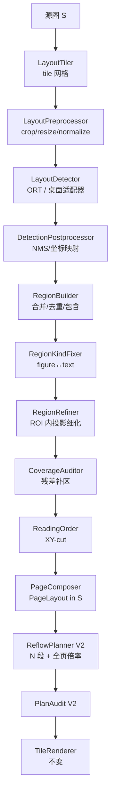
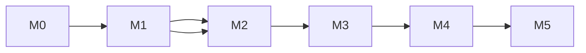

# 07 · V2 计划：版面识别 + 阅读顺序重排

> **当前状态（0.5.1）：v2 不发布。** App 只跑 v1；v2 的代码留在 `:core` / `:cli` 做技术验证，
> 不进入发行包。v1 的规划器**不引用** v2（分流在 `SmartReflow`，只有 CLI 用），
> `scripts/verify-v1-only.ps1` 对 release 的 `classes.dex` / R8 `mapping.txt` 做机检门禁，
> 见 [03 §14.2](03-architecture.md)。本文其余章节是 v2 的设计与实施记录，**不代表发行版行为**。

> 目标：把 v1 的“按行左右对半切”升级为“先识别版面区域，再按阅读顺序排成单列”。
> 依据：需求截图（A–L 流程）、PP-DocLayout-S 官方模型卡/文档（23 类、4.834MB、mAP 70.9、Apache-2.0）、
> `testdata/private/samples*` 的 18 张真实截图、
> 以及当前 `core/`（`RowSegmenter → RowClassifier → ColumnSplitter → ReflowPlanner`）的代码基线。
> 范围：v2.0。仍然不做 OCR、不做语义理解、不联网；所有像素原样搬运。
> 状态：**已停止接入产品（0.5.1）**。M0 已完成：官方模型契约已核对、ONNX 已产出并与官方 Paddle 对拍
> ≤0.01px；`core/layout` 的检测后处理 / tile 网格 / 区域合并 / 细化 / 覆盖审计 / 阅读顺序 / 切点 / 规划 / 审计
> 已实现并带单测。**V2-32（App 接线）与 V2-51（顶栏「强化重排」）已成为历史**：V2-52 决定 0.5 只发 v1，
> v2 留在 `:core`/`:cli` 做技术验证，release 产物由 `scripts/verify-v1-only.ps1` 机检门禁。
> 进度与结论见 §13（§13.6.10 是最终决定）。
> 文中标“待复核”的模型数字已在 M0 用实际模型文件确认（见 §4.2 的实测块），代码以 `models/doclayout/contract.json` 为准。

---

## 0. 先给结论

1. **V2 的增量不是“换个分类器”。** 真正要加的是三件事：区域级版面模型、阅读顺序、按需 N 段切分。
   模型只回答“这是什么区域、大致在哪”，**不回答“这一行从哪切”**；像素级几何仍由投影链路负责。
2. **模型不能单独用。** 480×480 的框最多精确到“区域”，直接拿它裁图会切字、切图、切表格；
   小模型还会漏检，漏检就是丢内容。必须“模型给区域，投影给几何，覆盖审计兜底”。
3. **讨论里的“几十毫秒”是单 tile，不是整页。** 1080×2400 约 3 个 tile，1080×20000 约 20 个；
   整页耗时 = tile 数 ×（解码 + 预处理 + 推理 + 后处理）+ 区域细化。预算必须按整页算。
4. **体积不再设硬上限。** 4.8MB 模型 + 推理 runtime，release 不可能还在 8MB 内；
   预算已确认可增加，具体以 M0/V2-01 的实测为准（APK、下载、安装、内存分别记录），不设强制门槛。
5. **顺序规则按截图执行：先横带、后左右。** 截图的 A、C、B 不是“先文字后图片”，而是
   “同一横带内，左边区域整体读完，再读右边区域”。这条规则要写成可测试的算法，不能让模型“猜”。
6. **字号只用一个 `s`，但“切不动”要有兜底。** TEXT/TITLE/CAPTION 全部乘同一个 `s`；
   CJK 正文找不到字缝时允许每行一次强制切（宁可坏一个字），数字/URL/代码/价格则一次都不切。

---

## 1. 截图到底要求什么

### 1.1 四个阶段

| 阶段 | 截图表现 | 产物 | 由谁负责 |
|---|---|---|---|
| ① 原图 | 一块混排页面：文字块、图片、整行文字、左右并排 | 源图 S 坐标 | 解码层（不变） |
| ② 区域框 | 每个语义块一个框：A/C、B、D、E、F/G/H、I、J/K/L | `LayoutRegion[]`（S 坐标） | 版面模型 + NMS + 合并 |
| ③ 单列顺序 | 框被拉平成一列：A、C、B、D1、D2、E、F、G、H、I、J、K、L | `region.order` / 行序列 | 阅读顺序（XY-cut） |
| ④ 行切分 | 放不下的行再切：J→J1/J2、K→K1/K2、L→L1/L2 | `RenderItem[]`（S→O） | 投影细化 + N 段切分 |

③ 里 D 已经变成 D1/D2，是因为 D 是整行宽文字；④ 里 J/K/L 也各自变成两行，是因为它们在半宽区域里仍然放不下。
**这两步不是两个独立的“重排遍数”，而是同一个“按需切分”的结果**：先定全局字号，再逐行算需要几段。
截图把它们画成两帧，是为了表达“先排顺序、再流行宽”，实现上可以一次算完。

### 1.2 期望输出

```text
A  C  B  D1 D2  E  F  G  H  I  J1 J2  K1 K2  L1 L2
```

- A、C 是左上文字区的两行，按 y 顺序；
- B 是右上图片，整块，不切；
- D 是整行文字，按输出列宽切 2 段；
- E 是图片，整块；
- F、G、H 是右侧半宽文字，各自一行（够宽就不切）；
- I 是图片，整块；
- J、K、L 各自按需切 2 段。

### 1.3 与 v1 的差异

| 维度 | v1（当前） | v2 |
|---|---|---|
| 分割 | 全页水平投影切行带 | 模型区域 + 区域内投影细化 |
| 左右并排 | 同一行带被合并成一条输出行（图注在左、正文在右） | 区域分离，按“横带→左右”排序 |
| 切分 | 只切满宽行，且只对半 | 任意文字行按需切 N 段 |
| 缩放 | 全页一个 `bodyScale`，受“最宽的不切行”压制 | 全页一个 `s`，TEXT/TITLE/CAPTION 共用；不切行不再压全页 |
| 顺序 | 行 y 顺序 | 区域阅读顺序 + 区域内 y 顺序 |
| 长图 | 长边 1600 降采样，1080×20000 只剩 86px 宽 | 按 tile 从源图取样，按页宽定标 |
| 依赖 | 0 | 约 4.7MB 模型 + 推理 runtime |
| 体积 | <8MB | 实测记录，不设硬上限 |
| 失败 | 回退原图 | 先回退 v1，再回退原图 |

双栏报刊是一个额外收益：v1 检测到多栏直接回退，v2 若模型把两栏分成两个区域，XY-cut 会先读完左栏再读右栏，
**顺序天然正确**。但前提是模型真的分开了两栏；分不开时仍回退（见 §4.7.3）。

---

## 2. 这个方案有 8 个真问题

> 这一节是评审重点。每条都给出“现象 / 证据 / 后果 / 对策”，对策会落到后面的任务卡。

### 2.1 480×480 的框不能直接用来裁像素

**现象**：模型输入 480×480（社区 ONNX 口径；官方 `img_size` 默认 `None`，M0 确认）；
1080 宽的页面映射到 480，1 个模型像素 ≈ 2.25 个源像素。
PicoDet 的 stride 通常是 8/16/32/64，反算到源图就是 18–144px 的量化误差；再加 NMS 抖动。
一行正文只有 22px 高、一行字间距只有 2–4px。

**后果**：直接用模型框 `drawBitmap`，会切掉半行字、切掉图片边缘、把表格切掉一行。
这不是“精度差一点”，是**不可逆的内容破坏**。

**对策**：

- 模型框只作为 **ROI**（约 ±8–16px 的容差），在 ROI 内重新跑 v1 的
  `BackgroundEstimator → Binarizer → RowSegmenter → RowClassifier`，得到像素级行带；
- 渲染只用细化后的 `TextLine.band`，不用模型框；
- 细化失败（0 行、墨量过低）→ 该区域降级为 FIGURE 整块保留，不硬切。

**验收**：合成页上，模型框故意偏移 ±12px，细化后的行带与真实行 y 范围误差 ≤1px；切点仍落在字缝。

### 2.2 长图/宽图的分辨率：v1 的“长边 1600”会把长图压成一条

> **[已修 · 2026-10-31]** v1 的定标规则已改为**宽度优先**（`AnalysisScale`：`k = min(1, analysisMaxWidth/srcW)`），
> 像素超预算时按高度切条带（`StripLayoutAnalyzer`，块高 3000 / 重叠 48 / 并行 / 行带缝合）。
> 690×10305 现在是 690×10305 的分析图、230 行（旧规则 107×1598、87 行）；同一张图 gain 从虚高的
> 1.92 回到 0.79，正确回退原图。本节保留作为背景与 v2 的对照。

**现象**：`BitmapDecoder` 用 `max(w,h)=1600` 降采样。1080×20000 的长图会变成 **86×1600**。
v1 只需要行投影，86px 宽还能切行；但 v2 要送模型 480 宽，86px 根本不够，字缝切分也失效。

**证据**：`app/.../image/BitmapDecoder.kt` 的 `scaleToAnalysis()` 用 `maxSide`；
`docs/02` §3 也明确“长边 ≤1600”。1080×20000 → `k = 86/1080 ≈ 0.08`。

**后果**：长截图是本品类的核心场景，如果 v2 沿用它，模型看到的是一张 86px 宽的缩略图，
区域检测和字缝切分都是假的。

**对策**：

1. **模型 tile 从源图取样，不从全局分析图取样。** 新增 `TileSampler`：
   - App：`BitmapRegionDecoder.decodeRegion` + `inSampleSize`，按 tile 解码 1080×1080；
   - CLI/测试：`BufferedImage.getSubimage`；
2. **分析分辨率改为“按宽度定标 + 分条带”**，不再按长边。v2 的区域细化是逐 ROI 做的，
   不需要一张全页大图；全页只需要一个粗略的行/区域统计；
3. 对 1080×20000，模型 20 个 tile；每个 tile 1080×1080 源像素，缩放 0.444 后送 480；
   内存峰值只多一张 tile（约 4.6MB ARGB），不是 86MB 的全页。

> **这不只是 v2 的问题。** v1 在 1080×20000 上的切点质量同样受 86px 宽度限制。
> v2 顺手把“长图分析”修对，是必要的技术债偿还，不是可选项。

### 2.3 漏检就是丢内容

**现象**：4.8MB 的 S 模型是为文档扫描件训练的；对截图里的状态栏、按钮、表情、水印、手写、
竖排、低对比度小字，漏检率会明显高于大模型。讨论里也提到“可能存在部分漏检”。

**后果**：如果只渲染“检测到的区域”，没检测到的文字会从阅读页消失。
这直接违反项目第一原则：**宁可排版难看，不可丢内容**。

**对策（硬门槛）**：

1. **覆盖审计**：每个 tile 内算一次“墨迹 mask”，再算“被接受区域覆盖的墨迹”；
   `coverage = coveredInk / totalInk`，整页要求 ≥ 99.5%；
2. **残差补区**：未覆盖的墨迹按行/连通聚类成 `RESIDUAL` 区域，再做一次细化；
   文字状 → TEXT，块状 → FIGURE，绝不丢弃；
3. **回退**：残差面积 > 5% 页面积，或补区后 coverage 仍 < 99.5% → 整页回退 v1；
4. **包含关系**：一个区域被另一个更高优先级区域包含 ≥80% 时，只保留外层（内容在外层里），
   避免重复；除此之外每个区域都必须至少产出一个 `RenderItem`。

**验收**：构造“模型漏掉一段文字”的合成页，残差补区必须把它找回来；
`PlanAudit` 对每个区域断言“至少一个 item”，否则整页回退。

### 2.4 模型不输出阅读顺序

**现象**：PP-DocLayout 系列输出的是框 + 类别 + 分数，不输出 reading order。
截图里的 A、C、B 顺序需要自己算。

**后果**：如果按 `(top, left)` 简单排序，双栏页面会左右交错、图注会跑到正文前面、
卡片网格会乱序；这比 v1 的“行 y 顺序”更糟。

**对策**：实现**递归 XY-cut**（§4.7）：

1. 先找“贯通整页宽度的水平空白带”，把页面切成横带，按 y 排序；
2. 每个横带内找“贯通整带高度的竖直空白带”，切成列，按 x 排序；
3. 对每个单元格递归；
4. 两个方向都切不开且区域数 >1 → `orderAmbiguous = true`，退回稳定排序并记入审计；
   这类页面不强行“猜顺序”，必要时回退 v1。

**验收**：截图用例必须输出 `A C B D1 D2 E F G H I J1 J2 K1 K2 L1 L2`；
双栏、通栏标题、侧图注、2×2 卡片网格各有独立用例。

### 2.5 单 tile 几十毫秒 ≠ 整页几十毫秒

**现象**：讨论中的 10ms（服务器 CPU）/ 2.4ms（GPU）/ 5–20ms（手机）都是 **一次 480×480 推理**。
官方文档给 PP-DocLayout-S 的实测是 **18.53ms（FP32 / 8 线程 / Xeon 6271C）**，高性能模式 6.29ms；
讨论里的 10ms 接近前者，手机端通常更慢。整页要切 tile：

| 页面 | 缩放 | tile 源尺寸 | tile 数 |
|---|---|---|---|
| 1080×2400 | 0.444 | 1080×1080 | 3 |
| 1080×20000 | 0.444 | 1080×1080 | 20 |
| 1920×1080 | 0.350 | 1371×1371 | 2 |
| 3000×2000 | 0.350 | 1371×1371 | 6 |
| 600×800 | 0.800 | 600×600 | 2 |

> `600×800` 那一格原文写 1，按 §4.1 的公式是 **2**（`tileH = tileW = 600`、`stride = 536`、
> `ceil((800-600)/536)+1 = 2`）。以公式为准，`TileGridTest` 已按 2 断言。
>
> M0 实测（2026-10-30）：ONNX 4.69MiB、opset 13、ORT CPU 单 tile 中位 **20.8ms**（x86 开发机，4 线程），
> 与本节“20ms/tile”的预算假设一致；arm64 手机端仍未测。

**后果**：20 个 tile × 20ms = 400ms，还没算解码、缩放、NMS、区域细化。
如果按“模型只要 10ms”做预算，首屏必然超。

**对策**：

- 预算按整页写：1080×2400 模型 ≤120ms、总分析 ≤350ms；1080×20000 模型 ≤500ms、总分析 ≤1.5s；
- tile 解码与推理流水化（解码下一个 tile 时推理当前 tile），M4 再做；
- 先保证正确性，再做并发；不要为了“几十毫秒”牺牲覆盖率。

### 2.6 APK 8MB 目标与 runtime 冲突（v2 不再设硬上限）

**现象**：ORT Android 的 `libonnxruntime.so` 单 ABI 约 4–6MB（压缩后 2–3MB），模型 4.7MB。
即使只打 arm64，release 也会到 12–17MB；加 x86_64/armeabi-v7a 更大。

**后果**：`docs/04` 的 M5 出口条件“release APK < 8MB”在 v2 不可能成立。

**对策**（见 §8 D-V2-1）：

- 方案 A（推荐）：ORT Android + `arm64-v8a`（debug 加 `x86_64`）；**不设硬性体积上限**，
  M0/V2-01 实测 APK、下载、安装体积与内存，再决定是否换 runtime / 分 ABI；
- 方案 B：改用 MNN/NCNN 等更小 runtime，代价是 JNI/NDK 与转换成本；
- 方案 C：AAB 按 ABI 分发，降低下载体积，但侧载 APK 仍大；
- 无论哪个方案，M0 必须先量出真实数字，不能先写代码再发现包炸了。

### 2.7 模型类别 ≠ 产品角色；截图不是文档

**现象**：模型的 `text` 既可能是正文，也可能是按钮文字、时间戳、弹幕；
`figure` 既可能是照片，也可能是头像、图标、整张海报。模型训练分布是文档扫描件，
手机截图里的卡片、气泡、状态栏、emoji 都不在分布内。

**官方口径（2026-10 核对）**：PP-DocLayout-S 是 **23 类、4.834MB、mAP(0.5)=70.9**；
评估集是 500 张文档图（论文、杂志、合同、书本、试卷、研报），**不是手机截图**。
70.9 不能当作截图上的精度预期；它只说明“文档页上大概能用”，截图必须实测。

**后果**：

- 把按钮行当正文切 → 图标被切成两半（v1 踩过，v1.1 用行级角色修好）；
- 把整张文字卡片当 figure → 文字不放大，用户觉得“没效果”；
- 把海报当 text → 文字叠图被切碎。

**对策**：

1. 显式**标签→角色映射表**（§4.3），未知标签一律 `OTHER`（整块保留，不切）；
2. **区域二次判定**（§4.4）：figure 区域内若细化出 ≥3 条稳定文字行且密度低 → 改判 TEXT；
   text 区域内若 0 行或密度 >0.6 → 改判 FIGURE；
3. 行级角色仍由 `RowClassifier` 决定（UI/HEADING/CAPTION/BODY），模型标签只做先验；
4. 海报/复杂叠图作为**负样例**：允许回退 ORIGINAL，不要求重排。

### 2.8 统一缩放不能丢

**现象**：模型把页面切成区域后，最自然的错误是“每个区域各自缩放到屏宽”。
这样半宽区域会被放大 2 倍，整宽区域只放大 1 倍，同一页出现两三种字号——
这正是 v1.0 的“标题 1.62×、正文 2.81×”翻版。

**后果**：阅读页字号忽大忽小，比不重排还难读。

**对策**：

- **全页一个倍率 `s`，而不是每种角色一个倍率**：TEXT / TITLE / CAPTION 都乘同一个 `s`，
  源图的层级（标题大、图注小）按同一比例保留；不再有 `0.9 × bodyScale` 的图注、
  也不再有 `min(bodyScale, 列宽/行宽)` 的标题；
- `s` 只由 **BODY 行高的中位数** 算一次（`em ≈ 0.92 × medH`），不逐行估字号，避免标题把倍率拉花；
- **只放大、不缩小**：`s = max(s, 1.0)`；大字图交给 `gain ≥ 1.25` 回退，不能用重排把字改小；
- 窄区域不拉伸到全宽，左对齐，右侧留白；这是诚实的排版，不是缺陷；
- UI/CHROME 例外：`min(s, 1.5)`，否则状态栏、按钮、头像会被放大得离谱；图/表按宽度适配，不参与文字倍率；
- `PlanAudit` 断言 TEXT/TITLE/CAPTION 的实际缩放与 `s` 偏差 ≤2%，UI ≤1.5，图/表不越界；
- 收益门槛 `gain ≥ 1.25` 保留。

### 2.9 其它必须记录的问题（不单独展开）

| # | 问题 | 对策 |
|---|---|---|
| a | 模型许可证/来源不明 | M0 记录模型卡、SHA-256、opset、导出者；许可证不允许就换方案 |
| b | 预处理/后处理与训练不一致，框系统性偏移 | M0 用 Python 参考实现对齐，Kotlin 与参考误差 ≤2px |
| c | 竖排/希伯来语 RTL | `vertical_text` 或竖排占比 >30% → ORIGINAL；RTL 无可靠信号，保留手动开关/已知限制 |
| d | 表格被切开就废 | 表格整块当 FIGURE，不切；超宽等比缩小 |
| e | 文字叠在图片上 | 区域包含关系去重；无法判断时保留整图，文字不单独切 |
| f | 模型输出不确定（浮点/线程差异） | 黄金测试只锁类别/数量/顺序，框用容差；纯 Kotlin 后处理用固定 fixture |
| g | `:core` 被 native 依赖污染，单测跑不动 | 检测接口放 `:core`，ORT 实现只在 `app`/`cli`；`:core:test` 不加载模型 |
| h | 16KB page size（Android 15+） | 选 ORT ≥1.19 并检查 `.so` 对齐；M4 验证 |

---

## 3. 目标架构

### 3.1 一张图



### 3.2 模块边界

| 模块 | 放什么 | 不放什么 |
|---|---|---|
| `:core` | 纯 Kotlin：tile 网格、预处理、NMS、标签映射、区域合并、细化、覆盖审计、XY-cut、组装、规划、审计 | ORT、Android、Bitmap、文件 IO |
| `:app` | ORT Android 适配器、模型资产拷贝、`BitmapRegionDecoder` 采样、UI/设置/进度 | 版式算法 |
| `:cli` | ORT 桌面适配器、`BufferedImage` 采样、调参输出 | 产品 UI |
| `models/` | ONNX、contract、LICENSE、SHA-256 | 代码 |

`:core` 仍然不 import `android.*`；`:core:test` 不加载 native 库。这是硬约束。

### 3.3 坐标系统

| 坐标系 | 记号 | 定义 | 用途 |
|---|---|---|---|
| 源图 | S | 原始像素（EXIF 已纠正） | 模型框、细化行带、渲染 `src` |
| tile | T | 480×480 模型输入像素 | 模型输出、NMS 前 |
| 输出 | O | 重排结果像素 | `dest` |

v2 的 `PageLayout` 统一用 **S 坐标 + `analysisScale = 1.0`**。
理由：v2 不分配全页分析位图，不需要 A 空间；S 坐标让模型框、细化行带、渲染矩形三者一致，
少一层换算就少一类 bug。v1 路径保持 A 坐标不变，两条路径靠 `strategy` 区分。

tile 映射（全尺寸 tile）：

```text
x_src = tile.left + x_tile / scale
y_src = tile.top  + y_tile / scale
scale = tile.srcWidth / 480        // 每页固定
```

边缘 tile **不补边**：把最后一行/列 tile 往页内平移（`min(index*stride, pageW-tileW)`），
用重叠 + 全局 NMS 去重。这样所有 tile 都是满 480×480，避免 padding 造成的分布偏移。
只有页面本身小于一个 tile 时才补边（居中，用页面底色）。

### 3.4 数据模型

```kotlin
// core/model/LayoutRegion.kt
enum class RegionKind { TEXT, TITLE, FIGURE, TABLE, CAPTION, CHROME, OTHER }
enum class RegionSource { MODEL, MODEL_FIXED, RESIDUAL, HEURISTIC }
enum class LayoutStrategy { PROJECTION, DOC_LAYOUT }

data class LayoutRegion(
    val id: Int,
    val kind: RegionKind,
    val bounds: RectI,                 // S
    val lines: List<TextLine> = emptyList(), // S（v2 下 TextLine.band 就是 S）
    val order: Int = -1,
    val confidence: Float = 1f,
    val source: RegionSource = RegionSource.MODEL,
    val label: String = "",            // 模型原始标签，便于调试
)
```

对现有模型的改动**全部带默认值**，不破坏旧构造：

```kotlin
data class PageLayout(
    // ... 现有字段不动
    val regions: List<LayoutRegion> = emptyList(),
    val strategy: LayoutStrategy = LayoutStrategy.PROJECTION,
)

data class ReflowPlan(
    // ... 现有字段不动
    val strategy: LayoutStrategy = LayoutStrategy.PROJECTION,
)

data class ReflowOptions(
    // ... 现有字段不动
    val maxSegmentsPerLine: Int = 6,     // 单行软上限
    val hardMaxSegments: Int = 8,        // 单行硬上限；超过则压缩该行
    val forcedCutPerLine: Int = 1,       // 每行最多几个“劈字”切点
    val forcedCutPageRatio: Float = 0.10f, // 全页强制切行占比目标
    val sensitiveCompressedRatio: Float = 0.05f,
    val regionGapRatio: Float = 0.5f,    // 区域间距 × 输出字高
)
```

`RenderItem.TextRow` 增加 `regionIndex: Int = -1`、`segmentIndex: Int = 0`、`segments: Int = 1`，
只用于审计和调试，不影响渲染。

---

## 4. 关键设计

### 4.1 Tile 网格

```kotlin
data class LayoutOptions(
    val modelInput: Int = 480,       // 社区 ONNX 口径；官方 img_size 待 M0 确认
    val overlapPx: Int = 64,
    val minScale: Float = 0.35f,
    val maxScale: Float = 1.0f,
    val scoreThreshold: Float = 0.40f,
    val nmsIou: Float = 0.50f,
    val minCoverage: Float = 0.995f,
    val residualInkRatio: Float = 0.003f,
    val maxTiles: Int = 64,
    val maxSegmentsPerLine: Int = 6,
)
```

```text
scale   = clamp(480 / pageW, minScale, maxScale)
tileW   = min(pageW, round(480 / scale))
stride  = max(1, tileW - overlapPx)
cols    = max(1, ceil((pageW - tileW) / stride) + 1)
rows    = max(1, ceil((pageH - tileH) / stride) + 1)
x(i)    = min(i * stride, max(0, pageW - tileW))   // 最后一列贴边
y(j)    = min(j * stride, max(0, pageH - tileH))   // 最后一行贴边
```

- `tileH` 与 `tileW` 相同（模型固定方形输入）；
- 页面很窄（600px）时 `scale=0.8`、`tileW=600`，只补少量边；
- 页面很宽（1920px）时 `scale=0.35`、`tileW=1371`，横向 2 列；
- `maxTiles=64` 是保护：超过就回退 v1，并记 `layout_too_many_tiles`。

**验收**：`TileGridTest` 覆盖 §2.5 表格里的五种尺寸，tile 数、贴边、重叠全部对上。

### 4.2 模型契约（M0 必须产出）

不要凭记忆写预处理。M0 产出 `models/doclayout/contract.json`：

```json
{
  "model": "PP-DocLayout-S",
  "version": "官方推理模型 / 以实际下载为准",
  "source": "https://huggingface.co/PaddlePaddle/PP-DocLayout-S",
  "docs": "https://www.paddleocr.ai/main/version3.x/module_usage/layout_detection.html",
  "license": "Apache-2.0",
  "mAP50": 70.9,
  "classes": 23,
  "artifact": "PP-DocLayout-S_infer.tar（Paddle inference）",
  "tarSha256": "待填",
  "onnxExport": {
    "tool": "Paddle2ONNX",
    "version": "待填",
    "opset": "待填",
    "sha256": "待填"
  },
  "input": {
    "name": "待填",
    "shape": [1, 3, 480, 480],
    "layout": "NCHW",
    "dtype": "float32"
  },
  "preprocess": {
    "resize": "stretch|letterbox",
    "keepRatio": false,
    "mean": [0.485, 0.456, 0.406],
    "std": [0.229, 0.224, 0.225],
    "padValue": 114
  },
  "output": {
    "name": "待填",
    "shape": [1, 100, 6],
    "fields": ["class_id", "score", "x1", "y1", "x2", "y2"],
    "normalized": false,
    "nmsBuiltIn": true
  },
  "nms": { "iou": 0.6, "score": 0.4 },
  "labels": ["doc_title", "paragraph_title", "text", "page_number", "..."],
  "note": "labels 顺序、输入尺寸、mean/std 全部从模型 metadata 读，不按本文硬编码"
}
```

> 官方产物是 **Paddle inference `.tar`**，不是 ONNX；ONNX 必须由 Paddle2ONNX 转换，
> 并把转换工具/版本/opset 一起记录。不要直接用一个来源不明的社区 ONNX 当基线。
> 480×480 是社区 ONNX 的口径；官方 `img_size` 默认 `None`，M0 要从模型配置确认。

M0 同时写一个**只用于对拍的 Python 脚本** `tools/doclayout_reference.py`：
先用官方 Paddle 推理跑 3 张图，再用 ONNX 跑同一批图；两者框误差 ≤2px，才允许 Kotlin 接。
Kotlin/CLI 的结果再与 ONNX 参考对齐（同样 ≤2px）。

必须核实的点：

1. 输入是 NCHW 还是 NHWC；mean/std 还是 /255；
2. resize 是直接拉伸到 480×480，还是保持比例 + padding；
3. 输出是“已 NMS 的 `[1,N,6]`”，还是 PicoDet 的 4 个 raw head；
4. 坐标是 0–480 像素还是 0–1 归一化；
5. 类别数、label 顺序、是否有 `vertical_text`；
6. 模型许可证是否允许随 APK 分发（官方为 **Apache-2.0**，仍需在 NOTICE 记录）；
7. 官方 tar → ONNX 的转换链（Paddle2ONNX 版本/opset）是否可复现；
8. 23 类的实际 label 顺序（不要按本文表硬编码）；
9. `img_size` 是固定 480 还是动态；动态的话 tile 可以更大，耗时模型要重算。

> 只要第 1–5 条有一条猜错，框就会系统性偏移，后面所有验收都会变成“调参”。
> 这是 M0 的唯一目的：**把不确定性关在模型契约里**。

#### 4.2.1 M0 实测结果（2026-10-30，已落库）

上面的模板是“写之前的样子”。实际模型跑通后，**有 6 处必须改**，原文保留是为了说明“照模板写会错”：

| 模板里的写法 | 实测事实 | 影响 |
|---|---|---|
| 单个输入 | **两个**：`image [1,3,480,480]` + `scale_factor [1,2]` | 少喂一个直接报 missing input；`scale_factor` 恒喂 `[1,1]` |
| 输出 `[1,100,6]` | `fetch_name_0` 是 **`[N,6]` 动态 N**（白图 N=7，截图可顶到 100）+ `fetch_name_1 [1] int32` 计数 | 必须按第 0 维实际长度解析，不能假设 100 |
| `nmsBuiltIn: true`（0.4/0.6） | 图内确实有 NMS，但阈值是 **score 0.025 / iou 0.6 / keep_top_k 100** | **0.3 阈值 + 0.5 类内 NMS 必须客户端做**，否则低分垃圾框全进来 |
| `padValue: 114` | **没有 padding**：`keep_ratio: false`，纯 stretch | 保留 `padValue` 只用于“页面小于一个 tile”时我们自己的居中填充 |
| `artifact: PP-DocLayout-S_infer.tar` | HF 仓库是 PIR 三件套（`inference.json` + `.pdiparams` + `inference.yml`），没有 tar | `tarSha256` 不适用；转换必须装 `paddlepaddle`（paddle2onnx 2.1.0 的 `.pyd` 链接了 `libpaddle.pyd`） |
| `labels[0] = doc_title`（本文 §4.3 的直觉） | 官方 `label_list[0]` 是 **`paragraph_title`**，`doc_title` 是 11 | 已按 `config.json` 硬校验，见 `ModelLabelsTest` |

实测数字：

```text
ONNX     4,914,725 B（4.69 MiB）  sha256 3cfcad68…162e9  opset 13  IR 7  568 节点
Paddle 3.1.1 vs ONNX   01-article-light 25/25 框、03-news-columns 31/31 框，
                       类别零错配，坐标最大差 0.01px（要求 ≤2px）
单 tile 推理            中位 20.8ms（x86 开发机 CPU，ORT 1.23.2，默认线程）
```

产物与证据：`models/doclayout/{contract.json,CONVERSION.md,PP-DocLayout-S.onnx,SHA256SUMS}`、
`tools/doclayout_reference.py`（ONNX 参考）、`tools/compare_paddle_onnx.py`（对拍）。

> 结论：第 1–5 条全部核实，`img_size` 是**固定 480**（锚点 4789 = 60²+30²+15²+8²），
> 所以“动态 img_size 可以放大 tile”这条路走不通，§4.1 的 `modelInput = 480` 保持不变。

### 4.3 标签 → 角色映射

> 官方口径是 **23 类**；不同版本/导出的 label 顺序可能不同。下表是“常见标签 → 角色”的
> 语义映射，实现时用 `ModelLabels.kt` 按实际 metadata 建 id→label→role，不按本文顺序硬编码。

| 模型标签（示例，M0 用实际列表替换） | `RegionKind` | 行角色先验 | 切分 | 缩放 |
|---|---|---|---|---|
| `text`, `abstract`, `table_of_contents`, `reference`, `reference_content`, `algorithm` | TEXT | BODY | 按需 N 段，允许一次强制切 | **`s`** |
| `doc_title`, `paragraph_title` | TITLE | HEADING | 按需 N 段，允许一次强制切 | **`s`** |
| `figure_title`, `table_title`, `chart_title`, `footnote`, `aside_text` | CAPTION | CAPTION | 只走硬/软缝，**不强制** | **`s`**（不乘 0.9） |
| `image`, `chart`, `formula`, `formula_number`, `seal` | FIGURE | — | 不切 | `clamp(列宽/宽, 1.0, 2.2)` |
| `table` | TABLE | — | 不切 | `min(2.2, 列宽/宽)`，超宽缩小 |
| `header`, `footer`, `page_number`, `header_image`, `footer_image` | CHROME | UI | 不切 | `min(s, 1.0)` |
| `vertical_text`（若模型有；没有就靠投影主方向判断） | OTHER | — | 不切 | 整块；页占比 >30% → ORIGINAL |
| 未知 | OTHER | — | 不切 | 整块保留 |

> 统一倍率只覆盖 **TEXT / TITLE / CAPTION**。UI 行、状态栏、按钮、头像、图块、表格不参与，
> 否则“全页统一”会变成“全页都巨大”。`s` 的下限是 1.0，上限是 `maxScale` 与目标字身。

映射表放 `ModelLabels.kt`，单测断言“0..labels.size-1 每个 id 都有映射”，未知走 OTHER 并打日志。

### 4.4 区域合并、去重与二次判定

模型可能在 tile 边缘重复检测、把一个段落拆成多个框、或把整张卡片判成 figure。按顺序处理：

1. **全局去重**：所有 tile 的框映射到 S 后，按类别做 NMS（IoU 0.5，跨 tile 也做）；
2. **包含去重**：若 `area(A∩B)/area(B) ≥ 0.8`：
   - 同族（都 text / 都 figure）→ 保留大的；
   - text 在 figure 内 → 先保留 figure，交给第 4 步判定；
   - figure 在 text 内 → 保留 text（小图标/头像不单独成块）；
3. **文本合并**：两个 TEXT 框水平重叠 ≥50%，垂直间距 ≤1.2×行高中位数 → 合并；
4. **二次判定**（`RegionKindFixer`）：
   - FIGURE 内细化出 ≥3 条稳定行（行高 CV <0.25、宽度中位数 ≥0.5×区域宽、密度 <0.30）
     → 改判 TEXT（`MODEL_FIXED`）；
   - TEXT 内细化出 0 行，或密度 >0.62 / `maxRun > 2.6×行高` → 改判 FIGURE；
5. **横向并排不合并**：A/C 与 B 是同一横带的两列，不能因为 y 重叠就合并。

### 4.5 文本区细化

对每个 TEXT/TITLE/CAPTION 区域，取 `bounds` 外扩 6px 的 ROI：

```text
crop   = clamp(roi, page)
r      = min(1.0, 1400 / crop.width, sqrt(2_500_000 / crop.area))
gray   = 灰度 + 背景估计 + Otsu（复用 v1）
mask   = 二值化 + 去噪（复用 v1）
bands  = RowSegmenter(mask)            // 行带
lines  = RowClassifier(bands)          // BODY/HEADING/CAPTION/UI
cuts   = 每行的安全字缝（复用 ColumnSplitter/ColumnInk）
```

- 坐标从 ROI 换回 S：`line.band + (crop.left, crop.top)`；
- `cut` 也换回 S；
- 模型标签覆盖行角色：TITLE → HEADING，CAPTION → CAPTION，CHROME → UI；其余保留 `RowClassifier` 结论；
- 如果 ROI 内行数 >0，但某行宽度 <0.1×区域宽 → 丢掉（噪声/边框）；
- 细化使用 v1 的参数，不改默认值；需要调就在 `AnalysisOptions` 里加 v2 专用字段，不动 v1 基线。

**为什么不在全局分析图上细化**：全局图长边 1600，长图只有 86px 宽；ROI 是局部 1080px，
分辨率足够，且内存只跟 ROI 走。这是 §2.2 的落地方式。

### 4.6 覆盖审计与残差

每个 tile 内（T 空间，480×480）：

```text
ink        = Otsu(gray) > t                    // 与细化同一套二值化
covered    = 所有已接受区域映射到该 tile 的并集
uncovered  = ink && !covered
ratio      = uncovered.count / ink.count
```

- `ratio ≤ 0.5%`：正常；
- `0.5% < ratio ≤ 5%`：把 `uncovered` 的 bbox 聚成残差框，映射回 S，走一次细化和二次判定；
- `ratio > 5%`：记 `layout_residual_high`，整页回退 v1；
- 整页 `coverage = ΣcoveredInk / Σink`，必须 ≥99.5%。

残差框的合并：相邻/重叠的残差框按 8px 膨胀后 union；一个残差框内如果细化出 ≥2 行 → TEXT，
否则 → FIGURE（保留像素，不切）。残差区域同样参与阅读顺序。

> 这条是“模型漏检不丢内容”的最后一道闸。没有它，V2 不能上线。

### 4.7 阅读顺序

#### 4.7.1 递归 XY-cut

```kotlin
fun order(regions: List<LayoutRegion>): OrderResult {
    if (regions.size <= 1) return OrderResult(regions, ambiguous = false)

    val bands = splitByFullWidthGaps(regions, minGapY)   // 横带，按 top 升序
    if (bands.size > 1) {
        return bands.flatMapOrdered { order(it) }        // 先上后下
    }

    val cols = splitByFullHeightGaps(regions, minGapX)   // 竖列，按 left 升序
    if (cols.size > 1) {
        return cols.flatMapOrdered { order(it) }         // 先左后右
    }

    // 两个方向都切不开：稳定排序 + 标记歧义
    return OrderResult(
        regions.sortedWith(compareBy({ it.bounds.top }, { it.bounds.left })),
        ambiguous = true,
    )
}
```

- `splitByFullWidthGaps`：把所有框投影到 y，找“没有任何框覆盖”的区间；
  区间高度 ≥ `minGapY = max(4, 0.25×行高中位数)` 才算断带；
- `splitByFullHeightGaps`：同理投影到 x，`minGapX = max(4, 0.5×行高中位数)`；
- 断带/断列必须是**整条贯通**的（所有框都不跨越），否则不算；
- 递归深度上限 32，防御异常输入。

#### 4.7.2 截图用例

| 层 | 切分 | 结果 |
|---|---|---|
| 全页 | 横向断带：y≈110–120、160–180、330–350 | `[A,C,B] [D] [E,F,G,H] [I,J,K,L]` |
| 第 1 带 | 竖向断带：A/C 右缘与 B 左缘之间 | `[A,C] [B]` |
| 第 3 带 | 竖向断带：E 右缘与 F/G/H 左缘之间 | `[E] [F,G,H]` |
| 第 4 带 | 竖向断带：I 右缘与 J/K/L 左缘之间 | `[I] [J,K,L]` |

最终：`A C B D1 D2 E F G H I J1 J2 K1 K2 L1 L2`。
A、C 谁先谁后由区域内行 y 顺序决定；如果模型把 A、C 分成两个框，它们在同一列，递归后仍按 y 排。

#### 4.7.3 切不开时怎么办

- `ambiguous=true` 且区域数 ≥4：记 `layout_order_ambiguous`，**仍然用稳定排序出图**（通常 top-left 已经够用），
  但 CLI 报告标红；如果该页在 v1 下本来能正常重排，允许人工选择 v1（设置项）。
- 文本区内部如果被 `MultiColumnDetector` 判定为双栏（模型没分开两栏）：
  - v2.0 直接整页回退 v1（v1 会 `MULTI_COLUMN` → 原图），不冒险；
  - v2.1 再做“区域内按栏再切”；
- 竖排：`vertical_text` 面积 >30% → ORIGINAL；否则整块保留。

### 4.8 按需 N 段切分与全页倍率

#### 4.8.1 一个倍率 `s`，不是每种角色一个倍率

```text
emBody = 0.92 × medianLineHeight(BODY 行；没有 BODY 时用全部 TEXT/TITLE/CAPTION)
s      = min(targetEm / emBody, maxScale)
s      = max(s, 1.0)          // 只放大、不缩小；大字图交给 gain 门槛回退
```

- **TEXT / TITLE / CAPTION 全部乘同一个 `s`**：标题仍然比正文大、图注仍然比正文小，
  因为源图的比例被原样保留；不再有 `0.9 × s` 的图注，也不再有“标题装不下就单独压小”；
- `s` 只用 **BODY 行高中位数** 算一次。不要逐行估字号：标题行高大会把 s 拉低，图注行高小会把 s 拉高；
- **不再有 v1 的 `byUnsplit`**（用“最宽的不切正文行”压全页倍率）。任何 TEXT/TITLE 行都可以按需切；
  只有 CAPTION / CHROME 这类不强制切的行，才在**行级**压缩，不拉低全页 `s`；
- 段数上限：`softMax = 6`，`hardMax = 8`。某行需要超过 `hardMax` 段时，优先给满 `hardMax`；
  仍放不下 → 该行压缩（`line_compressed`），**不为了这一行降全页 s**；
- UI 行：`min(s, 1.5)`；CHROME：`min(s, 1.0)`；FIGURE/TABLE：`min(2.2, contentW / 宽)`，超宽缩小；
- `gain = s × srcW / outW`，`gain < 1.25` → `ORIGINAL`；
- 如果某行按 `s` 需要 >`hardMax` 段，且它是**敏感行**（见 4.8.2），则该行压缩，不改变 `s`；
  如果敏感行压缩比例 >5%，整页回退 v1。

> 为什么用 BODY 中位数而不是全页中位数：一页里标题行可能只有 2 行、图注 3 行，正文 20 行；
> 全页中位数会被短文本带偏。BODY 为 0 时才退回全部文字行。

> **统一倍率的代价**：如果源图标题字高是正文的 3 倍，输出标题就是正文的 6 倍（`s=2`），
> 可能一行只放得下两三个字。这是“保留源层级”的必然结果；如果产品不接受，只能给标题单独设
> **输出字高上限**（例如 ≤2.2× 正文），那就不是“所有文字同一倍率”了。这条需要拍板（D-V2-9）。

#### 4.8.2 三级切点：硬缝 → 软缝 → 强制

```text
对每个理想分界点 target = line.left + line.width × i / need：
  1) 硬缝：整行零墨列，宽度 ≥ max(2, 0.10 × medH)
  2) 软缝：1–2px 低墨（ink ≤ 1.5），局部最小，宽度 ≥ 1
  3) 强制：target ± 8% 行宽内 ink 最小的列（仍要求是局部最小）
找不到任何一级 → 减一段；最终 1 段仍放不下 → 压缩该行，记 line_compressed
```

**强制切不是“从正中间切”**：几何中点大概率落在笔画上；在目标附近找 ink 最小的列，
多数时候仍然落在字边/笔画最薄处。只有整段所有列都差不多时，才会接近中点。

强制切的准入（全部满足才允许）：

| 条件 | 说明 |
|---|---|
| `kind ∈ {TEXT, TITLE}` | CAPTION 里的日期/数字多，不强制；UI/CHROME 不切 |
| `isCjkDominant(line)` | 宽墨簇（≥0.6×medH）占比 ≥60%；拉丁/数字行不走强制 |
| `!isLatinLike(line)` 且 `!hasUrlOrCode(line)` | 沿用 v1 的 P1-1 特征；URL/代码/英文单词不切 |
| 行密度 <0.62 且 `maxRun < 2.6×medH` | 否则先怀疑“这是图不是字”，交给 `RegionKindFixer` |
| 该行强制切点 ≤1 个 | 4 段最多 3 个刀口，不允许 3 个都劈字 |
| 切点两侧不能都是窄墨簇 | 两侧都 <0.6×medH 时，可能是数字/拉丁字内部；换列或放弃强制 |
| 全页 `forcedLines / splitLines ≤ 10%` | 超过 10% 记 `forced_cut_high`；超过 15% 审计失败、回退 v1 |

**敏感行**（拉丁/URL/代码/价格/长数字）找不到硬/软缝时：不强制，按列宽压缩该行，
记 `sensitive_compressed`；敏感行比例 >5% → 回退 v1（沿用 P1-1 的“不劈词”原则）。

**像素归属**：左段 `[x0, c)`，右段 `[c, x1)`；`c` 归右段。不重叠、不丢列、不做“1px 羽化”。
强制切只改变“在哪里断开”，不改变像素内容；这是“可读性优先”的例外，不是默认策略。

| 行类型 | 硬缝 | 软缝 | 强制 | 找不到时 |
|---|---|---|---|---|
| CJK 正文 / 标题 | ✓ | ✓ | ✓（≤1/行） | 强制，保住全页字号 |
| 图注（日期/数字） | ✓ | ✓ | ✗ | 压缩该行 |
| 拉丁 / URL / 代码 / 价格 | ✓ | ✓（仅词边界） | ✗ | 压缩该行；比例高则回退 |
| UI / 状态栏 / 按钮 | ✗ | ✗ | ✗ | 按宽度缩，不切 |
| 图 / 表 / 海报 | ✗ | ✗ | ✗ | 整块保留 |

> 强制切的收益账：一行 46 字、`s=2`，对半切只坏 1 个字，换来全页 2×；
> 不切则要把 `s` 压到 1.0，46 个字全部小一半。对中文正文，这笔账划算；
> 对 `¥1,299`、URL、代码，切错是语义错误，不是观感问题，所以必须排除。

> 注意：v2 不再用 `cleanRatio ≥ 0.70` 作为全局门槛。新指标是 `safeCutRatio`、`forcedCutRatio`、
> `sensitiveCompressed`；三者一起决定“切得够不够干净”。

#### 4.8.3 间距与块序

- 区域内：行距 = `(medianPitch - medianLineHeight) × s`，clamp 到 `0.15–0.55 × outEm`；
- 区域间：`regionGap = max(1.2 × lineGap, 0.5 × outEm)`；
- 图块前后：`blockGap = max(1.6 × lineGap, 0.45 × outEm)`；
- 段落：源间距 >1.35×`medianGap` 时加 `paraExtra`（沿用 v1）；
- `dest.top` 严格单调；同一区域内按行序，区域之间按 `order`。

### 4.9 回退矩阵

| 条件 | 动作 | 诊断 |
|---|---|---|
| 模型资产缺失 / ORT 初始化失败 / ABI 不支持 | v1 | `layout_unavailable` |
| 所有 tile 失败 / 最高分 <0.3 | v1 | `layout_no_detection` |
| 区域 <2 或 TEXT 区域 =0 | v1 | `layout_too_few_regions` |
| 单个 TEXT 覆盖 >85% 页且无 FIGURE | v1 | `layout_single_wall` |
| tile 数 >64 | v1 | `layout_too_many_tiles` |
| 覆盖 <99.5% | v1 | `layout_low_coverage` |
| 残差 >5% | v1 | `layout_residual_high` |
| 强制切行占比 >15% | v1 | `layout_forced_cut_high` |
| 敏感行压缩占比 >5% | v1 | `layout_sensitive_compressed` |
| 竖排 >30% | ORIGINAL | `layout_vertical` |
| `gain < 1.25` | ORIGINAL | 现有 `GAIN_TOO_SMALL` |
| 审计失败（字号/段数/越界） | v1 | `layout_audit_failed` |

回退是**正常路径**，不是错误；UI 只在 `ORIGINAL` 时提示，v1 回退无感。

### 4.10 App / CLI / 渲染

**App**：

- `AppContainer` 懒加载 `OrtLayoutDetector`；模型从 assets 拷贝到 `filesDir/models/`，
  用 `modelVersion` 标记，升级时重拷；
- 首次加载失败只记日志，`smartLayout` 自动降级 v1，不弹错；
- 分析进度：`Loading(stage = "正在识别版式 3/12")` → `"正在分析文字"`；
- 设置项 `smartLayout: Boolean`，v2.0 默认 **关**（β），验收通过后 v2.1 默认开；
- 阅读页/图块全屏/瓦片渲染**不改**，`RenderItem` 的 `src/dest` 契约不变。

**CLI**：

- 新增 `--layout`、`--model <path>`、`--dump-regions`、`--compare`；
- `debug.png` 叠加区域框、order 序号、标签、置信度；不同 kind 不同颜色；
- `plan.json` 增加 `strategy`、`layout: {model, tiles, coverage, regions, ambiguous}`；
- `--compare` 同图跑 v1/v2，输出两张 after + 一张 stats 表。

### 4.11 HTML 测试夹具与 DOM 真值（本地生成）

#### 4.11.1 为什么用 HTML，而不是只靠真实截图

真实截图当然是最终验收标准，但它有三个硬伤：

1. **数量不够**：v1 攒了 18 张，已经很难再覆盖“双栏 / 深色 / 表格 / 海报 / 超长 / 宽屏”所有组合；
2. **没有真值**：你只能人工说“这块漏了”，说不出“漏了 3 行、覆盖率 96.2%”；
3. **不可控**：想单独验证“背景从纯白换成纸纹”或“图片从右侧换到左侧”，只能等下一张样图。

HTML 夹具补的正是这三块：

- 一个页面就是一份**可版本化的版面参数**：背景、栏数、图注位置、字号、图片左右、表格、长度；
- 每个语义块用 `data-region` 标注，渲染时直接导出**DOM 真值**（框、逐行矩形、期望顺序），
  不需要人工标框；
- 单文件、纯 CSS 占位图、无网络请求，渲染结果可重复；PNG 与真值一起入库，CI 不依赖浏览器。

> 它**不替代**真实截图。HTML 渲染太干净，没有系统状态栏、App 自己的底栏、JPEG 压缩、
> 字体回退和动态内容；模型可能在合成页上“考高分”，到真实截图上仍然漏。
> 所以：**HTML 用于回归、参数扫描和真值指标；真实截图用于最终可用性评分**。两边都要。

#### 4.11.2 目录与标注约定

```text
testdata/layout/
├─ fixtures.json                 # 夹具清单：id / html / 宽度 / 标签 / 是否严格顺序
├─ html/
│  ├─ base.css                   # 公共排版：字号/卡片/占位图/表格/chrome
│  ├─ 01-article-light.html
│  ├─ ...
│  └─ 11-doc-two-column.html
├─ screens/                      # 渲染结果（入库）
│  ├─ 01-article-light@1080.png
│  └─ ...
├─ ground-truth/                 # DOM 真值（入库）
│  ├─ 01-article-light@1080.json
│  └─ ...
└─ manifest.json                 # 尺寸/哈希/浏览器版本/区域数
```

标注只有三个属性：

| 属性 | 取值 | 说明 |
|---|---|---|
| `data-region` | 唯一 id | 一个语义块；不要嵌套同族文本块 |
| `data-kind` | `text` / `title` / `figure` / `caption` / `table` / `ui` / `chrome` | 决定角色、是否提行、是否切分 |
| `data-order` | 全局整数 | 期望阅读顺序；按截图规则：横带优先、带内左右 |

真值提取（渲染器在页面里执行）：

```js
for (const el of document.querySelectorAll("[data-region]")) {
  const box = el.getBoundingClientRect();
  const lines = ["text","title","caption"].includes(el.dataset.kind)
      ? textLines(el)          // Range.getClientRects() 按 y 合并
      : [];
  // regions[] = { id, kind, order, box, inkBox, lines[] }
}
```

- `box` 是元素边框盒，用于排序；
- `inkBox` 是文本行矩形的并集，用于覆盖/IoU；
- `lines` 是逐行矩形，用于“行召回”和“切点是否落在行内”；
- 图片/表格没有 `lines`，用 `box`；
- 图注可以在 `<figure>` 内，但必须是独立 `data-region`，测试时允许包含关系。

#### 4.11.3 渲染器

`scripts/render-layout-fixtures.mjs`：

- 用 **Edge/Chrome headless + DevTools Protocol**，Node ≥22 内置 `WebSocket`，**零 npm 依赖**；
- `Page.captureScreenshot(captureBeyondViewport=true)` 按 `scrollHeight` 截整页，
  不靠 `--window-size`，因此 7,500px 的长页也能一次截完；
- 每个夹具可渲染多个宽度；`Emulation.setDeviceMetricsOverride` 精确设置 CSS 宽度；
- 关滚动条、关动画、等 `document.fonts.ready`、等两帧 RAF；
- 输出 PNG + `ground-truth/*.json` + `manifest.json`（含 SHA-256、浏览器版本、区域数）；
- `--check` 不启动浏览器，只校验 PNG 尺寸/哈希、真值区域是否越界、id 是否重复；
- 最后一列/行不补边，和模型 tile 网格的“贴边”策略一致。

命令：

```bash
# 全部重渲染（约 40–70 秒，12 张）
node scripts/render-layout-fixtures.mjs

# 只重画一张 / 换宽度
node scripts/render-layout-fixtures.mjs --only 01-article-light
node scripts/render-layout-fixtures.mjs --only 03-news-columns --width 720

# 只校验入库产物（CI 可跑，不需要浏览器）
node scripts/render-layout-fixtures.mjs --check
```

#### 4.11.4 当前覆盖（12 张，已生成）

| 夹具 | 背景 | 布局重点 | 高度 |
|---|---|---|---|
| `01-article-light` | 浅灰底 + 白卡片 | 左文右图、图注、引用、双图 | 1793 |
| `02-article-paper` | 米色纸纹 + 衬线 | 图片右浮动、文字环绕、首字下沉 | 1264 |
| `03-news-columns` | 纯白、无卡片 | 通栏标题 + 大图 + 双栏 + 右栏表格 | 1834 |
| `04-social-feed` | 灰底 + 白卡片 | 头像/昵称/正文/图片/操作栏（UI） | 1862 |
| `05-chat` | 米色底 | 左右气泡、时间戳、图片/语音消息、输入栏 | 1297 |
| `06-product` | 纯白 | 左图右文、规格表、详情图、评价 | 2086 |
| `07-dashboard` | 深色侧栏 + 浅色主区 | 1920 宽：侧栏/KPI/图表/表格 | 1080 |
| `08-dark-article` | 深色底 + 浅字 | 深色背景估计、代码块、图注 | 1549 |
| `09-poster` | 渐变海报 | 文字叠图、超大标题、二维码（硬负样例） | 1600 |
| `10-long-feed` | 灰底 + 14 张卡片 | 7,539px 长页、重复结构、跨 tile 去重 | 7539 |
| `11-doc-two-column` | 纯白、衬线 | 论文双栏、公式、表格、脚注 | 1392 |
| `12-tight-sensitive` | 纯白、无卡片 | 紧排粗体中文（字间缝很窄）+ 价格/URL/代码/电话（敏感行） | 1229 |

产物：PNG 合计约 5.5MB，真值约 85KB，`--check` 0 问题。
`10-long-feed` 是长图主用例；`07-dashboard` 是宽图主用例；`09-poster` 是“允许回退”的负样例；
`12-tight-sensitive` 是“强制切 + 敏感行保护”的主用例。

后续补到 18–20 张的方向：

- 带状态栏/底栏的“真机截图”（用模拟器截，不用 HTML）；
- 深色聊天、深色表格；
- RTL（希伯来语/阿拉伯语占位文本）；
- 竖排（`writing-mode: vertical-rl`）；
- 超宽网页（2560/3440）；
- 表格为主（合并单元格、跨页表头）；
- 登录/表单页（大量 UI 控件，测试“不切 UI”）。

#### 4.11.5 真值怎么进测试

**不加载模型的纯 Kotlin 测试（每个 PR 都跑）**：

1. `FixtureOrderTest`：读 `ground-truth/*.json` 的 `box + order`，只喂给 `ReadingOrder`，
   断言输出顺序与 `data-order` 一致；`orderStrict=false` 的夹具只断言“不交叉/不逆序”。
2. `FixtureComposerTest`：把 `text` 行的 `lines` 转成 `TextLine`，喂给 `PageComposer + ReflowPlanner`，
   断言：图块不切、文本行按需分段、TEXT/TITLE/CAPTION 共用一个 `s`、UI ≤1.5、所有 `src` 在页内。
3. `FixtureCutPolicyTest`：读 `12-tight-sensitive` 的 GT，按 §4.8.2 跑选刀：
   - 紧排行允许软缝或 1 次强制切，段数 ≥2，总宽 = 行宽（不丢列）；
   - 价格/URL/代码/电话（`sensitive=true`）强制切次数 = 0；
   - 强制切率 ≤10%，敏感压缩率 ≤5%；
   - 另用合成的 `TextLine(cuts = emptyList(), minInkColumn = c)` 断言“无硬缝时确实走强制切”，
     不依赖 HTML 字体是否恰好压出零墨列。
4. `FixtureCoverageTest`：用 `lines` 与“模拟检测框”构造漏检，验证残差补区把行找回来。

**加载模型的回归（手动 / nightly）**：

1. 读 `screens/*.png`，跑 `LayoutDetector` → 区域；
2. 与 `ground-truth` 比：区域召回/准确率（IoU≥0.5，同族 kind）、文本行覆盖、顺序准确率；
3. 阈值按夹具设：`03/11`（文档/双栏）要求高，`12` 要求“强排段落只坏一个字、敏感行零强制”，
   `09`（海报）只要求“不崩、允许回退”。

这样即使没有模型文件，**顺序、切分、覆盖、规划**也都能回归；模型只影响“区域检测”这一层。

#### 4.11.6 局限

- **字体依赖本机**：重渲染需要同一套中文字体；入库 PNG + 真值就是为了让 CI 不依赖字体。
  HTML 改过之后必须重新生成，`--check` 会因为哈希不一致报错。
- **太干净**：没有 JPEG 噪点、没有系统 UI、没有表情符号；真实样例仍占验收的一半。
- **真值是“语义块”，不是“模型框”**：模型合并两个段落时，IoU 会低，但行覆盖仍然高；
  所以指标要同时看区域级和行级，不能只看 IoU。
- **顺序有歧义**：仪表盘侧栏/顶栏谁先读没有唯一答案；`orderStrict=false` 的夹具只做弱断言。

---

## 5. 里程碑

| 里程碑 | 内容 | 出口条件 | 预估 |
|---|---|---|---|
| M0 | 模型契约 + runtime 选型 + HTML 夹具 | 官方 Paddle 与 ONNX 参考框对齐；APK/下载/安装体积与单 tile 延迟有实测数字；12 张夹具 `--check` 0 问题 | 3d |
| M1 | 检测与坐标（不接产品） | CLI 能对 18 张真实样例 + 12 张 HTML 夹具输出区域框/覆盖/tile 统计 | 5d |
| M2 | 区域、顺序、细化 | 截图用例顺序正确；漏检补区；`PageLayout.regions` 可用 | 5d |
| M3 | 规划与审计 | N 段切分、全页倍率、审计通过；App 可开关 | 4d |
| M4 | 真机与长图 | 1080×2400 ≤350ms；1080×20000 不 OOM；回退矩阵全绿 | 3d |
| M5 | 验收与发布 | 18+ 样例 A/B 不低于 v1；文档/许可齐备；体积/内存实测记录 | 2d |
| v2.1 | 量化（可选，不阻塞 v2.0） | V2-42：INT8/FP16 对比；召回下降 ≤2 点且体积或延迟改善 ≥20% 才采用 | 2d |

总计约 22 个 agent-day（v2.0）；加量化约 24 个。三轨（core / app / 验收）并行约 10–12 个自然日。



依赖细节：

```text
V2-00 ─→ V2-01 ─→ V2-10 ─→ V2-11 ─→ V2-12 ─→ V2-13
                     │         │
                     └→ V2-20 ─→ V2-21 ─→ V2-22 ─→ V2-23 ─→ V2-24 ─→ V2-30 ─→ V2-31
                                                                          │
                                                                          └→ V2-32 ─→ V2-40 ─→ V2-41 ─→ V2-42（可选，v2.1）
```

---

## 6. 任务卡

> 每张卡是一个可独立验收的 PR。公共 DoD 沿用 `docs/04` §4：单测、无 TODO、不越界、贴证据。
> v2 额外两条：**不允许新增未记录的依赖**；**不允许在没有覆盖审计的情况下合并检测代码**。

### V2-00 · 官方模型契约与参考实现（M0）

**目标**：把“模型怎么用”变成可执行的事实，而不是讨论里的数字。

**产出**

```text
models/doclayout/PP-DocLayout-S.onnx   # 由官方 tar 经 Paddle2ONNX 转换，入库
models/doclayout/contract.json
models/doclayout/LICENSE               # Apache-2.0 原文/链接
models/doclayout/SHA256SUMS            # 官方 tar + ONNX 两份哈希
models/doclayout/README.md             # 来源、版本、转换命令、opset、许可
tools/doclayout_reference.py           # 官方 Paddle vs ONNX 对拍，不随 APK
```

**做法**

1. 从官方 HF / PaddleOCR 文档下载 `PP-DocLayout-S_infer.tar`，记录来源 URL、版本、SHA-256、
   许可证（**Apache-2.0**）；
2. 用 Paddle2ONNX 转 ONNX，记录工具版本、opset、输入/输出名；转换脚本入库，禁止“手工转一次”；
3. 用官方 Paddle 推理跑 3 张图（`twitter`、`news_jp`、`synthetic_acl`），再用 ONNX 跑同一批，
   输出 `boxes.json` + 叠加图；两者框误差 ≤2px 才继续；
4. 逐项确认 §4.2 的 9 个问题（输入布局、resize、mean/std、输出格式、坐标、23 类 label、NMS）；
5. 如果输出是 raw head，先在 Python 里复现官方后处理，再移植 Kotlin。

**验收**

- `contract.json` 无“待填”；23 类 label 顺序与实际 metadata 一致；
- 官方 Paddle 与 ONNX 的框误差 ≤2px；ONNX 转换可重复；
- 许可证原文/链接与哈希入库；
- 不存在“来源不明的社区 ONNX”作为基线。

**风险**：Paddle2ONNX 转换与官方推理不一致。对策：以官方 Paddle 输出为基准；不一致就换 opset/工具版本，
仍不一致则退回 Paddle Lite/MNN，不硬接。

---

### V2-01 · Runtime 体积/延迟 spike（M0）

**目标**：用真实 APK 量出“ORT vs NCNN/MNN”“arm64 vs 多 ABI”的数字；**不设体积硬上限**。

**做法**

1. 在 `app` 加 `onnxruntime-android`，`abiFilters = arm64-v8a`（debug 加 `x86_64`）；
2. 写一个最小 `OrtLayoutDetector`，只做 session 创建 + 一次 480×480 dummy 推理；
3. 构建 release，记录：**APK 总大小、下载大小、安装后占用、`libonnxruntime.so` 大小**、
   冷启动 session 时间、单 tile 中位数、峰值内存；
4. 至少 2 台真机（中端 + 旗舰）；
5. 如果 APK >25MB 或单 tile >40ms，评估 `onnxruntime-mobile` / NCNN / ABI 分包，再决定。

**验收**

| 指标 | 记录值 |
|---|---|
| APK 总大小（arm64） | 实测 |
| 下载 / 安装后占用 | 实测 |
| session 创建 | 实测 |
| 单 tile 推理（CPU 2 线程） | 实测 |
| 峰值内存增量 | 实测 |

**风险**：ORT 版本在镜像里拉不到。对策：先确认 `libs.versions.toml` 能解析；拉不到就换 Maven Central 直连或换版本，不改技术路线。

---

### V2-10 · 数据模型、NMS、标签映射（M1）

**产出**

```text
core/.../model/LayoutRegion.kt
core/.../layout/LayoutOptions.kt
core/.../layout/LayoutDetector.kt
core/.../layout/DetectionPostprocessor.kt
core/.../layout/ModelLabels.kt
core/.../layout/Detection.kt
```

**做法**

- `Detection` 用 tile 坐标（0..480） + labelId + score；
- `DetectionPostprocessor`：阈值过滤 → 类别内 NMS → 裁剪到有效区 → 映射到 S；
- `ModelLabels`：id→label→`RegionKind`；未知→OTHER；
- 所有逻辑纯 Kotlin，不依赖 ORT。

**验收**

- 合成 `[N,6]` 输入：重叠框只留高分；跨类别不互相抑制；越界框被裁剪；
- 每个 label id 都有映射；未知 id 不崩；
- 映射坐标用 1080/480 的比例，误差 ≤1px。

---

### V2-11 · Tile 网格与预处理（M1）

**产出**

```text
core/.../layout/LayoutTiler.kt
core/.../layout/TileSampler.kt       # interface
core/.../layout/LayoutPreprocessor.kt
core/.../layout/LayoutInput.kt
```

```kotlin
interface TileSampler {
    /** 采样 [src] 到 outW×outH 的 ARGB；越界用 background 填充。 */
    fun sample(src: RectI, outW: Int, outH: Int, background: Int): IntArray
}
```

**做法**

- 按 §4.1 生成网格；最后一列/行贴边；
- 预处理：双线性缩放到 480×480（或按 scale 后的尺寸 + 居中 padding），
  RGB→float CHW，按 contract 的 mean/std 归一化；
- `LayoutInput` 复用 `FloatArray`，避免每 tile 分配 2.7MB。

**验收**

- 五种尺寸的 tile 数/坐标与 §2.5 表格一致；
- 1080×2400 的 3 个 tile 覆盖全页，无 1px 缝；
- 预处理输出长度 = 3×480×480，值域在归一化范围内；
- 同一 tile 重复采样结果一致。

---

### V2-12 · CLI 接线与调试叠加（M1）

**产出**

```text
cli/.../layout/DesktopLayoutDetector.kt
cli/.../layout/DesktopTileSampler.kt
cli/.../Main.kt（改）
```

**做法**

- CLI 用 `runtimeOnly` 依赖桌面 ORT，不污染 `:core`；
- 读 `models/doclayout/PP-DocLayout-S.onnx`，支持 `--model` 覆盖；
- `--dump-regions` 写 `regions.json`；`debug.png` 画框/序号/标签/分数；
- 打印 tiles、推理耗时、区域数、coverage。

**验收**

```bash
./gradlew :cli:run --args="testdata/private/samples/news_jp.jpg testdata/out/v2/news_jp --out-width 1080 --layout"
```

- 输出 `after.png`、`debug.png`、`plan.json`、`regions.json`；
- debug 图能一眼看出区域边界和 order；
- 与 Python 参考框误差 ≤2px。

---

### V2-13 · 真实样例 + HTML 真值的检测基线（M1）

**目标**：先量，不调。回答“模型在真实截图和可控版面上到底能检出什么”。

**做法**

1. 对 `testdata/private/samples` + `testdata/private/samples2` 的每张图跑 `--layout`；
2. 对 `testdata/layout/screens/` 的 12 张 HTML 夹具跑同一链路，与 `ground-truth/*.json` 比对：
   - 区域召回/准确率（IoU≥0.5、同族 kind）；
   - 文本行覆盖（GT 行矩形被检测框覆盖的比例）；
   - 顺序（`orderStrict=true` 的夹具要求精确匹配）；
3. 统计：tile 数、区域数、TEXT/FIGURE/TABLE 分布、coverage、耗时、失败原因；
4. 人工抽 6 张真实图标注：漏了哪些块、错分了哪些块；
5. 写入 `testdata/layout/detection-baseline.md`。

**验收**

- 18 张真实 + 12 张 HTML 全部有结果（含回退）；
- HTML 夹具：区域召回 ≥0.85、准确率 ≥0.80、行覆盖 ≥0.99、严格顺序 10/10；
- 至少列出 5 个具体失败模式，每个附截图/坐标；
- 如果真实样例 TEXT 区域召回 <70%，先停下来评估“是否值得微调/换模型”，不要直接进 M2。

---

### V2-20 · 区域合并、去重、二次判定（M2）

**产出**：`core/.../layout/RegionBuilder.kt`、`RegionKindFixer.kt`。

**做法**：§4.4 的 5 步。

**验收**

- 跨 tile 重复框只留一个；
- 包含关系：text 在 figure 内、figure 在 text 内各有用例；
- figure 里 4 行文字 → 改判 TEXT；text 里一张照片 → 改判 FIGURE；
- A/C 与 B 不合并。

---

### V2-21 · 文本区细化（M2）

**产出**：`core/.../layout/RegionRefiner.kt`。

**做法**：§4.5；复用 `BackgroundEstimator/Binarizer/RowSegmenter/RowClassifier/ColumnInk`。

**验收**

- 合成 1080×400 文本区：行数、y 范围、x 范围误差 ≤1px；
- 模型框故意偏移 ±12px，行带不变；
- 3 行文本 + 2px 引用竖线：竖线被忽略，仍是 3 行；
- 深色底浅字：行带正确；
- 纯照片区域：返回 0 行（交给二次判定）；
- 每行输出：`hardGaps[]`（零墨列组）、`softGaps[]`（低墨列组）、`minInkColumn`（目标附近最小墨量列），
  以及 `isCjkDominant` / `isLatinLike` / `hasUrlOrCode` / `density` / `maxRun` 特征；
- 紧排粗体中文行：`hardGaps` 可能为空，但 `softGaps` 或 `minInkColumn` 非空；
- URL/价格行：`isLatinLike=true`，后续规划器禁止强制切。

---

### V2-22 · 覆盖审计与残差补区（M2）

**产出**：`core/.../layout/CoverageAuditor.kt`。

**做法**：§4.6。

**验收**

- 合成页故意“漏掉”一段 3 行文字：残差补区把它找回，coverage ≥99.5%；
- 合成纯图页：残差为 0，不产生假文字；
- 残差 >5% 时返回回退信号；
- 审计结果进 `plan.json`。

---

### V2-23 · 阅读顺序（M2）

**产出**：`core/.../layout/ReadingOrder.kt`。

**做法**：§4.7。

**验收**

- 截图用例：手写 7 个框 + 行，输出 `A C B D1 D2 E F G H I J1 J2 K1 K2 L1 L2`；
- 双栏：左栏 3 段、右栏 3 段，输出左栏全部再右栏；
- 通栏标题 + 双栏：标题 → 左栏 → 右栏；
- 2×2 卡片：行优先；
- 图注在图片右侧：图片 → 图注；
- 框互相重叠 1px：不误判断带；
- 无法切分：`ambiguous=true`，不崩。

---

### V2-24 · 页面组装（M2）

**产出**：`core/.../layout/PageComposer.kt`。

**做法**

- 把有序区域 + 细化行组装成 `PageLayout`（S 坐标，`analysisScale=1`）；
- 计算全局 `textLeft/textRight/medianLineHeight/medianGap/medianPitch`；
- `splitX=-1`、`cleanRatio=1.0`（v2 不适用）；
- `diagnostics.notes` 加 `layout_model`、`layout_tiles_N`、`layout_coverage_0.997`。

**验收**

- 组装后的 `regions` 顺序与 `order` 一致；
- 行数 = 各区域行数之和；
- v1 的 `PageLayout` 构造不受影响，旧测试全绿；
- `strategy=DOC_LAYOUT` 时 `toSource` 是恒等（误差 0）。

---

### V2-30 · 规划器 V2（M3）

**产出**：`core/.../plan/ReflowPlanner.kt`（加 v2 分支）、`ReflowOptions.kt`。

**做法**：§4.8；v1 分支保持原样，靠 `layout.strategy` 分流。

**验收**

- 截图用例：D 切 2 段、J/K/L 各 2 段、F/G/H 不切、E/I/B 整块；
- 全页 TEXT/TITLE/CAPTION 使用同一个 `s`，实际缩放偏差 ≤2%；
- 紧排粗体中文行（硬缝很少）→ 软缝或 1 次强制切，`s` 不变；其余 20 行不受影响；
- 合成 `TextLine(cuts = emptyList(), minInkColumn = c)` → 必须走强制切，段数 2，`s` 不变；
- `¥1,299`、URL、代码行 → 0 次强制切，只允许压缩；敏感压缩行 ≤5%；
- UI 行 ≤1.5、CHROME ≤1.0；图/表不切；
- 每行强制切 ≤1；全页强制切行 ≤10%；
- `line_compressed` / `sensitive_compressed` / `forcedCutLines` 计数正确；
- `gain <1.25` → ORIGINAL；
- 1080×20000 的计划高度 <300000。

---

### V2-31 · 审计 V2（M3）

**产出**：`core/.../plan/PlanAudit.kt`（扩展）。

**检查**

| 检查 | 条件 |
|---|---|
| 区域覆盖 | 每个有墨的区域 ≥1 个 item |
| 顺序 | item 的 `regionIndex` 单调不减 |
| 越界 | `src` 在页内、`dest` 在 `[0,outW]` |
| 字号 | TEXT/TITLE/CAPTION 相对 `s` 偏差 ≤2%；UI ≤1.5；CHROME ≤1.0 |
| 段数 | ≤`maxSegmentsPerLine`；单行硬上限 8；压缩行 ≤10% |
| 强制切 | 每行 ≤1；全页 ≤10%（>15% 失败）；敏感行强制切 =0 |
| 敏感压缩 | 敏感行压缩占比 ≤5% |
| 重叠 | `dest` 垂直重叠 ≤2px |
| 覆盖率 | ≥99.5% |

**验收**：注入 9 种坏计划（含 2 种强制切越界），每种都能报出对应失败并触发回退。

---

### V2-32 · App 接线（M3）

**产出**

```text
app/.../layout/OrtLayoutDetector.kt
app/.../layout/ModelAssets.kt
app/.../layout/AndroidTileSampler.kt
app/.../AppContainer.kt（改）
app/.../data/SettingsRepository.kt（加 smartLayout）
app/.../ui/viewer/ViewerViewModel.kt（改）
```

**做法**

- 懒加载 session；assets → filesDir 拷贝（版本戳 + SHA-256 校验）；
- `createSession`：先试 v2，`LayoutAudit` 通过才用；否则 v1；
- 设置项默认关；打开后立即重新分析当前页（不是只重规划）；
- 进度文案；失败无感降级；
- R8 keep `ai.onnxruntime.**`（如果需要）。

**验收**

- 真机分享一张图 → 3 秒内出首屏（v2 开）；
- 关掉开关 → 走 v1，结果与旧版一致；
- 删掉模型文件 → 自动 v1，不崩；
- 旋转屏幕不重新分析；
- 内存峰值 ≤180MB。

---

### V2-33 · CLI A/B 与报告（M3）

**做法**

- `--compare`：同图跑 v1/v2，输出 `after-v1.png`、`after-v2.png`、`compare.png`、`stats.json`；
- 生成 `testdata/report-v2.md`：mode/regions/coverage/scale/height/耗时对比；
- 批量脚本 `scripts/score-v2.ps1`，人工评分写 `notes-v2.csv`。

**验收**：18 张跑完，报告能按“v1 回退 / v1 重排”分组看 v2 的收益与回归。

---

### V2-40 · 长图与性能（M4）

**做法**

1. 1080×20000 合成长图：20 个 tile，验证不 OOM、tile 贴边、区域不重复；
2. 1920×1080 宽图：2 个 tile，验证横向切分；
3. 600×800 窄图：1 个 tile，验证 padding；
4. 统计解码/预处理/推理/NMS/细化各阶段耗时；
5. 如果解码占比 >40%，把 tile 解码与推理流水化。

**验收**

| 场景 | 分析 | 首屏 | 峰值内存 |
|---|---|---|---|
| 1080×2400 | ≤350ms | ≤800ms | ≤180MB |
| 1080×20000 | ≤1.5s | ≤1.2s | ≤180MB |
| 1920×1080 | ≤400ms | ≤900ms | ≤180MB |

（中端机；桌面 JVM 只作参考，不作验收。）

---

### V2-41 · 验收、文档与发布（M5）

**做法**

1. 18 张 + 6 张合成页，v1/v2 A/B；人工评分（可用/勉强/不可用 + 顺序是否正确）；
2. 目标：v2 可用数 ≥ v1；v1 的 7 张回退里至少 3 张变可用；0 内容丢失；
3. 更新 README/docs/02/03/05/07；`NOTICE` 加模型与 ORT 许可；“关于”页加一句“本地模型”；
4. release：R8、ABI、体积；`versionCode 6 / versionName 0.5.0`；
5. 真机清单：中端/旗舰/低内存各一台。

**验收**

- `:core:test` 全绿；新增 v2 用例 ≥20 个；
- 18 张 A/B 表 + 6 张合成页截图；
- **记录** APK 总大小、下载大小、安装后占用（arm64）；不设硬门槛；
- 0 崩溃、0 丢块、0 越界。

---

### V2-42 · 量化评估（v2.1，可选，不阻塞 v2.0）

**前置**：V2-41 的 FP32 版本已经达到结构/可用性指标；量化不参与 v2.0 发布门。

**目标**：回答“4.8MB 的 FP32 能不能换 FP16/INT8，体积/延迟降多少、掉点多少”。

**做法**

1. 以 V2-41 的 FP32 为基线，固定同一套 12 张 HTML + 18 张真实样例、同一阈值；
2. 两版对比：
   - **FP16**：ONNX `convert_float_to_float16` / ORT FP16；CPU 可能不加速，重点看体积与 GPU/NNAPI；
   - **INT8**：ORT dynamic quantization 或 PaddleSlim PTQ；校准集用 12 张 HTML + 6 张真实图，
     **不能只用 1 张**；
3. 指标：区域召回/准确率、行覆盖、顺序、`forcedCutRatio`、单 tile P50/P95、峰值内存、模型体积；
4. 接受条件：召回下降 ≤2 点、覆盖 ≥99.5%、顺序不降；体积或延迟至少一项改善 ≥20%；否则保留 FP32；
5. 量化版只作为可选资产，不替换默认模型；若采用，单独升 `modelVersion` 并保留 FP32 回退。

**验收**

- 对比表（FP32 / FP16 / INT8 × 体积 / 延迟 / 召回 / 覆盖）；
- 至少 3 台设备（含一台低端）；
- 结论明确：采用/不采用，理由与数据入库。

---

## 7. 验收指标

### 7.1 结构

| 指标 | 基线（v1.1/v1.2） | v2 目标 | 测量 |
|---|---|---|---|
| 区域召回（HTML DOM 真值） | — | ≥0.85（官方 mAP 70.9，不能按 0.95 预期） | GT vs 检测框 IoU≥0.5、同族 kind |
| 区域准确率（HTML DOM 真值） | — | ≥0.80 | 同上 |
| 文本行覆盖（HTML DOM 真值） | — | ≥0.99 | GT 行矩形被检测框/输出项覆盖 |
| 阅读顺序正确（18 张真实） | 行 y 顺序 | ≥16/18 无逆序 | 人工标注 `order.csv` |
| 阅读顺序正确（10 张严格 HTML） | — | 10/10 精确匹配 | `data-order` |
| 截图用例 | — | 100% 等于 A..L | 单测 |
| 墨迹覆盖率 | — | ≥99.5% | `CoverageAuditor` |
| 丢块 | 0（v1 保证） | 0 | `PlanAudit` |
| 硬/软缝占比 | ≥0.70（v1 门槛） | ≥0.90（切分段） | `safeCutRatio` |
| 强制切行占比 | — | ≤10%（>15% 回退） | `forcedCutLines` |
| 敏感行压缩占比 | — | ≤5%（>5% 回退） | `sensitiveCompressed` |
| 强制切每行次数 | — | ≤1 | `forcedCutPerLine` |
| 敏感行强制切 | — | **0** | `isLatinLike` / URL 行审计 |
| TEXT/TITLE/CAPTION 倍率偏差 | ≤5%（BODY） | ≤2%（相对 `s`） | `PlanAudit` |
| UI/CHROME 上限 | ≤1.5 | ≤1.5 / ≤1.0 | `PlanAudit` |
| 压缩行比例 | — | ≤10% | `line_compressed` |
| 段数 p95（×2） | 2 | ≤3（硬上限 8） | `segments` |

### 7.2 性能/体积

| 指标 | v1 | v2 目标 |
|---|---|---|
| 1080×2400 分析 | <120ms | ≤350ms |
| 1080×2400 首屏 | <500ms | ≤800ms |
| 1080×20000 分析 | 未单独验收 | ≤1.5s |
| 峰值内存 | <120MB | <180MB |
| APK（arm64 release） | <8MB | **实测记录，不设硬门槛**（总大小/下载/安装后占用） |
| 模型 + runtime 增量 | 0 | 实测记录（不设上限） |
| 冷启动 session | — | ≤300ms |
| 量化（v2.1，可选） | — | 召回下降 ≤2 点；体积或延迟改善 ≥20% |

### 7.3 样例矩阵

> 真实截图因版权/隐私原因**不随仓库分发**：本地放到 `testdata/private/samples*`，
> 脚本与测试会自动发现；CI 只跑 `testdata/layout/` 的 HTML 夹具与合成页。

| 类别 | 样例 | v2 期望 |
|---|---|---|
| 中文长文 | `news_jp`、公众号长图 | 重排，标题≥正文，图注独立 |
| 社交卡片 | `twitter`、微博/知乎 | 区域顺序正确，头像/按钮不切 |
| 图文并排 | 截图用例、`samples_mark` | A/C 与 B 分开，不再同行合并 |
| 双栏 | 报刊/PDF 双栏 | 模型分开 → 左栏→右栏；分不开 → 回退 |
| 表格 | 含表格截图 | TABLE 整块，不切 |
| 竖排/书法 | 竖排样例 | `ORIGINAL` 或整块 |
| RTL | 希伯来语 | 已知限制；手动原图 |
| 纯图 | `photo_only` | `NO_TEXT` → ORIGINAL |
| 超长图 | 1080×20000 | 20 tile，不 OOM |
| 宽图 | 1920×1080 | 2 tile，横向切 |
| HTML 合成版面 | `testdata/layout/` 12 张 | 区域/行覆盖/顺序达标；背景、双栏、深色、长图都覆盖 |
| 紧排 + 敏感文本 | `12-tight-sensitive` | 紧排中文只允许 1 次强制切；价格/URL/代码/电话 0 次强制 |
| 海报叠字 | `arknights`、`09-poster` | 允许回退，内容完整 |

---

## 8. 需要先拍板的决策

| # | 决策 | 建议 | 备选/代价 |
|---|---|---|---|
| D-V2-1 | v2 的 APK 预算与 runtime | **ORT Android + arm64；预算可增加，不设硬上限**；M0 实测 APK/下载/安装/内存后再定 runtime 与 ABI | 8MB 硬扛 → 只能换 NCNN/MNN；设 18MB 硬门槛 → 可能为了体积牺牲正确性 |
| D-V2-2 | 模型职责 | **只给区域/类别，几何交给投影** | 直接用模型框裁 → 切字/切图，不可接受 |
| D-V2-3 | `smartLayout` 默认值 | **v2.0 默认关（β），v2.1 验收后默认开** | 默认开 → 首版风险高；默认关 → 收益触达慢 |
| D-V2-4 | 阅读顺序规则 | **几何序：横带→左右** | “文字优先于图片”会打乱图注/首图语义，不推荐 |
| D-V2-5 | 切分范围 | **任意 TEXT/TITLE 行按需切 N 段（软上限 6、硬 8）；CJK 正文允许每行 1 次强制切** | 只切满宽行 → 半宽长行只能压小字号；完全不强制 → 一行拖累全页倍率 |
| D-V2-6 | 表格/海报 | **整块保留，不结构化；文字行 <2 → ORIGINAL** | 拆表格 → 内容错位，明确不做 |
| D-V2-7 | 长图分析 | **按 tile 从源图取样 + 按宽度定标** | 提高全局分析分辨率 → 内存/耗时爆炸 |
| D-V2-8 | 是否微调模型 | **v2.0 不微调，先收集 100 张标注** | 微调需要标注/训练链，周期 +2–3 周 |
| D-V2-9 | 统一倍率的边界 | **TEXT/TITLE/CAPTION 共用一个 `s`；UI `min(s,1.5)`、CHROME `min(s,1.0)`、图/表按宽度；标题是否另设 2.2× 输出上限待拍板** | 所有元素都乘 `s` → 头像/按钮/状态栏巨大；标题不设上限 → 3× 标题可能变 6× 正文；按角色分别乘 → 回到字号忽大忽小 |
| D-V2-10 | 强制切的底线 | **硬缝→软缝→强制；每行 ≤1 次；全页 ≤10%；敏感行零强制** | 完全禁止 → 一行不可切就把全页压小；完全不限制 → 数字/URL 被切断，语义错误 |
| D-V2-11 | 量化 | **v2.0 不做；v2.1 在准确率验收通过后测 FP16/INT8** | 先量化 → 掉点原因和模型能力混在一起，无法归因 |

---

## 9. 风险清单

| 风险 | 概率 | 影响 | 应对 |
|---|---|---|---|
| 模型在手机截图上的零样本召回不足 | 高 | 区域漏检/错分 | 官方 mAP 70.9 是文档集，截图更低；V2-13 先测，<70% 暂停，评估微调或限制场景 |
| 480 输入导致小字漏检 | 中 | 残差补区兜底，但顺序可能乱 | 残差区域参与排序；coverage 硬门槛 |
| 文字叠在图片上 | 中 | 重复/裁切 | 包含去重；整图优先；海报回退 |
| tile 接缝处框被截断 | 中 | 区域碎片 | 64px 重叠 + 全局 NMS + 包含合并 |
| Paddle2ONNX 与官方推理不一致 | 中 | 框系统性偏移 | 以官方 Paddle 输出为基准；记录转换链；不一致就换 opset/工具 |
| ORT 体积/ABI/16KB | 中 | 包大/装不上 | M0 实测；arm64；ORT ≥1.19；>25MB 再评估 runtime/ABI |
| 低端机 20 tile 超时 | 中 | 首屏慢 | 流水化；分阶段进度；必要时先出前几屏 |
| 量化掉点 | 中 | 区域召回下降 | v2.1 单独评估；召回下降 >2 点就保留 FP32 |
| 模型许可证不允许分发 | 低 | 方案作废 | 模型卡标注 Apache-2.0；M0 核对原文并写入 NOTICE |
| v1 回归 | 中 | 旧样例变差 | `strategy` 分流；v1 测试不动；A/B 硬门槛 |
| 测试脆弱（浮点框） | 中 | CI 红 | 只锁类别/数量/顺序；框用容差；假检测器做单测 |
| 代码把 ORT 带进 `:core` | 中 | 单测崩 | 接口/实现分离；review 检查 build.gradle |

---

## 10. 文档、构建与目录变更

### 10.1 新增文件

```text
core/src/main/kotlin/app/pictext/core/layout/
  LayoutOptions.kt
  LayoutDetector.kt          # interface + LayoutInput + Detection
  LayoutTiler.kt
  TileSampler.kt
  LayoutPreprocessor.kt
  DetectionPostprocessor.kt
  ModelLabels.kt
  RegionBuilder.kt
  RegionKindFixer.kt
  RegionRefiner.kt
  CoverageAuditor.kt
  ReadingOrder.kt
  PageComposer.kt
  CutPolicy.kt              # 硬缝/软缝/强制切 + 敏感行保护
core/src/main/kotlin/app/pictext/core/model/LayoutRegion.kt
app/src/main/kotlin/app/pictext/layout/{OrtLayoutDetector,ModelAssets,AndroidTileSampler}.kt
cli/src/main/kotlin/app/pictext/cli/layout/{DesktopLayoutDetector,DesktopTileSampler}.kt
models/doclayout/{PP-DocLayout-S.onnx,contract.json,LICENSE,SHA256SUMS,README.md}
tools/doclayout_reference.py
testdata/layout/{fixtures.json,manifest.json}
testdata/layout/html/{base.css,01..12-*.html}
testdata/layout/screens/*.png
testdata/layout/ground-truth/*.json
scripts/render-layout-fixtures.mjs
core/src/test/kotlin/app/pictext/core/layout/*.kt
```

### 10.2 Gradle

```kotlin
// app
android {
    defaultConfig { ndk { abiFilters += listOf("arm64-v8a") } }
    buildTypes { debug { ndk { abiFilters += "x86_64" } } }
    androidResources { noCompress += "onnx" }
}
dependencies { implementation(libs.onnxruntime.android) }

// cli
dependencies { runtimeOnly(libs.onnxruntime.desktop) }

// app assets
android.sourceSets["main"].assets.srcDir(rootProject.file("models"))
```

- 版本 pin 在 `libs.versions.toml`，M0 确认可拉取；
- 模型不入 `app/src/main/assets` 的副本，统一放 `models/`，避免两份。

### 10.3 许可证

- **PP-DocLayout-S：Apache-2.0**（按模型卡信息；M0 核对 HF 模型卡原文并入库）；`NOTICE` 记录模型名、来源链接、
  版本、SHA-256、许可证原文链接；
- 来源：
  - <https://huggingface.co/PaddlePaddle/PP-DocLayout-S>
  - <https://www.paddleocr.ai/main/version3.x/module_usage/layout_detection.html>
- ONNX Runtime（MIT）、Paddle2ONNX（Apache-2.0）一并记录；
- “关于”页加“本地版面模型，图片不离开设备”；
- 如果后续换模型/换导出源，重新核对许可证；不允许就不进 APK，退回 v1。

### 10.4 文档同步

| 文档 | 改什么 |
|---|---|
| `README.md` | D1 改为“v1 无模型；v2 引入 4.8MB 版面模型（Apache-2.0），可回退”；文档地图加 07；体积改为“实测记录，不设硬门槛” |
| `docs/00-overview.md` | §4.1 模型对比行更新；§7 路线表加 v2 |
| `docs/02-algorithm.md` | 保持 v1 规格；末尾加一句“v2 走 07，不改本文参数” |
| `docs/03-architecture.md` | 模块图/目录/接口加 layout 包；`PageLayout.regions` |
| `docs/05-testing.md` | 加 V2 单测/黄金/真机矩阵 |
| `docs/06-next-steps.md` | 顶部加“v2 计划见 07” |
| 根目录 | `LICENSE`（Apache-2.0）、`NOTICE`、`THIRD_PARTY_LICENSES.md`、`CONTRIBUTING.md`；真实截图移入 `testdata/private/` |

---

## 11. 复现命令（计划完成后）

```bash
# 契约对拍（Python，不随 APK）
python tools/doclayout_reference.py --model models/doclayout/PP-DocLayout-S.onnx \
    --image testdata/private/samples/news_jp.jpg --out testdata/out/ref

# 单张调参
./gradlew :cli:run --args="testdata/private/samples/news_jp.jpg testdata/out/v2/news_jp \
    --out-width 1080 --layout --dump-regions"

# v1/v2 对比
./gradlew :cli:run --args="testdata/private/samples/twitter.jpg testdata/out/v2/twitter \
    --out-width 1080 --compare"

# 批量评分
powershell -ExecutionPolicy Bypass -File scripts/score-v2.ps1

# HTML 夹具：重渲染（12 张，约 40–70 秒）/ 只校验入库产物
node scripts/render-layout-fixtures.mjs
node scripts/render-layout-fixtures.mjs --check
node scripts/render-layout-fixtures.mjs --only 12-tight-sensitive

# 单测（不需要模型/native）
./gradlew :core:test
```

产物：

```text
testdata/out/v2/<name>/after.png       # v2 重排
testdata/out/v2/<name>/after-v1.png    # 对照
testdata/out/v2/<name>/debug.png       # 区域框/order/行切点
testdata/out/v2/<name>/plan.json       # strategy/layout/items/audit
testdata/out/v2/<name>/regions.json    # 模型原始框 + 合并后区域
testdata/report-v2.md                  # 批量对比
```

---

## 12. 一句话给评审

> 这个方案能做成，但**不能按“模型直接输出重排结果”做**。
> 正确做法是：模型负责“哪些块、大概在哪、谁先谁后”，投影负责“这一行在哪、从哪切”，
> 覆盖审计负责“一个像素都不能丢”。三件事分开，任何一件失败都能回退到 v1。
> 如果只做第一件，V2 会比 V1 更糟。

---

## 13. 实施进度（2026-10-30）

### 13.1 已完成

| 任务卡 | 产物 | 验证 |
|---|---|---|
| M0 / V2-00 | `models/doclayout/{PP-DocLayout-S.onnx,contract.json,CONVERSION.md,SHA256SUMS,LICENSE.txt}`、`tools/doclayout_reference.py`、`tools/compare_paddle_onnx.py` | Paddle vs ONNX 对拍 0.01px；契约签名逐项实测 |
| M0（夹具） | `testdata/layout/` 12 张 HTML 夹具 + DOM 真值 + `scripts/render-layout-fixtures.mjs` | `--check` 0 问题（上一轮已入库） |
| V2-10 | `core/layout/{Detection,DetectionPostprocessor,ModelLabels,ModelContract}.kt` | `LabelAndDetectionTest`：阈值/NMS/跨类不抑制/越界裁剪/坐标误差 ≤1px/标签全覆盖 |
| V2-11 | `core/layout/{LayoutTiler,LayoutPreprocessor,Tile,LayoutInput}.kt` | `TileGridTest`：五种尺寸 tile 数、贴边、重叠、补边、`maxTiles` |
| V2-20 | `core/layout/{RegionBuilder,RegionKindFixer}.kt` | `RegionBuilderTest`：跨 tile 去重、包含去重、碎片合并、并排不合并、figure↔text 改判 |
| V2-21 | `core/layout/RegionRefiner.kt` | `RegionRefinerTest`：行数/坐标 ≤1px、模型框 ±12px 不漂、竖线忽略、深色底、紧排行切点特征 |
| V2-22 | `core/layout/CoverageAuditor.kt` | `CoverageAuditorTest`：漏检找回、纯图页零残差、>5% 回退、padding 不计墨 |
| V2-23 | `core/layout/ReadingOrder.kt` | `ReadingOrderTest`：截图用例 `A C B D E F G H I J K L`、双栏、通栏标题、2×2、图注在右、1px 重叠不误判 |
| V2-24 | `core/layout/PageComposer.kt` | `PageComposerTest`：S 坐标恒等、块映射、`medianLineHeight/Gap/Pitch` |
| V2-30 | `core/plan/ReflowPlannerV2.kt` + `ReflowOptions` v2 字段 | `ReflowPlannerV2Test`：整行切 2 段、半宽长行切 2 段、半宽短行不切、图整块、统一 `s`、UI/CHROME 上限、强制切过多回退 |
| V2-31 | `core/plan/LayoutAudit.kt` | `LayoutAuditTest`：9 类坏计划各自报出对应 issue |
| 编排 | `core/plan/SmartReflow.kt`（v2 → v1 → 原图） | `SmartReflowTest`：模型缺失走 v1、v2 失败回退带诊断码、竖排走原图 |
| V2-12（部分） | `cli/{Main,V2,DesktopLayoutDetector}.kt`：`--layout/--model/--detections/--dump-regions/--compare` | `:cli:run` 对 42 张（29 真实 + 12 夹具 + 1 设备截图）跑通；桌面 ORT 单 tile ≈20.8ms |
| V2-13（部分） | `scripts/score-v2.ps1`、`testdata/report-v2.{md,csv}`、`testdata/layout/detection-baseline.md` | 37 张可解码图上 **v2 接管 31 张（84%）**、`auditV2` 31/31 通过、覆盖率 0.999+；6 张回退全部有诊断码 |
| V2-13（真值收尾） | `core/src/test/.../layout/Fixture{Order,Composer,CutPolicy}Test.kt`、`FixtureSupport.kt`、`scripts/score-detection.ps1`、`testdata/report-detection.md` | 顺序 **9/10** 逐块一致；12 张真值版面 **0 次 `LAYOUT_FALLBACK`**；敏感行强制切 **0**；检测面积召回 56.5%、行覆盖 80.5%（**闸门未过，见 §13.7**） |
| V2-32 | `app/.../layout/{ModelAssets,OrtLayoutDetector,AndroidTileSampler}.kt`、`AppContainer`、`SettingsRepository.smartLayout`（β 开关在顶栏）、`ViewerViewModel` 走 `SmartReflow` | MuMu（Android 15 / 1440×2560 / x86_64）实测：模型从 assets 装到 filesDir、ORT 双输入会话就绪、`strategy=DOC_LAYOUT`、`coverage=1.000`、`auditV2=true`、页面正常重排 |
| V2-43 | `core/.../plan/TrustGate.kt`、`LayoutPipeline` 的四个信任度信号、`SmartReflow` 两段式复核 | 聊天夹具（文字被框成图片）**回退 v1**：`layout_text_as_figure`；42 张真实样例 **零误伤**（v2 31→30 全部来自夹具）；正常页零成本（文字面积 ≥0.20 不复核） |
| V2-48 | `core/.../layout/RegionDeduper.kt`、`LayoutPipeline` 在补区后调用 | 690×1533 深色页的重复 src **17 组 → 0**；42 张批量 `dupSrc=0`、`itemsDropped=0`；`:core:test` 新增 7 个去重用例 |
| V2-49 | RegionRefiner 的“行带贴边 → ROI 再外扩” | 同一张图标题第二行右缘 533 → 538（实际墨迹 537），仍是 DOC_LAYOUT、auditV2=ok |
| V2-50 | 审计降采样 240²、FIGURE 半分辨率细化、区域并行、Android 整页灰度缓存、CLI/Android 内存采样、`scripts/bench-v2.ps1` | 1080×2400 CLI 977→751ms、1080×20000 2335→2057ms；MuMu 1080×2400 3065→1901ms；**目标仍未达标**（详见 §13.6.5） |
| V2-51 | `SmartReflow` 取消 v2→v1 回退；App 默认 v1 + 顶栏「强化重排」；设置键改 `enhanced_reflow` | 默认只跑 v1；v2 成功 33/37、失败 4 张显示原图；`SmartReflowTest` 4 例；CLI 报告增加 `v2ok/mode` 列 |
| V2-52 | **0.5 只发 v1**：App 移除 v2/ORT/模型与强化重排入口；v2 留在 `:core`/`:cli` 做技术验证 | release APK **24.59MB → 1.23MB**（−95%）；版本 0.5.0 / code 6；v1 的 ×4 二次重排保留 |
| V2-33 | `--compare` 的 `compare.png`、`testdata/notes-v2.csv` | 42 张评分表已建；compare.png 已验证（1128×1371） |
| V2-41（部分） | 「关于」文案、`keystore.properties.example`、release/安装体积记录、37 张盲评 | release 24.59MB 可构建；安装 23,996KB APK + 7,660KB 数据；盲评 v2 可用 19 vs v1 17，但真实样例 4:8、丢内容 2:0 → **暂不发布**（§13.6.8）；真机待用户 |

### 13.1.1 检测基线摘要（详见 `testdata/layout/detection-baseline.md`）

- 回退 6 张：2 张 `layout_too_few_regions`（仪表盘、模拟器启动器）、3 张 `compressed_ratio`（压缩行 11–14%）、
  1 张 `layout_too_few_regions`（只认出 3 个区域）；**0 丢内容**。
- 未测：区域召回/准确率、严格顺序准确率 —— 缺“GT 对比”工具（`ground-truth/*.json` 已有，
  下一步用 `ReadingOrder` 直接吃 `box + order`，不需要模型）。
- `.webp` 在 CLI 侧无法解码（`ImageIO` 限制），批量脚本标 `decode_failed` 并排除。

### 13.2 与本文规格的偏差（都已在代码 KDoc 里写明原因）

1. **敏感行只能用几何代理**：v2.0 不做 OCR，`hasUrlOrCode` / `digitHeavy` 无法从文本内容判断，
   实现改为“墨簇宽度/间距/等宽性”的几何特征（`RegionRefiner`）。
   **风险**：真实 URL/价格行的召回不保证；靠“`latinLike` ⇒ 敏感”兜住大多数英文/数字串。
   这是本文 §4.8.2 表格里“URL/代码/价格零强制”这条承诺的**已知弱化点**，需要在 V2-13 用真实样例量化。
2. **`CoverageReport.fallbackCode` 判定顺序**：先判残差、再判覆盖率。因为 `coverage = 1 - residualRatio`
   恒成立，先判覆盖率会让 `layout_residual_high` 永远不可达。
3. **区域细化的顺序**：本文 §3.1 的流程图把 `RegionKindFixer` 画在 `RegionRefiner` 之前，
   但 §4.4.4 的判据（“figure 内细化出 ≥3 条稳定行”）必须有细化结果，所以实现是**先细化、再改判**。
4. **TEXT 碎片合并的行高**：合并发生在细化之前，拿不到行高中位数，用“两框较矮者的 1/4”作代理并夹到 `[6,64]`。
5. **`LayoutDetector.detect(input, tile)`**：比本文的 `detect(input)` 多一个 `tile` 参数。
   脚本检测器要把已知的 S 坐标框回填到正确 tile；ORT 实现忽略它。
6. **CLI 依赖用 `implementation`**：本文 §10.2 写 `runtimeOnly(libs.onnxruntime.desktop)`，
   但适配器要引用 `ai.onnxruntime.*` 类型，`runtimeOnly` 编译不过。
7. **`600×800` 的 tile 数是 2 不是 1**（见 §2.5 注）。
8. **真实样例位置**：仓库里是 `testdata/samples/`（29 张，gitignore），不是文中写的 `testdata/private/samples*`。
9. **残差补区先于回退闸门**：§4.6 原文“残差 >5% → 整页回退 v1”。实测发现一个被漏掉的
   占位图/纯色卡片就能把单页残差顶到 20%（`01-article-light` 的两张占位图就是），
   而补区本来就为此设计且不丢内容。实现改为：先补区 → 再判覆盖率；补区后仍 <99.5%，
   或残差块数 >`maxResiduals(64)` 才回退，诊断码仍是 `layout_residual_high` / `layout_low_coverage`。
10. **审计的两处语义收紧**（否则必然误报）：
    - `compressedLineIdx` 只统计 **TEXT/TITLE/CAPTION**、且**不参与**“2% 偏差”检查——
      压缩行是有意为之（计入 10% 门槛），否则两条规则互斥；CHROME/UI 按设计就是 `min(s,1.0)`，
      算进“压缩行”会让每一页都超 10%；
    - 比例门槛（敏感压缩 ≤5%、压缩行 ≤10%）在样本 <3 行时不生效（`MIN_RATIO_SAMPLE`），
      否则“整页只有 1 行敏感行 → 压掉它 = 100% → 整页回退”会频繁误伤；小样本仍受
      “敏感行零强制切”这条绝对门槛约束。
11. **切分从 `needed` 往上试，而不是往下退**：±8% 窗口会让某一段比理想宽 8%，
    它就只能被压缩（字号比同页小一截）。实现先找“每段都放得下 `s`”的最小段数
    （`needed` 起往上到硬上限），仍不行才退到更少段数并压缩该行——“宁可多切，不降字号”。
12. **APK 里只放 ONNX**：`models/` 里还有转换用的 `inference.json/.pdiparams/.yml`（5.2MB），
    运行时用不到。`androidResources.ignoreAssetsPatterns` 按文件名忽略它们，
    release 因此从 27.67MB 降到 **23.44MB**。加 `-keep class ai.onnxruntime.**` 防 R8 打断 JNI。
13. **UI 入口**：仓库里还没有设置页，β 开关做成顶栏右侧的“版式β·开/关”按钮
    （改动后立即重跑当前页与下一页的分析）；`AppSettings.smartLayout` 默认仍是 `false`。
14. **XY-cut 的两处修正**（`ReadingOrder`）：原计划是“先横带、后竖列，一次切光所有空白”。
    用真值一测就发现它把双栏论文排成“左一段、右一段”（`11-doc-two-column`：栏间距 40px，
    段间距 11px，横带断口先成立）。改成：
    ① 每一步只切**最显著的一刀**再递归，而不是把整页一次切成 N 带；
    ② 挑刀时**优先切在通栏块（图/表/页脚）的边界**上，其次才看宽度。
    改完顺序从 7/10 提到 9/10；剩下 1 张是文字环绕浮动图，几何不可判定，锁成黄金值。
15. **检测评分口径**：不做逐框 IoU 匹配。`RegionBuilder` 会刻意合并同列碎片，逐框匹配会把
    “合并”误算成漏检（实测逐框召回 34.7%，面积召回 56.5%，同一批结果）。改用 8px 网格的
    面积覆盖 + 行中心覆盖，见 `scripts/score-detection.ps1`。
16. **“同一 src 渲染多次”的真因不是跨 tile NMS（V2-48）**：初始判读（§13.6.2 末尾）以为是
    `Nms.dedupeAcrossTiles` 的 IoU 阈值太松。加日志逐 tile 打印 `first.residuals` 后发现：
    模型区域只覆盖了一半 tile 墨迹，**覆盖审计在重叠的两个 tile 上各补出一块残差**；残差 ROI
    是外接框 + 6px 外扩，细化时把**已经由模型区域覆盖的行**又切了一遍。所以修法不是改 NMS
    阈值，而是在“模型区域 + 残差区域都细化完”之后做**行带级/块级去重**（`RegionDeduper`）。
    另外 `plan.json` 原来的 `"seg":0/1` 不是合法 JSON，顺手改成 `"seg":"0/1"`，`score-v2.ps1`
    才能用机器可读的方式统计 `dupSrc` / `itemsDropped`。
17. **取消 v2→v1 自动回退（V2-51）**：本文 §4.9 写的是“v2 → v1 → 原图”三级回退，盲评后
    用户决定改成“默认 v1；打开「强化重排」才走 v2；v2 失败显示原图”。所以 §4.9、§4.10 里
    “v2 失败回退 v1”“TrustGate 自动回退”等描述**已作废**，以 §13.6.9 为准。
    `SmartReflow` 只是在 detector=null 时走 v1，不再做“v2 失败后重跑 v1”。

### 13.4 Android 实测（MuMu 模拟器，Android 15 / 1440×2560 / x86_64）

| 项 | 实测 |
|---|---|
| 构建 | JDK 17 + AGP 8.7.3 + SDK 35 + build-tools 35.0.0（本机 `%LOCALAPPDATA%\Android\Sdk`） |
| APK（debug，arm64+x86_64） | 56.84MB |
| APK（release，arm64，R8） | **23.44MB**（`libonnxruntime.so` 17.6MB + JNI 0.9MB + ONNX 4.9MB） |
| 模型安装 | assets → `filesDir/models/`，4,914,725 B，带版本戳 |
| ORT 会话 | `inputs=[image, scale_factor] outputs=[fetch_name_0, fetch_name_1]`，2 线程 |
| **v1 分析（1080×1793）** | 786ms |
| **v2 分析（1080×1793，优化前）** | 1712ms（decode 386 / detect 113 / refine 707 / coverage 305 / order 1） |
| **v2 分析（1080×1793，V2-40 第一轮后）** | **1237ms**（decode 494 / detect 69 / refine 270 / coverage 241 / order 13） |
| v2 结果 | `strategy=DOC_LAYOUT`、24–25 区域 / 27–29 行 / 9–10 图、`coverage=1.000`、`auditV2=true`、`scale=3.0` |
| β 开关 | 顶栏切换后立即重跑当前页，`DataStore` 持久化，重启 App 仍生效 |
| 1440×2560 设备截图 | v2 2275ms（4 tile，8 个残差补区） |

### 13.5 V2-40 第一轮：把两处重复劳动去掉（−28%）

| 改动 | 效果 |
|---|---|
| `AndroidTileSampler` 缓存整页位图（≤4MP 才缓存；超长图仍按需解码） | refine 707→270ms：PNG 的 `decodeRegion` 必须从头解码，原来 24 个 ROI = 24 次整图解码 |
| `CoverageAuditor.prepare/audit` 拆开，墨迹掩膜每 tile 只算一次 | coverage 305→241ms（补区前后各审计一遍，但背景估计+Otsu 与区域无关） |
| 附带的 | detect 113→69ms（tile 也走缓存裁切，不再解码 4 次） |

### 13.5.1 V2-43 可信度闸门：把“文字被框成图片”的页整体交回 v1

判定用**和 v1 交叉验证**（`v2 行数 < 0.6 × v1 行数`），且只在“文字面积 < 0.20”时才跑 v1 复核，
正常文章页零成本。实测（54 张 = 42 真实 + 12 夹具）：

| 量 | 结果 |
|---|---|
| 触发 | `05-chat@1080` 一张 → `layout_text_as_figure`（v2 9 行 / v1 18 行 = 0.50） |
| 误伤 | **0**：长图文流 0.72、文章页 1.12–1.87、海报 v1 只 5 行（低于 `trustMinV1Lines` 不比） |
| 复核成本 | 6/12 夹具进入复核段，仅触发的页多跑一次 v1 分析（约 150ms） |
| 单测 | `TrustGateDecisionTest`：边界 60/100 用千分整数比较，不做浮点近似 |

**为什么五个面积类信号都没用**（这是本节最重要的结论）：`textAreaRatio`、`inkInTextRatio`、
`blockLineRatio`、`emptyTextRegionRatio` 在 12 张夹具上与真值召回**不同向**——
深色文章 `inkInTextRatio` 0.79 却仍是低召回，正常卡片流 `blockLineRatio` 到 0.44。
所以判定必须落到“和既有实现比”，不能只看模型自己的输出。

**还没做完的（下一轮按收益排序）**：

1. **审计降采样到 240×240**：残差框只需要 ~2px 精度，像素数直接除以 4，预计 coverage 241→~80ms；
2. **整页解码本身 ~250ms**（模拟器 PNG 解码 1.9MP）：真机大致 40–60ms，模拟器数据不能当预算；
   若要再快，只能在导入时预生成缩略图缓存；
3. **refine 270ms / 25 个区域 ≈ 11ms/区域**：可以对 FIGURE 区域用半分辨率细化
   （只判断“里面有没有字”，不需要 1px 字缝），预计再省 20–25%。
4. 预算对照：真机（骁龙 7 系）大约是模拟器 x86 的 1/3，按此估算当前 1080×1793 ≈ 400ms，
   §2.5 的 350ms 目标属于“接近但未达标”，需要第 1、3 条都做完。

> **性能结论（这就是 V2-40 的输入）**：`refine`（ROI 细化 707ms）和 `coverage`（305ms）
> 占 v2 总耗时的 59%，模型推理只有 113ms。优化顺序应当是：
> ① 覆盖审计复用 tile 的 Otsu 掩膜（现在前后各算一遍）；② 细化只对文字区域做、
> 且先用低分辨率判断“有没有字”；③ tile 解码 386ms 也偏高（`inSampleSize=2` 后再缩放），
> 可以直接 `inSampleSize=1` + 一步缩放到 480。
>
> **模拟器已知问题**：MuMu 的 MediaProvider 在 `/storage/emulated/0` 上会报
> `Failed to update quota type for ...`，偶尔让相册/分享的 `openInputStream` 卡住（App 停在
> “正在分析版式…”）。这是模拟器存储实现的问题，不是 App 逻辑——同一份图从相册重新选一次就能过。
> 真机验收（V2-41）要在真实设备上复核“打开/分享 50 次不卡”。

### 13.6 未完成（按优先级）

1. **V2-40 性能**：第二轮已做审计降采样、FIGURE 半分辨率、并行细化、Android 灰度缓存
   （§13.6.5），但 1080×2400 折算真机仍约 390ms（目标 350ms）、峰值 PSS 313MB（目标 180MB），
   **仍未达标**；剩余大头是 refine（模拟器 741ms）与长图内存。
2. **V2-33 / V2-41**：`compare.png` 与 `notes-v2.csv` 已补（§13.6.6）；真机验收清单、
   人工 A/B、正式 keystore 仍需用户参与（§13.6.7）。
3. **V2-42 量化**：不阻塞 v2.0。

### 13.6.1 V2-44：打开图片卡在“正在分析版式…”（已修，2026-10-30）

**现象**：模拟器上从相册选图后，界面永远停在 Loading，页面上什么都没有。

**先怀疑了模拟器**（MuMu 的 MediaProvider 确实在刷 `Failed to update quota type`），但证据不支持：
`cache/inbox` 里文件大小正好是 345354B（完整），线程 dump 里所有 `DefaultDispatcher-worker-*`
都是 parked（**没有任何协程在跑**），主线程在 Looper 里空转。**不是慢，也不是 IO 卡住，是协程被取消了。**

**根因**（日志时间线，精确到毫秒）：

```text
23:04:17.198  intake: read done 345354                       ← 拷贝已完成
23:04:17.227  settings: smartLayout false->true entries=0    ← 30ms 后 DataStore 首帧到达
```

`ViewerViewModel.init` 里 `settings.settings.collect{}` 把 **DataStore 的第一次发射**（从磁盘读回
已保存的 β=true）当成了“用户刚切换开关”，于是调用 `reanalyzeAll()` → `cancelAllJobs()`，
而 `openJob` 就在同一个 job 列表里，于是 `open()` 在 `withContext(IO)` 恢复的那一刻被取消——
状态永远停在 `Loading`。**只有把 β 打开过的用户会中招**（默认 false 时首帧与默认值相同，不触发）。

**修复**（两层，都在 `ViewerViewModel`）：

1. 设置流首帧只同步、不当变更（`settingsLoaded` 标记），`updateReadySettings()` 照常执行；
2. `reanalyzeAll()` 在 `entries.isEmpty()` 时直接返回——没有图片就没有“重新分析”，
   （该函数与 v2 开关一起在 0.5.1 删除了，这里只是事故复盘。）
   更不能顺带取消正在进行的 `open()`。

**验证**：β=on 下连续两轮冷启动，均正常（`DOC_LAYOUT` 1553ms / 1608ms）；
β 开关仍能触发重分析（`settings: smartLayout false->true entries=1` → 1284ms 重跑）；
`:core:test` 全绿。

**顺带加的日志**（`Log.d("PicText", …)`，线上可用 `adb logcat -s PicText:*` 直接看进度）：
`open: start / copied / entries / ready`、`session[i]: decode …`、`intake: …B`。
这类“不知道卡在哪一步”的问题，缺的往往就是这几行。

### 13.6.2 V2-46：A/B 里“字号变小”的 4 张，逐张看图后的结论

`testdata/report-ab.md` 里有 4 张页面的“输出行高”比 v1 小。逐张渲染对照
（`scripts/ab-compare-crops.ps1` 把 v1/v2 顶部裁出来并排）后，结论是：
**没有一张是“s 定得太小”，全部是几何/切分 bug**，所以**不动 `s` 的语义**。

| 图 | 现象 | 性质 | 处置 |
|---|---|---|---|
| `iifqry1ciaj`（聊天） | 头像、点赞图标被**画到页面正中** | 真 bug：v2 把所有图块 `dx=(outW-destW)/2` 居中 | **已修**（见下） |
| `iihqk46zfij`（深色标题） | 标题放大正确，但每行**右侧缺一截** | 真 bug：细化出的行带比实际文本窄，放大后像被裁 | 待修 |
| `iiketin8cdj`（路透社） | 字号确实更大，但拉丁署名被切碎（“作”“s Sytas”单独成行） | 真 bug：切点落进英文单词内部 | 待修 |
| `Screenshot …164821` | 两边都只有 5–8px 行高（本身就是缩略图样张） | 无实际意义 | 忽略 |

**已修的那个（V2-46）**：`ReflowPlannerV2` 原来对**所有**图块一律
`dx = (outW - destW) / 2`。正文插图居中是对的，但聊天头像（34px）、点赞图标（30px）、
气泡边框这些“窄图”的左右位置本身是语义——居中等于把“谁说的”抹掉。改成：

- 宽度 < `narrowFigureRatio(0.35)` × 页宽的图块：**按比例映射原 x 再夹到列内**
  （源图比输出宽时，右边缘元素自然贴右）；
- 更宽的（正文插图/照片）：仍居中。

单测：`narrow figures keep their left right side` / `wide photos stay centred`。

**剩下两个的真因**（留给下一轮，都已定位到具体阶段）：

1. 行带比文本窄：`RegionRefiner` 的行带 x 范围来自 ROI 内的投影，模型框偏窄时行带跟着窄；
   需要“行带贴住 ROI 边界时向外扩到相邻墨迹”的规则。
   **尝试过的方案**：让 `RegionBuilder` 把“同一行的左右两个框”合并（y 重叠 ≥60% + x 缝隙 ≤0.5×行高，
   并把合并范围从 TEXT 扩到 TITLE/CAPTION）。结果反而更糟——合并后一行跨满整行，
   因含数字被判 sensitive、切不动 → `layout_sensitive_compressed` 整页回退。
   **已回滚**，只在 docs 留下结论：合并方向要配合“敏感行可以在 CJK 边界切”一起做才成立。
2. 拉丁词被切开：`CutPolicy` 的硬/软缝按零墨列判定，抗锯齿的细字缝会被当成刀口。
   **已修（V2-47）**：拉丁行的硬缝门槛改成 `max(3px, 0.18×行高)`，并禁用软缝
   （词内 1–3px 的缝再也不会被当刀口）；新增 3 个用例（词内不切、只有细缝时压缩、
   汉字行不受影响）。

**顺带发现的更严重问题**：`006v119zgy1iihqk46zfij30z025swqq`（690×1533、3 个 tile）的
plan 里**同一个 `src` 被渲染 3 次**（17 组重复）。真因与修法见 §13.6.3（不是跨 tile NMS，
而是残差补区把已覆盖的行又切了一遍）。

### 13.6.3 V2-48：多 tile 页同一行渲染 2–3 次（已修，2026-10-31）

**现象**：690×1533 深色页（3 个纵向 tile）的 `plan.json` 里 69 个 item、38 行，
其中 **17 组 `src` 重复**；其余 8 张抽查 0 重复。

**初始假设（错的）**：跨 tile 重叠区的模型框 IoU 没过 0.5，`Nms.dedupeAcrossTiles` 漏掉。
按这个方向改阈值（候选 ②“IoU≥0.3 且中心距<0.5×行高”）没有证据支持，所以先加了
逐 tile 的残差日志再动手。日志（`first.residuals`）显示：

```text
tile#0 ink=76942 covered=35738  residual [0,499,690,690]:41190
tile#1 ink=115975 covered=39310 residual [0,626,690,972]:76362
tile#2 ink=46794 covered=18283  residual [0,843,690,972]:26767
```

模型区域只覆盖了 46% 的墨迹，两个相邻 tile 各补出一块**几乎相同**的残差。残差 ROI 是
“外接框 + 6px 外扩”，细化只看像素、不知道哪一行已经有人负责，于是把模型区域里
`20,620,671,636` 这样的行又切了出来——`plan.json` 里同一行就有 2–3 份。**不是模型框重复，
是残差区域重复。**

**修法**：`core/.../layout/RegionDeduper.kt`，在“模型区域 + 残差区域都细化完”之后、
第二次覆盖审计之前做：

1. 先收模型区域的行（模型优先），残差行的几何与已保留行重合就丢弃；
   “同一行”= y 重叠 ≥50% 较矮行高、行中心距 ≤50% 较矮行高、x 重叠 ≥50% 较窄行宽
   （只要求 x 有重叠，天然排除双栏）；
2. 某区域的行**全部**重复：模型区域整块丢（重复框），残差区域也整块丢；
   真正没覆盖的墨迹会在第二次审计时重新量出来，覆盖率掉下去走回退，不会静默丢内容；
3. 没有行的残差块（图标/小图）与已保留的非文字区域包含度 ≥80% 时丢弃（跨 tile 重复块）。

**实测**（同一张图）：`items 69→36`、`lines 38→22`、重复组 **17→0**，`coverage=1.000`、
`auditV2=ok`。42 张批量（`score-v2.ps1` 新增 `dupSrc` / `dropped` 两列）：**0 张有重复
src、0 个丢块**。`:core:test` 新增 `RegionDeduperTest` 7 个用例（残差行去重、整块丢弃、
跨 tile 同块、双栏不误合并、相邻行不误合并）。

**副作用（已确认不是回归）**：V2-48/49 时点的 v2 接管从 31/37 变成 **30/37**。少掉的是
`Screenshot 2026-10-30 164821`（论坛长截图）：模型把左半页框成 `TABLE`，同时又框了一个
`TEXT` 区域，两者细化出同一批行。去重后 `TABLE` 里的行不能再作为 `TEXT` 重复渲染，
v2 的文字行从 7 降到 2，于是 V2-43 可信度闸门按设计回退 v1（v1 把 7 行都当文字排）。
**这一页回退后的阅读效果比改前更好**（改前是“表格整图 + 同一批文字再来一遍”，视觉重复）。
V2-50 的审计降采样改变残差后，这一页不再触发闸门，批量已回到 **31/37**（2026-10-31 实测）。
A/B 字号中位 1.008×，变大 13 / 持平 15 / 变小 3；3 张“变小”全部是 v1 走原图、v2 正常重排
（v1 输出行高=源图行高），不是几何/切分 bug。

**为什么不直接改 NMS 阈值**：残差重复与模型框 IoU 无关，改阈值只会让“框略有偏移的
真实相邻行”更容易被误抑制；行带级去重能同时覆盖模型框与残差两条来源，而且判据是
“同一物理行”的几何，不依赖分数排序。

### 13.6.4 V2-49：标题行带贴住 ROI 边界时右侧缺一截（已修，2026-10-31）

同一张图的标题第二行 `Pro 20x 200美元套餐` 实际墨迹到 x=537，模型框右边界 527，
`refinePadPx=6` 后 ROI 到 533，行带就被切在 533（放大 3× 后右边约 12px 被裁）。

**修法**（`RegionRefiner`）：行带只要贴住 ROI 左/右边界，说明“这里不是墨迹的真实终点”，
把 ROI 按 `0.5×行高`（最多 32px）向外再扩一次重切；只扩左右，不扩上下（上下相邻的是
别的段落，横向相邻的通常只是同一字形的残余笔画）。扩一次仍贴边就接受，避免跨过栏间距
吃进相邻列。

**实测**：标题第二行行带 `18,291,533,344 → 18,291,538,344`，渲染后“套餐”完整；
仍是 `DOC_LAYOUT`、`coverage=1.000`、`auditV2=ok`。回归用例：
`line touching the roi edge grows outward to the glyph` /
`line not touching the roi edge is not grown`。


### 13.6.5 V2-40 第二轮：审计降采样 / FIGURE 半分辨率 / 并行细化（2026-10-31）

**改了什么**

1. **覆盖审计降采样**（`LayoutOptions.auditDownsample=2`）：`CoverageAuditor` 先把 480² 的
   tile 灰度按 2×2 块平均降到 240²，再跑背景估计 + Otsu；有效区、区域掩膜、残差聚类全在
   240² 上，只有残差框映射回 S 时乘回 2。残差精度损失 ≤2 模型像素（1080 宽约 4.5 源像素），
   远小于 `residualDilatePx=8` 的合并半径；覆盖率是面积比，口径不变。
   单测仍用 `CoverageAuditor(downsample=1)`，坐标断言保持 1px 精确。
2. **FIGURE/TABLE/OTHER 半分辨率细化**：这类区域只需要判断“里面有没有稳定的文字行”，
   用 `refineFigureMaxWidth=700` / `refineFigureMaxPixels=625k`；TEXT/TITLE/CAPTION 不受影响
   （1px 字缝是切分依据，不能糊）。
3. **区域细化并行**：区域之间互相独立、细化是纯 CPU，`LayoutPipeline` 在区域数 ≥6 时用
   `parallelStream().map().collect()`，`collect` 保持 encounter order，输出顺序与串行一致。
   `LayoutOptions.parallelRefine=false` 可关（基准对比用，CLI `--serial-refine`）。
4. **Android 整页灰度缓存**（`AndroidTileSampler`）：整页缓存位图先一次性转成 1 byte/px 的
   `GrayImage`，ROI 采样不再每次 `Canvas.drawBitmap + getPixels + ARGB→灰度`；线程安全用
   `@Synchronized` 建缓存 + `@Volatile` 快路径。
5. **CLI 峰值内存 / 分段耗时**：`Runtime.totalMemory-freeMemory` 20ms 采样，输出
   `peakMem=…MB` 并写进 `plan.json`；`--audit-downsample N`、`--figure-full-res`、
   `--serial-refine` 三个基准旋钮。
6. **Android 峰值 PSS**：分析前后 `Debug.getMemoryInfo` + 50ms 采样线程，日志里输出
   `pss` / `peakPss`（含 native/ORT/图形，Runtime 看不到）。

**CLI 桌面实测**（`scripts/bench-v2.ps1`，同一台机器，取 N 次最快；素材是 690×10305 真实长图）：

| 尺寸 | 基线（串行 + 审计全分辨率 + FIGURE 全分辨率） | 优化后 | 变化 |
|---|---|---|---|
| 1080×2400 | 977ms（refine 356 / coverage 108） | **751ms**（refine 166 / coverage 50） | −23% |
| 1920×1080 | 735ms（refine 211 / coverage 64） | **713ms**（refine 227 / coverage 41） | −3%（噪声内） |
| 1080×20000 | 2335ms（refine 994 / coverage 245） | **2057ms**（refine 699 / coverage 129） | −12% |
| 1080×20000 峰值堆 | 500MB | 509MB | 无变化（CLI 先解整张图：IntArray 86MB + 位图） |

**MuMu 模拟器实测**（Android 15 / x86_64 / debug APK / 1080×2400，同一张图）：

| 阶段 | 优化前* | + 整页灰度缓存 | + 并行细化 |
|---|---|---|---|
| decode | 1254ms | 744ms | 634ms |
| detect | 177ms | 256ms | 93ms |
| refine | 1056ms | 951ms | **741ms** |
| coverage | 164ms | 131ms | 157ms |
| 总 | 3065ms | 2442ms | **1901ms** |

\* 第一列已经包含“审计降采样 + FIGURE 半分辨率”；模拟器数字波动大（同一构建 ±300ms），
只用于看趋势。

**结论：V2-40 仍然没有达标，不能写成已完成。**

- 按 §13.5 的换算（模拟器 x86 ≈ 骁龙 7 系的 1/3）估算 1080×2400：
  decode 真机约 60ms（文档实测量级，不按 1/3）+ detect 31 + refine 247 + coverage 52
  ≈ **390ms**，离 350ms 还差约 10%；1920×1080 估算 ≈ 50+22+333+33 = **438ms**，离 400ms 差 10%。
- 1080×20000：CLI 2057ms（目标 1500ms），Android 未在模拟器上打开（内存/耗时都不适合），
  这一项**没有真机数据**。
- 峰值内存：CLI 509MB 是“整图 IntArray + 整图位图 + 整页灰度”的桌面口径，不代表 Android；
  Android debug 1080×2400 的 `peakPss` 实测 **313MB**（release 在 MuMu 上走 ARM 翻译，
  331MB，不可比）。**离 180MB 有明显差距**，需要真机 release 复核后再定论。
- 下一步（按收益）：① refine 仍是最大头（模拟器 741ms，且 1920×1080 上 11 个区域就 998ms），
  先把 TEXT ROI 也按 0.75× 降采样或把 `RowSegmenter/ColumnInk` 的多次全 ROI 遍历合并；
  ② 真机 release 用 3 台设备复测 PSS；③ 长图 ROI 解码在 Android 上仍是按需 `decodeRegion`，
  1080×20000 需要专门的“分块灰度缓存”。

### 13.6.6 V2-33：`--compare` 并排图 + 人工评分表（2026-10-31）

- `--compare` 现在除了 `after-v1.png` / `after-v2.png` / `after.png` / `debug.png` / `stats.json`，
  还会写 **`compare.png`**（左 v1、右 v2，各缩到 540 宽并排；复用 `summary` 的拼图逻辑）。
- 新增 **`testdata/notes-v2.csv`**：42 张样例一行一张，列为
  `图片, 分组, v2链路, 人工评分v1, 人工评分v2, 主要问题, 备注`，评分留空等 V2-41 人工填。

### 13.6.7 V2-41：可以自动做的部分（真机/人工项仍待用户）

- **「关于」文案已更新**：删掉“不上模型”，改成“只在本机用一个小型版面模型
  （PP-DocLayout-S，约 4.8MB）判断区域与阅读顺序，不识别文字、不联网、不上传图片”。
- **release 签名**：仓库里新增 `keystore.properties.example`；`app/build.gradle.kts` 早已支持
  读 `keystore.properties`（gitignore）。用临时自签名 keystore 验证过 release 可构建：
  **24,585,566 B（24.59MB）**，签名校验通过；安装后 `base.apk` 占 23,996KB、`/data/data`
  7,660KB（含 4.8MB 模型）。**正式 keystore 仍需用户提供**（密码/alias 不入库）。
- **盲评页面（2026-10-31）**：V2-41 原计划的 18 张真实在 `testdata/private/samples2`
  （未入库），6 张合成页也不在仓库；按用户要求改用本机现有 `testdata/samples` +
  `testdata/layout/screens` 的 37 张可解码图。
  - `scripts/make-blind-review.ps1`：逐张跑 `--compare`，把 after-v1/after-v2 缩到 540 宽，
    按文件名哈希随机左右（重跑稳定），生成
    `testdata/out/blind-review/index.html`（页内评分、localStorage 保存、同步滚动、导出 CSV）
    和隐藏映射 `mapping.csv`；
  - 评分页 → 导出 `blind-ratings.csv` 放回同目录 →
    `scripts/score-blind.ps1` → `testdata/report-blind.md`（还原 v1/v2 后的
    可用/勉强/不可用、顺序、丢内容、逐张偏好）。
- **仍待用户参与**：3 台真机验收、真机 release 的安装体积与 `peakPss`；37 张盲评已完成，
  结果见 §13.6.8。

### 13.6.8 盲评结果（2026-10-31，37 张）

评分口径：每边「可用/勉强/不可用」+「顺序对/错」+「内容有无丢失」，左右随机、评分前不知道
版本；原始评分在 `testdata/out/blind-review/blind-ratings.csv`，汇总见
`testdata/report-blind.md` 与 `report-blind.csv`。

| 指标 | v1 | v2 |
|---|---|---|
| 可用 | 17 | **19** |
| 勉强 | 16 | 16 |
| 不可用 | 4 | **2** |
| 平均分（0–2） | 1.351 | **1.459** |
| 顺序正确 | **35** | 33 |
| 内容丢失 | **0** | **2** |

逐张偏好：v2 更好 13 / v1 更好 10 / 持平 14。**按语料拆开后结论相反**：

| 分组 | 张数 | v2 更好 | v1 更好 | 持平 |
|---|---|---|---|---|
| 真实样例 | 20 | 4 | **8** | 8 |
| 设备/截图 | 5 | 2 | 1 | 2 |
| HTML 夹具 | 12 | **7** | 1 | 4 |

**硬门槛失败（v2 比 v1 多，不能直接发布）**：

- **v2 内容丢失 2 张**：`P25 Screenshot 2026-10-30 164847`（论坛长截图，重排后段落被拆成
  右侧碎片、多处截断）、`P31 06-product@1080`（商品详情右侧规格表：模型把「标签」和
  「值」拆成两个区域，值所在区域被判成 FIGURE/残差，重排后只剩 `存储 GB`、`可用 7C` 这种截断）。
  v1 两张都没有丢内容。
- **v2 顺序错 4 张**：`P06 iidc0d7u9hj`、`P10 iifqry1ciaj`、`P34 09-poster`、
  `P35 10-long-feed`；v1 顺序错 2 张（P28/P36）。
- **P13 `iihqk46zfij`（深色标题页）v2 判「不可用」**：V2-49 只修了右侧缺一截；
  这次盲评看到更大的问题——蓝色大标题「惨遭额度腰斩一半」被强制切分成
  「惨遭额度腰 / 要斩一半」，顺序和字形都被破坏。**TITLE 允许强制切的策略需要重新评估**
  （改成“标题宁可压缩也不切”，但要先看 A/B 字号是否可接受）。
- P16（10k 长图）v1 不可用 / v2 可用：长图重排是 v2 的真实优势；
  P24（缩略图样张）两边都不可用，属无效样本。

**结论**：v2 在合成夹具上明显更好（7:1），但在真实样例上仍然输给 v1（4:8），
且内容丢失 2:0、顺序 33:35 都没过硬门槛。按这个结果，v2 不能设为默认——见 §13.6.9
的处置：默认全部走 v1，v2 变成用户显式选择的「强化重排」。
（注：这次盲评是在 V2-51 之前做的，当时 v2 失败会静默回退 v1，所以“不可用/内容丢失”的
页面现在打开强化重排会直接显示原图而不是 v1；要评估新交互下的 v2 观感需要重跑盲评。）

### 13.6.9 V2-51：取消自动选版，默认 v1 +「强化重排」才走 v2（2026-10-31）

**决策**（用户拍板）：不再让程序根据页面内容自动判断用 v1 还是 v2，也不再做 v2→v1 的
自动回退。版本只由用户显式选择：

| 用户操作 | 实际链路 | 失败时 |
|---|---|---|
| 不打开「强化重排」（默认） | 只跑 v1（`LayoutAnalyzer` + `ReflowPlanner`） | 按 v1 原有逻辑处理 |
| 打开「强化重排」 | 只跑 v2（`LayoutPipeline` → `ReflowPlannerV2` → `LayoutAuditor`） | **显示原图**（`LAYOUT_FALLBACK`），不换回 v1 |

**改了什么**

- `SmartReflow`：detector 为 null 时只走 v1（不再记为 fallback）；v2 的
  `LayoutOutcome.Fallback`、规划 `LAYOUT_FALLBACK`、`LayoutAuditor` 失败全部返回
  “空版面 + 原图”，不再调用 `LayoutAnalyzer`。**V2-43 的 TrustGate 产品链路已停用**
  （类与单测保留作诊断参考，不再参与判定）。
- App：`AppSettings.smartLayout` → `enhancedReflow`，DataStore 键改成 `enhanced_reflow`
  （老 β 键不再读取，升级后统一回到 v1）；顶栏按钮是两行「强化重排 / 开|关」，
  v2 失败时用 `fallback_enhanced_failed` 提示“强化重排没有成功，已显示原图”。
- CLI/报告：`--layout` 的失败现在是 `mode=ORIGINAL` + `fallback=LAYOUT_FALLBACK`；
  `score-v2.ps1` 增加 `v2ok`/`mode` 列，`ab-v1-v2.ps1` 的“混合”口径改成“v2 失败=原图”，
  `score-detection.ps1` 只统计 v2 成功的页。
- `:core:test` 新增 `SmartReflowTest`：默认 v1 不算 fallback、v2 成功走 DOC_LAYOUT、
  v2 两种失败都返回空版面+原图（不再出现 v1 的块/行）。

**影响**：盲评里 P13/P31/P25 这些问题只会影响打开了「强化重排」的用户；默认路径完全走
v1，行为与 v1 旧版本一致。v2 仍可继续迭代，不再需要为了“别把 v1 弄坏”而束手束脚。

> **后续决定（V2-52）**：V2-51 的“App 里保留强化重排入口”只存在了一天。盲评结论出来、
> 用户算完体积账后决定 **0.5 安装包只发 v1**，v2 只作为 `:core`/`:cli` 的技术验证，
> 不再接进 APK，也不发 full 包。见 §13.6.10。V2-51 的“取消自动回退、默认 v1”结论仍然有效，
> 只是 App 里不再有 v2 入口。

**实测（2026-10-31 改造后）**：

- 42 张批量：v2 成功 **33/37**（37 = 可解码），失败显示原图 **4** 张：
  `006v119zgy1iiavd4iffpj30z025sak4`（audit）、`device-1440x2560` 与 `07-dashboard@1920`
  （too few regions）、`12-tight-sensitive@1080`（audit）；解码失败 5 张不变。
  这 4 张在旧逻辑里会静默变成 v1，现在会明确显示原图 + 提示条。
- 检测评分（只统计 v2 成功页）：召回 60.1% / 准确 87.2% / 行覆盖 87.7%
  （旧口径 64.0/90.6/91.9 是“回退 v1 的页不计入”，现在 05-chat 这类页真正进了 v2 统计，
  分数下降是**诚实口径**，不是模型变差）。
- A/B：v2 成功 33/37；字号中位 1.008×，变大 15 / 持平 15 / 变小 3；行数净增 209；
  耗时 955ms → 2753ms（v2 比 v1 慢约 2.9×，这是用户显式选择才付的成本）。
- Android（MuMu）：默认 v1 冷启动 866ms（`strategy=PROJECTION`）；点「强化重排」后
  重跑 1459ms（`DOC_LAYOUT`）；v2 失败页（12-tight）`mode=ORIGINAL`，界面显示提示条，
  UI dump 确认没有 v1 的块/行。

### 13.6.10 V2-52：0.5 只发 v1，v2 转为技术验证（2026-10-31）

**决定**（用户拍板）：盲评真实样例 v1 更好 8:4、v2 内容丢失 2:0；v2 的 23.4MB
（ORT 17.6MB + JNI 0.87MB + 模型 4.9MB）不值得让所有用户承担。**0.5 安装包只发 v1**，
v2 不再打安装包，只保留在 `:core` / `:cli` 做技术验证。

**改了什么**

- App 删除 `app/.../layout/{AndroidTileSampler,ModelAssets,OrtLayoutDetector}.kt`；
  `AppContainer` 不再持有 ORT/模型；`ViewerViewModel` 直接走
  `LayoutAnalyzer → ReflowPlanner → PlanAuditor`，不再经过 `SmartReflow` 的 v2 分支；
- `app/build.gradle.kts` 移除 `onnxruntime.android` 依赖、`models/` assets、`noCompress onnx`
  与 ABI 过滤；`proguard-rules.pro` 移除 ORT keep 规则；
- 顶栏「强化重排」入口、`AppSettings.enhancedReflow` 与相关字符串全部移除；About 回到
  “不 OCR、不联网、不上模型”；
- `:core` / `:cli` 的 v2 代码、`--layout`、`SmartReflowTest`、42 张批量与盲评脚本原样保留，
  继续能跑技术验证；只是不再进 APK。

**体积**

| 版本 | release APK |
|---|---|
| 0.5.0-full（V2-51，带 v2） | 24,588,234 B（23.45 MiB） |
| **0.5.0-v1（V2-52）** | **1,231,056 B（1.17 MiB）** |

**验证**

- `:app:assembleDebug` / `:app:assembleRelease` 通过；release 签名校验通过；
- MuMu 覆盖安装成功（`versionCode 6 / versionName 0.5.0`），默认路径
  `strategy=PROJECTION`、`mode=REFLOW`（01-article-light，332ms）、无「强化重排」入口；
- `:core:test` 全绿；CLI `--layout` 仍可跑 v2，只是不再打包。

### 13.7 V2-13 闸门结论（2026-10-30）

用 12 张 HTML 真值把“顺序 / 组装 / 切分 / 检测”四层都量了一遍，明细见
`testdata/layout/detection-baseline.md` §7：

| 闸门 | 目标 | 实测 | 判定 |
|---|---|---|---|
| 严格顺序夹具逐块一致 | 10/10 | 9/10（1 张浮动图黄金锁定） | 接近达标 |
| TEXT 区域召回 | ≥85% | 63.6%（V2-43/45 后） | **未达标** |
| 文字行覆盖 | ≥97% | 91.9%（V2-43/45 后） | **未达标** |
| 敏感行强制切 | 0 | 0 | 达标 |
| GT 版面可规划率 | 100% | 12/12 | 达标 |

**判断**：排版链路（顺序 → 组装 → 规划 → 审计）可以信任；检测在浅底文章页够用
（面积召回 72–75%、行覆盖 100%），**深色页经反相后追到 42%/100%**，聊天气泡已整体回退 v1。
两块工作之后的数字变化：

| 阶段 | 召回 | 准确 | 行覆盖 | 说明 |
|---|---|---|---|---|
| 初始（10 张接管页） | 56.5% | 81.3% | 80.5% | — |
| + V2-43 信任闸门 | 60.0% | 84.1% | 83.9% | 聊天页改走 v1，不再拖均分 |
| + V2-45 深色反相 | **63.6%** | **90.9%** | **91.9%** | 深色 30→42%、海报 35→56%，行覆盖各 +22/+50 点 |

按 §2.7 的风险约定，这里**停下来评估，不直接进 M2**，处理顺序建议：

0. ~~先做“不可信页整体回退”~~：**已完成（V2-43，见 §13.5.1）**，聊天页已整体交回 v1，真实样例零误伤；
1. 再补**深色反相**预处理（成本极低）；气泡内小字需要小目标检测，成本高，v2.1 再说；
2. 换模型（PP-DocLayout-M/L 或云侧）留到 v2.1，不为 12 张合成夹具换架构。

